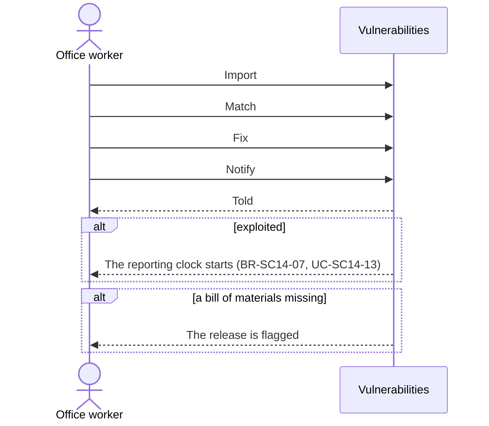

🏠 [Specs](../../../../README.md) › 🏷️ [Sectors](../../../README.md) › 💻 [SC14 IT and software](../../README.md) ›
📝 [Use cases](../README.md) › 📝 [Use cases: FL-SC14-05 Security and data compliance](README.md) ›
📝 UC-SC14-12 Keep the software bill of materials and handle vulnerabilities

# 📝 UC-SC14-12 Keep the software bill of materials and handle vulnerabilities

**Status:** ✅ specified

## Summary

An office worker imports each release's bill of materials, matches vulnerabilities, fixes and notifies; exploited ones
start the reporting clock.

## Personas

- [U16 Office worker](../../../../01-users/personas/u16-office-worker.md)

## Goal

Vulnerabilities found and handled.

## Trigger

A release or an advisory.

## Frequency

Daily.

## Preconditions

- The SC14 sector pack is installed for the company,
  [UC-F14-02](../../../../02-functional/f14-plugin-store/use-cases/01-find-and-install/uc-f14-02-install-a-plugin-or-sector-pack.md),
  and its users have their roles,
  [UC-F1-06](../../../../02-functional/f01-administration/use-cases/04-edit-a-role/uc-f01-06-edit-a-role-and-its-record-rules.md).

## Postconditions

- **Success:** fixes are released and customers told.
- **Failed:** the reporting clock starts.

## Main flow

1. The bill of materials is imported on
   [S-SC14-12 Vulnerabilities](../../screens/05-security-and-data-compliance/s-sc14-12-vulnerabilities.md)
   ([BR-SC14-08](../../business-rules/br-sc14-08-components-listed-in-the-bill-of-materials.md)).
2. Vulnerabilities are matched.
3. A fix is released.
4. Affected customers are told.

## Alternative flows

- 2a. A supplier advisory: it is matched the same way.

## Error flows

- 2e. Exploited: the reporting clock starts,
  [BR-SC14-07](../../business-rules/br-sc14-07-vulnerabilities-reported-in-time.md),
  [UC-SC14-13](uc-sc14-13-report-security-incidents.md).
- 1e. A bill of materials missing: the release is flagged.
- Any step: a call to a service or an outside system fails: it is retried first
  ([BR-F3-32](../../../../02-functional/f03-assistant/business-rules/br-f03-32-retry-before-an-error.md)), then the
  error message pattern ([D122](../../../../06-decisions/ux/d122-error-message-standard.md)) says what failed; what was
  typed is kept.

## Business rules

- [BR-SC14-08 Components listed in the bill of materials](../../business-rules/br-sc14-08-components-listed-in-the-bill-of-materials.md)
- [BR-SC14-07 Vulnerabilities reported in time](../../business-rules/br-sc14-07-vulnerabilities-reported-in-time.md)

## Entities

- [E-SC14-11 Component](../../data/e-sc14-11-component.md)

## Permissions

The office worker roles; the record rules of their role and site apply,
[UC-F1-06](../../../../02-functional/f01-administration/use-cases/04-edit-a-role/uc-f01-06-edit-a-role-and-its-record-rules.md).

## Notifications

None beyond the in-app updates of the records concerned.

## Audit events

Every creation, change and state change of component records, with who, when and the values before and after (T3).

## AI involvement

The AI assistant answers questions on the component records of this use case, with links, and prepares them as drafts
the user confirms. It works within the user's rights,
[BR-F3-34](../../../../02-functional/f03-assistant/business-rules/br-f03-34-every-capability-is-reachable-from-the-assistant.md),
and never deletes or does anything irreversible without the user's confirmation,
[BR-F3-07](../../../../02-functional/f03-assistant/business-rules/br-f03-07-no-deletes-no-irreversible-acts.md).

## API, MCP and A2A exposure

Through the API and webhooks (T5) and the MCP and A2A gateway (T6), with the caller's rights,
[BR-F3-34](../../../../02-functional/f03-assistant/business-rules/br-f03-34-every-capability-is-reachable-from-the-assistant.md),
reading, creating and changing the records of this use case; nothing irreversible without a person's confirmation.

## Screens

- [S-SC14-12 Vulnerabilities](../../screens/05-security-and-data-compliance/s-sc14-12-vulnerabilities.md)

## Flowchart

See [FL-SC14-05 Security and data compliance](../../flows/fl-sc14-05-security-and-data-compliance.md#flowchart).

## Sequence diagram

## Acceptance criteria

1. **Given** the example software company's release 4.2 with library L 1.9 **when** a CVE is published **then** 4.2 and
   its customers are listed.
2. **Given** library L 1.9 exploited **when** it is matched **then** the reporting clock starts,
   [BR-SC14-07](../../business-rules/br-sc14-07-vulnerabilities-reported-in-time.md),
   [UC-SC14-13](uc-sc14-13-report-security-incidents.md).

## Non-functional notes

[D408](../../../../06-decisions/technical/d408-performance-and-profiles.md)'s targets
([performance](../../../../05-non-functional/performance.md)): 95 % of screens within 1 second; lists paged on the
server, the first page within 1 second; reports within 5 seconds or in the background. WCAG 2.2 AA and RGAA
([D46](../../../../06-decisions/ux/d46-accessibility-standard.md)).

## Regulatory references

Legal values from the France country pack:
[CR-FR-168 Cyber Resilience Act reporting](../../../../10-country-packs/france/digital/cr-fr-168-cyber-resilience-reporting.md).

## Related use cases

- [UC-SC14-13 Report security incidents](uc-sc14-13-report-security-incidents.md)

## Open questions

None.

---

⬅️ [UC-SC14-11 Sign data processing agreements](uc-sc14-11-sign-data-processing-agreements.md) · ⬆️ [Up](README.md) ·
➡️ [UC-SC14-13 Report security incidents](uc-sc14-13-report-security-incidents.md)
