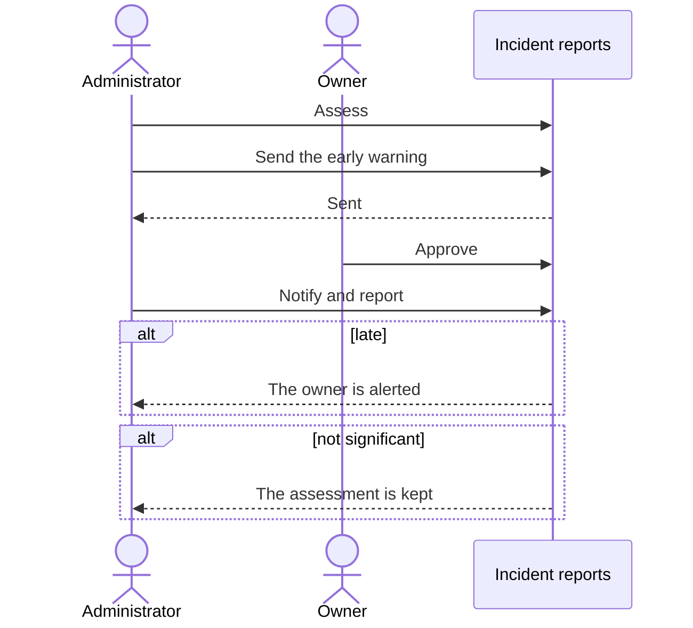

🏠 [Specs](../../../../README.md) › 🏷️ [Sectors](../../../README.md) › 💻 [SC14 IT and software](../../README.md) ›
📝 [Use cases](../README.md) › 📝 [Use cases: FL-SC14-05 Security and data compliance](README.md) ›
📝 UC-SC14-13 Report security incidents

# 📝 UC-SC14-13 Report security incidents

**Status:** ✅ specified

## Summary

The administrator assesses an incident or exploited vulnerability, sends the early warning, notifies and reports; the
owner approves.

## Personas

- [U07 Administrator](../../../../01-users/personas/u07-administrator.md)
- [U13 Owner](../../../../01-users/personas/u13-owner.md)

## Goal

Reports within each stage's time.

## Trigger

Awareness of an incident.

## Frequency

Rare.

## Preconditions

- The SC14 sector pack is installed for the company,
  [UC-F14-02](../../../../02-functional/f14-plugin-store/use-cases/01-find-and-install/uc-f14-02-install-a-plugin-or-sector-pack.md),
  and its users have their roles,
  [UC-F1-06](../../../../02-functional/f01-administration/use-cases/04-edit-a-role/uc-f01-06-edit-a-role-and-its-record-rules.md).

## Postconditions

- **Success:** every stage is sent in time.
- **Failed:** lateness escalates.

## Main flow

1. The administrator assesses on
   [S-SC14-13 Incident reports](../../screens/05-security-and-data-compliance/s-sc14-13-incident-reports.md).
2. The early warning goes out ([BR-SC14-07](../../business-rules/br-sc14-07-vulnerabilities-reported-in-time.md)).
3. The owner approves the notification.
4. Notification and final report follow.

## Alternative flows

- 2a. Several authorities: each gets its report
  ([BR-SC14-09](../../business-rules/br-sc14-09-incidents-notified-by-stage.md)).

## Error flows

- 2e. Late: the owner is alerted.
- 1e. Not significant: the assessment is kept.
- Any step: a call to a service or an outside system fails: it is retried first
  ([BR-F3-32](../../../../02-functional/f03-assistant/business-rules/br-f03-32-retry-before-an-error.md)), then the
  error message pattern ([D122](../../../../06-decisions/ux/d122-error-message-standard.md)) says what failed; what was
  typed is kept.

## Business rules

- [BR-SC14-07 Vulnerabilities reported in time](../../business-rules/br-sc14-07-vulnerabilities-reported-in-time.md)
- [BR-SC14-09 Incidents notified by stage](../../business-rules/br-sc14-09-incidents-notified-by-stage.md)

## Entities

- [E-SC14-12 Security report](../../data/e-sc14-12-security-report.md)

## Permissions

The administrator and owner roles; the record rules of their role and site apply,
[UC-F1-06](../../../../02-functional/f01-administration/use-cases/04-edit-a-role/uc-f01-06-edit-a-role-and-its-record-rules.md).

## Notifications

None beyond the in-app updates of the records concerned.

## Audit events

Every creation, change and state change of security report records, with who, when and the values before and after (T3).

## AI involvement

The AI assistant answers questions on the security report records of this use case, with links, and prepares them as
drafts the user confirms. It works within the user's rights,
[BR-F3-34](../../../../02-functional/f03-assistant/business-rules/br-f03-34-every-capability-is-reachable-from-the-assistant.md),
and never deletes or does anything irreversible without the user's confirmation,
[BR-F3-07](../../../../02-functional/f03-assistant/business-rules/br-f03-07-no-deletes-no-irreversible-acts.md).

## API, MCP and A2A exposure

Through the API and webhooks (T5) and the MCP and A2A gateway (T6), with the caller's rights,
[BR-F3-34](../../../../02-functional/f03-assistant/business-rules/br-f03-34-every-capability-is-reachable-from-the-assistant.md),
reading, creating and changing the records of this use case; nothing irreversible without a person's confirmation.

## Screens

- [S-SC14-13 Incident reports](../../screens/05-security-and-data-compliance/s-sc14-13-incident-reports.md)

## Flowchart

See [FL-SC14-05 Security and data compliance](../../flows/fl-sc14-05-security-and-data-compliance.md#flowchart).

## Sequence diagram

## Acceptance criteria

1. **Given** the example software company's exploited vulnerability known at 3 December 09:00 **when** the early warning
   is sent on 4 December at 08:00 **then** it is within the first stage's time.
2. **Given** aware at 3 December 09:00 and no early warning by the next morning **when** the time passes **then** the
   owner is alerted.

## Non-functional notes

[D408](../../../../06-decisions/technical/d408-performance-and-profiles.md)'s targets
([performance](../../../../05-non-functional/performance.md)): 95 % of screens within 1 second; lists paged on the
server, the first page within 1 second; reports within 5 seconds or in the background. WCAG 2.2 AA and RGAA
([D46](../../../../06-decisions/ux/d46-accessibility-standard.md)).

## Regulatory references

Legal values from the France country pack:
[CR-FR-168 Cyber Resilience Act reporting](../../../../10-country-packs/france/digital/cr-fr-168-cyber-resilience-reporting.md),
[CR-FR-169 NIS2 incident notification](../../../../10-country-packs/france/digital/cr-fr-169-nis2-incident-notification.md).

## Related use cases

- [UC-SC14-12 Keep the software bill of materials and handle vulnerabilities](uc-sc14-12-keep-the-software-bill-of-materials-and-handle-vulnerabilities.md)

## Open questions

None.

---

⬅️ [UC-SC14-12](uc-sc14-12-keep-the-software-bill-of-materials-and-handle-vulnerabilities.md) · ⬆️ [Up](README.md) ·
➡️ [UC-SC14-14 Let customers switch and export their data](uc-sc14-14-let-customers-switch-and-export-their-data.md)
