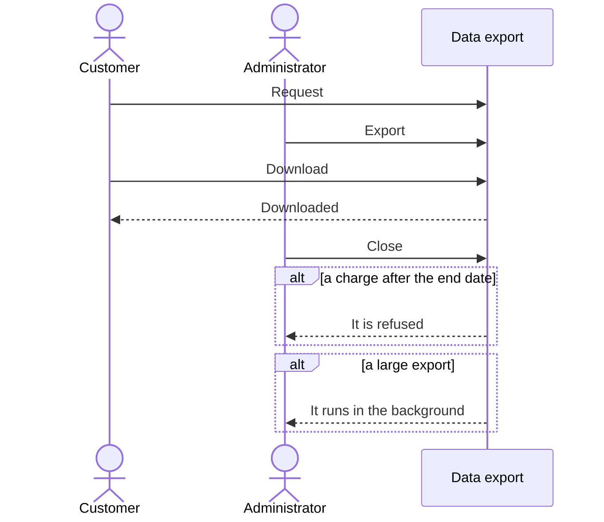

🏠 [Specs](../../../../README.md) › 🏷️ [Sectors](../../../README.md) › 💻 [SC14 IT and software](../../README.md) ›
📝 [Use cases](../README.md) › 📝 [Use cases: FL-SC14-05 Security and data compliance](README.md) ›
📝 UC-SC14-14 Let customers switch and export their data

# 📝 UC-SC14-14 Let customers switch and export their data

**Status:** ✅ specified

## Summary

A customer requests an export; it is produced in a common format; the account is closed without switching charges after
the legal date.

## Personas

- [U09 Customer](../../../../01-users/personas/u09-customer.md)
- [U07 Administrator](../../../../01-users/personas/u07-administrator.md)

## Goal

Customers leave without obstacle.

## Trigger

A request.

## Frequency

Rare.

## Preconditions

- The SC14 sector pack is installed for the company,
  [UC-F14-02](../../../../02-functional/f14-plugin-store/use-cases/01-find-and-install/uc-f14-02-install-a-plugin-or-sector-pack.md),
  and its users have their roles,
  [UC-F1-06](../../../../02-functional/f01-administration/use-cases/04-edit-a-role/uc-f01-06-edit-a-role-and-its-record-rules.md).

## Postconditions

- **Success:** the export is delivered and the account closed.
- **Failed:** charges are refused.

## Main flow

1. The customer requests on
   [S-SC14-14 Data export](../../screens/05-security-and-data-compliance/s-sc14-14-data-export.md).
2. The export is produced in JSON ([BR-SC14-10](../../business-rules/br-sc14-10-export-and-switch-without-obstacle.md)).
3. The customer downloads.
4. The account is closed.

## Alternative flows

- 2a. A partial export: only the chosen scope.

## Error flows

- 4e. A charge after the end date: it is refused.
- 2e. A large export: it runs in the background.
- Any step: a call to a service or an outside system fails: it is retried first
  ([BR-F3-32](../../../../02-functional/f03-assistant/business-rules/br-f03-32-retry-before-an-error.md)), then the
  error message pattern ([D122](../../../../06-decisions/ux/d122-error-message-standard.md)) says what failed; what was
  typed is kept.

## Business rules

- [BR-SC14-10 Export and switch without obstacle](../../business-rules/br-sc14-10-export-and-switch-without-obstacle.md)

## Entities

- [E-SC14-13 Data export](../../data/e-sc14-13-data-export.md)

## Permissions

The customer and administrator roles; the record rules of their role and site apply,
[UC-F1-06](../../../../02-functional/f01-administration/use-cases/04-edit-a-role/uc-f01-06-edit-a-role-and-its-record-rules.md).

## Notifications

None beyond the in-app updates of the records concerned.

## Audit events

Every creation, change and state change of data export records, with who, when and the values before and after (T3).

## AI involvement

The AI assistant answers questions on the data export records of this use case, with links, and prepares them as drafts
the user confirms. It works within the user's rights,
[BR-F3-34](../../../../02-functional/f03-assistant/business-rules/br-f03-34-every-capability-is-reachable-from-the-assistant.md),
and never deletes or does anything irreversible without the user's confirmation,
[BR-F3-07](../../../../02-functional/f03-assistant/business-rules/br-f03-07-no-deletes-no-irreversible-acts.md).

## API, MCP and A2A exposure

Through the API and webhooks (T5) and the MCP and A2A gateway (T6), with the caller's rights,
[BR-F3-34](../../../../02-functional/f03-assistant/business-rules/br-f03-34-every-capability-is-reachable-from-the-assistant.md),
reading, creating and changing the records of this use case; nothing irreversible without a person's confirmation.

## Screens

- [S-SC14-14 Data export](../../screens/05-security-and-data-compliance/s-sc14-14-data-export.md)

## Flowchart

See [FL-SC14-05 Security and data compliance](../../flows/fl-sc14-05-security-and-data-compliance.md#flowchart).

## Sequence diagram

## Acceptance criteria

1. **Given** the example software company's Acme asking for all its data **when** the export runs **then** a JSON file
   is available.
2. **Given** a switching fee after the legal date **when** it is billed **then** it is refused.

## Non-functional notes

[D408](../../../../06-decisions/technical/d408-performance-and-profiles.md)'s targets
([performance](../../../../05-non-functional/performance.md)): 95 % of screens within 1 second; lists paged on the
server, the first page within 1 second; reports within 5 seconds or in the background. WCAG 2.2 AA and RGAA
([D46](../../../../06-decisions/ux/d46-accessibility-standard.md)).

## Regulatory references

Legal values from the France country pack:
[CR-FR-170 Switching between cloud services (Data Act)](../../../../10-country-packs/france/digital/cr-fr-170-data-act-switching.md).

## Related use cases

- [UC-SC14-17 Give customers their portal](../06-portal-and-metrics/uc-sc14-17-give-customers-their-portal.md)

## Open questions

None.

---

⬅️ [UC-SC14-13 Report security incidents](uc-sc14-13-report-security-incidents.md) · ⬆️ [Up](README.md) ·
➡️ [UC-SC14-15](../01-subscriptions-and-billing/uc-sc14-15-bill-digital-services-across-the-eu.md)
