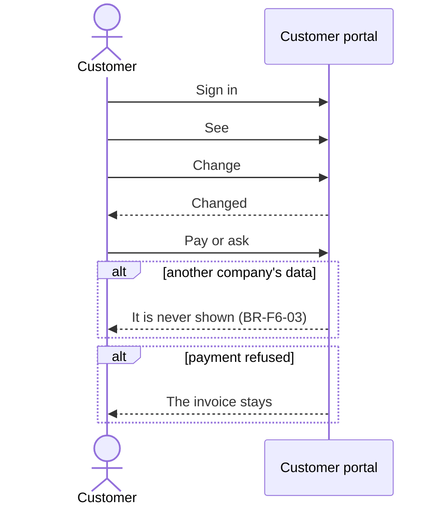

🏠 [Specs](../../../../README.md) › 🏷️ [Sectors](../../../README.md) › 💻 [SC14 IT and software](../../README.md) ›
📝 [Use cases](../README.md) › 📝 [Use cases: FL-SC14-06 Portal and metrics](README.md) ›
📝 UC-SC14-17 Give customers their portal

# 📝 UC-SC14-17 Give customers their portal

**Status:** ✅ specified

## Summary

Customers sign in to see and change subscriptions, invoices, usage, tickets and exports.

## Personas

- [U09 Customer](../../../../01-users/personas/u09-customer.md)

## Goal

Customers serve themselves.

## Trigger

A customer signs in.

## Frequency

Daily.

## Preconditions

- The SC14 sector pack is installed for the company,
  [UC-F14-02](../../../../02-functional/f14-plugin-store/use-cases/01-find-and-install/uc-f14-02-install-a-plugin-or-sector-pack.md),
  and its users have their roles,
  [UC-F1-06](../../../../02-functional/f01-administration/use-cases/04-edit-a-role/uc-f01-06-edit-a-role-and-its-record-rules.md).

## Postconditions

- **Success:** the customer sees their own and acts.
- **Failed:** nothing of others shows.

## Main flow

1. The customer signs in on
   [S-SC14-17 Customer portal](../../screens/06-portal-and-metrics/s-sc14-17-customer-portal.md),
   [UC-F6-11](../../../../02-functional/f06-customers-and-sales/use-cases/02-quote-to-order/uc-f06-11-use-the-customer-portal.md).
2. Subscriptions, invoices and usage show.
3. The customer changes seats.
4. The customer pays or opens a ticket.

## Alternative flows

- 1a. Admin and user roles: users see less than admins.

## Error flows

- 2e. Another company's data: it is never shown,
  [BR-F6-03](../../../../02-functional/f06-customers-and-sales/business-rules/br-f06-03-portal-shows-only-the-customer-s-own.md).
- 4e. Payment refused: the invoice stays.
- Any step: a call to a service or an outside system fails: it is retried first
  ([BR-F3-32](../../../../02-functional/f03-assistant/business-rules/br-f03-32-retry-before-an-error.md)), then the
  error message pattern ([D122](../../../../06-decisions/ux/d122-error-message-standard.md)) says what failed; what was
  typed is kept.

## Business rules

- [BR-SC14-10 Export and switch without obstacle](../../business-rules/br-sc14-10-export-and-switch-without-obstacle.md)
- [BR-F6-03 The portal shows only the customer's own](../../../../02-functional/f06-customers-and-sales/business-rules/br-f06-03-portal-shows-only-the-customer-s-own.md)

## Entities

- [E-SC14-01 Software subscription](../../data/e-sc14-01-software-subscription.md)
- [E-SC14-02 Customer usage record](../../data/e-sc14-02-customer-usage-record.md)

## Permissions

The customer roles; the record rules of their role and site apply,
[UC-F1-06](../../../../02-functional/f01-administration/use-cases/04-edit-a-role/uc-f01-06-edit-a-role-and-its-record-rules.md).

## Notifications

None beyond the in-app updates of the records concerned.

## Audit events

Every creation, change and state change of subscription, usage record records, with who, when and the values before and
after (T3).

## AI involvement

The AI assistant answers questions on the subscription, usage record records of this use case, with links, and prepares
them as drafts the user confirms. It works within the user's rights,
[BR-F3-34](../../../../02-functional/f03-assistant/business-rules/br-f03-34-every-capability-is-reachable-from-the-assistant.md),
and never deletes or does anything irreversible without the user's confirmation,
[BR-F3-07](../../../../02-functional/f03-assistant/business-rules/br-f03-07-no-deletes-no-irreversible-acts.md).

## API, MCP and A2A exposure

Through the API and webhooks (T5) and the MCP and A2A gateway (T6), with the caller's rights,
[BR-F3-34](../../../../02-functional/f03-assistant/business-rules/br-f03-34-every-capability-is-reachable-from-the-assistant.md),
reading, creating and changing the records of this use case; nothing irreversible without a person's confirmation.

## Screens

- [S-SC14-17 Customer portal](../../screens/06-portal-and-metrics/s-sc14-17-customer-portal.md)

## Flowchart

See [FL-SC14-06 Portal and metrics](../../flows/fl-sc14-06-portal-and-metrics.md#flowchart).

## Sequence diagram

## Acceptance criteria

1. **Given** the example software company's Acme admin **when** he adds 5 seats **then** the subscription shows 30 seats
   prorated.
2. **Given** Acme's admin **when** he opens Beta's invoice **then** it is never shown,
   [BR-F6-03](../../../../02-functional/f06-customers-and-sales/business-rules/br-f06-03-portal-shows-only-the-customer-s-own.md).

## Non-functional notes

[D408](../../../../06-decisions/technical/d408-performance-and-profiles.md)'s targets
([performance](../../../../05-non-functional/performance.md)): 95 % of screens within 1 second; lists paged on the
server, the first page within 1 second; reports within 5 seconds or in the background. WCAG 2.2 AA and RGAA
([D46](../../../../06-decisions/ux/d46-accessibility-standard.md)).

## Regulatory references

None specific to this use case; the sector's legal rules are listed in [SC14 regulatory](../../regulatory.md).

## Related use cases

- [UC-SC14-01 Sell subscriptions with plans and seats](../01-subscriptions-and-billing/uc-sc14-01-sell-subscriptions-with-plans-and-seats.md)

## Open questions

None.

---

⬅️ [UC-SC14-16](../01-subscriptions-and-billing/uc-sc14-16-handle-failed-payments-and-dunning.md) · ⬆️ [Up](README.md) ·
➡️ [UC-SC14-18 Follow SaaS metrics](uc-sc14-18-follow-saas-metrics.md)
