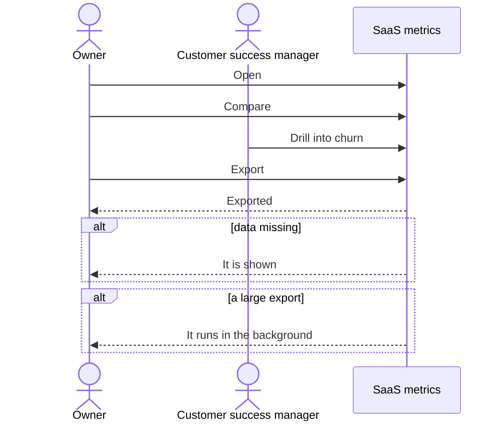

🏠 [Specs](../../../../README.md) › 🏷️ [Sectors](../../../README.md) › 💻 [SC14 IT and software](../../README.md) ›
📝 [Use cases](../README.md) › 📝 [Use cases: FL-SC14-06 Portal and metrics](README.md) ›
📝 UC-SC14-18 Follow SaaS metrics

# 📝 UC-SC14-18 Follow SaaS metrics

**Status:** ✅ specified

## Summary

The owner and the customer success manager follow recurring revenue, churn and net retention, compare and export.

## Personas

- [U13 Owner](../../../../01-users/personas/u13-owner.md)
- [U41 Customer success manager](../../../../01-users/personas/u41-customer-success-manager.md)

## Goal

Know the business's health.

## Trigger

Monthly review.

## Frequency

Monthly.

## Preconditions

- The SC14 sector pack is installed for the company,
  [UC-F14-02](../../../../02-functional/f14-plugin-store/use-cases/01-find-and-install/uc-f14-02-install-a-plugin-or-sector-pack.md),
  and its users have their roles,
  [UC-F1-06](../../../../02-functional/f01-administration/use-cases/04-edit-a-role/uc-f01-06-edit-a-role-and-its-record-rules.md).

## Postconditions

- **Success:** metrics are read and exported.
- **Failed:** missing data is shown.

## Main flow

1. The owner opens [S-SC14-18 SaaS metrics](../../screens/06-portal-and-metrics/s-sc14-18-saas-metrics.md).
2. Months and cohorts are compared.
3. The manager reads churn reasons.
4. The export is made.

## Alternative flows

- 2a. Cohorts: retention by start month.

## Error flows

- 1e. Data missing: it is shown.
- 4e. A large export: it runs in the background.
- Any step: a call to a service or an outside system fails: it is retried first
  ([BR-F3-32](../../../../02-functional/f03-assistant/business-rules/br-f03-32-retry-before-an-error.md)), then the
  error message pattern ([D122](../../../../06-decisions/ux/d122-error-message-standard.md)) says what failed; what was
  typed is kept.

## Business rules

- [BR-SC14-03 Revenue over the service period](../../business-rules/br-sc14-03-revenue-over-the-service-period.md)

## Entities

- [E-SC14-01 Software subscription](../../data/e-sc14-01-software-subscription.md)
- [E-SC14-09 Health score](../../data/e-sc14-09-health-score.md)

## Permissions

The owner and customer success manager roles; the record rules of their role and site apply,
[UC-F1-06](../../../../02-functional/f01-administration/use-cases/04-edit-a-role/uc-f01-06-edit-a-role-and-its-record-rules.md).

## Notifications

None beyond the in-app updates of the records concerned.

## Audit events

Every creation, change and state change of subscription, health score records, with who, when and the values before and
after (T3).

## AI involvement

The AI assistant answers questions on the subscription, health score records of this use case, with links, and prepares
them as drafts the user confirms. It works within the user's rights,
[BR-F3-34](../../../../02-functional/f03-assistant/business-rules/br-f03-34-every-capability-is-reachable-from-the-assistant.md),
and never deletes or does anything irreversible without the user's confirmation,
[BR-F3-07](../../../../02-functional/f03-assistant/business-rules/br-f03-07-no-deletes-no-irreversible-acts.md).

## API, MCP and A2A exposure

Through the API and webhooks (T5) and the MCP and A2A gateway (T6), with the caller's rights,
[BR-F3-34](../../../../02-functional/f03-assistant/business-rules/br-f03-34-every-capability-is-reachable-from-the-assistant.md),
reading, creating and changing the records of this use case; nothing irreversible without a person's confirmation.

## Screens

- [S-SC14-18 SaaS metrics](../../screens/06-portal-and-metrics/s-sc14-18-saas-metrics.md)

## Flowchart

See [FL-SC14-06 Portal and metrics](../../flows/fl-sc14-06-portal-and-metrics.md#flowchart).

## Sequence diagram

## Acceptance criteria

1. **Given** the example software company's 100,000 EUR of monthly recurring revenue **when** November is read **then**
   annual recurring revenue shows 1.2 million EUR.
2. **Given** a month without usage import **when** the metrics open **then** it is shown.

## Non-functional notes

[D408](../../../../06-decisions/technical/d408-performance-and-profiles.md)'s targets
([performance](../../../../05-non-functional/performance.md)): 95 % of screens within 1 second; lists paged on the
server, the first page within 1 second; reports within 5 seconds or in the background. WCAG 2.2 AA and RGAA
([D46](../../../../06-decisions/ux/d46-accessibility-standard.md)).

## Regulatory references

None specific to this use case; the sector's legal rules are listed in [SC14 regulatory](../../regulatory.md).

## Related use cases

- [UC-SC14-03 Recognise subscription revenue](../01-subscriptions-and-billing/uc-sc14-03-recognise-subscription-revenue.md)

## Open questions

None.

---

⬅️ [UC-SC14-17 Give customers their portal](uc-sc14-17-give-customers-their-portal.md) · ⬆️ [Up](README.md) ·
➡️ [UC-SC14-19 Manage partners and resellers](../02-licences-and-renewals/uc-sc14-19-manage-partners-and-resellers.md)
