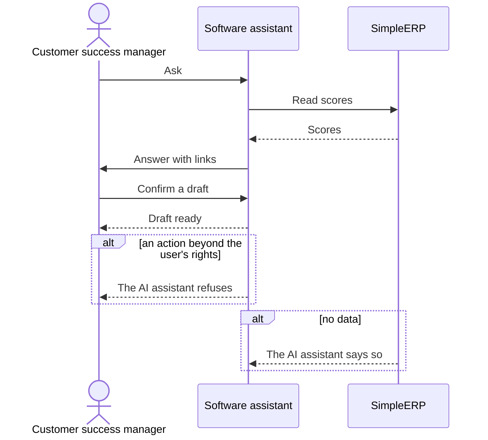

🏠 [Specs](../../../../README.md) › 🏷️ [Sectors](../../../README.md) › 💻 [SC14 IT and software](../../README.md) ›
📝 [Use cases](../README.md) › 📝 [Use cases: FL-SC14-06 Portal and metrics](README.md) ›
📝 UC-SC14-20 Ask the AI assistant

# 📝 UC-SC14-20 Ask the AI assistant

**Status:** ✅ specified

## Summary

The customer success manager or an office worker asks the AI assistant about accounts at risk, a customer's usage or
features awaited, within their role's rights.

## Personas

- [U41 Customer success manager](../../../../01-users/personas/u41-customer-success-manager.md)
- [U16 Office worker](../../../../01-users/personas/u16-office-worker.md)

## Goal

Answers without hunting.

## Trigger

A question.

## Frequency

Daily.

## Preconditions

- The SC14 sector pack is installed for the company,
  [UC-F14-02](../../../../02-functional/f14-plugin-store/use-cases/01-find-and-install/uc-f14-02-install-a-plugin-or-sector-pack.md),
  and its users have their roles,
  [UC-F1-06](../../../../02-functional/f01-administration/use-cases/04-edit-a-role/uc-f01-06-edit-a-role-and-its-record-rules.md).

## Postconditions

- **Success:** the answer cites the records, or the draft is confirmed.
- **Failed:** the AI assistant says it cannot answer or act, and why.

## Main flow

1. The manager asks on
   [S-SC14-20 Software assistant](../../screens/06-portal-and-metrics/s-sc14-20-software-assistant.md): "Which accounts
   are at risk?".
2. The AI assistant reads within the user's rights.
3. The AI assistant lists them.
4. The manager asks for a renewal email; the AI assistant drafts it,
   [UC-F3-04](../../../../02-functional/f03-assistant/use-cases/04-summarise-or-draft/uc-f03-04-summarise-and-draft.md).

## Alternative flows

- 1a. An office worker asks which features customers wait for: the AI assistant lists them.

## Error flows

- 4e. An action beyond the user's rights: the AI assistant refuses.
- 2e. No data: the AI assistant says so.
- Any step: a call to a service or an outside system fails: it is retried first
  ([BR-F3-32](../../../../02-functional/f03-assistant/business-rules/br-f03-32-retry-before-an-error.md)), then the
  error message pattern ([D122](../../../../06-decisions/ux/d122-error-message-standard.md)) says what failed; what was
  typed is kept.

## Business rules

- [BR-SC14-01 Software follows the country pack](../../business-rules/br-sc14-01-software-follows-the-country-pack.md)
- [BR-F3-34 All capabilities via the AI assistant](../../../../02-functional/f03-assistant/business-rules/br-f03-34-every-capability-is-reachable-from-the-assistant.md)
- [BR-F3-07 No deletes, no irreversible acts](../../../../02-functional/f03-assistant/business-rules/br-f03-07-no-deletes-no-irreversible-acts.md)

## Entities

- [E-SC14-09 Health score](../../data/e-sc14-09-health-score.md)
- [E-SC14-16 Tracked feature](../../data/e-sc14-16-tracked-feature.md)

## Permissions

The customer success manager and office worker roles; the record rules of their role and site apply,
[UC-F1-06](../../../../02-functional/f01-administration/use-cases/04-edit-a-role/uc-f01-06-edit-a-role-and-its-record-rules.md).

## Notifications

None beyond the in-app updates of the records concerned.

## Audit events

Every creation, change and state change of health score, tracked feature records, with who, when and the values before
and after (T3).

## AI involvement

The AI assistant answers questions on the health score, tracked feature records of this use case, with links, and
prepares them as drafts the user confirms. It works within the user's rights,
[BR-F3-34](../../../../02-functional/f03-assistant/business-rules/br-f03-34-every-capability-is-reachable-from-the-assistant.md),
and never deletes or does anything irreversible without the user's confirmation,
[BR-F3-07](../../../../02-functional/f03-assistant/business-rules/br-f03-07-no-deletes-no-irreversible-acts.md).

## API, MCP and A2A exposure

Through the API and webhooks (T5) and the MCP and A2A gateway (T6), with the caller's rights,
[BR-F3-34](../../../../02-functional/f03-assistant/business-rules/br-f03-34-every-capability-is-reachable-from-the-assistant.md),
reading, creating and changing the records of this use case; nothing irreversible without a person's confirmation.

## Screens

- [S-SC14-20 Software assistant](../../screens/06-portal-and-metrics/s-sc14-20-software-assistant.md)

## Flowchart

See [FL-SC14-06 Portal and metrics](../../flows/fl-sc14-06-portal-and-metrics.md#flowchart).

## Sequence diagram

## Acceptance criteria

1. **Given** the example software company's Acme at 62 **when** the manager asks **then** Acme is listed at risk.
2. **Given** an office worker asking to give a credit **when** he asks **then** the AI assistant refuses.

## Non-functional notes

[D408](../../../../06-decisions/technical/d408-performance-and-profiles.md)'s targets
([performance](../../../../05-non-functional/performance.md)): 95 % of screens within 1 second; lists paged on the
server, the first page within 1 second; reports within 5 seconds or in the background. WCAG 2.2 AA and RGAA
([D46](../../../../06-decisions/ux/d46-accessibility-standard.md)).

## Regulatory references

None specific to this use case; the sector's legal rules are listed in [SC14 regulatory](../../regulatory.md).

## Related use cases

- [UC-SC14-09 Follow customer health and churn risk](../02-licences-and-renewals/uc-sc14-09-follow-customer-health-and-churn-risk.md)

## Open questions

None.

---

⬅️ [UC-SC14-19 Manage partners and resellers](../02-licences-and-renewals/uc-sc14-19-manage-partners-and-resellers.md) ·
⬆️ [Up](README.md) ·
➡️ [UC-SC14-21](../04-product-delivery/uc-sc14-21-follow-features-and-products-in-the-development-tool.md)
