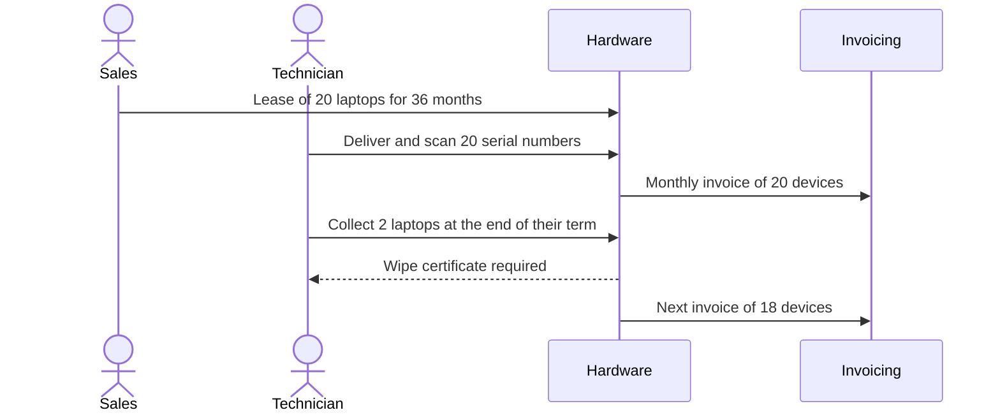

🏠 [Specs](../../../../README.md) › 🏷️ [Sectors](../../../README.md) › 💻 [SC14 IT and software](../../README.md) ›
📝 [Use cases](../README.md) ›
📝 [Use cases: FL-SC14-07 Hardware, licences, research tax credit and sponsorship](README.md) ›
📝 UC-SC14-22 Resell and lease IT hardware

# 📝 UC-SC14-22 Resell and lease IT hardware

**Status:** ✅ specified

## Summary

An IT services company sells laptops, servers and network equipment and also leases them to customers for a monthly fee.
Sales prepares the offer, the technician delivers and installs the devices and scans their serial numbers, the lease is
invoiced every month, and at the end of the lease the devices come back, are checked and wiped, and are leased again,
sold or recycled.

## Personas

- [U03 Sales](../../../../01-users/personas/u03-sales.md)
- [U14 Field worker](../../../../01-users/personas/u14-field-worker.md)

## Goal

Every leased device stays on its customer's list and on the lease invoice until it is back and checked, and every device
that comes back is wiped and sent to its next use.

## Trigger

A customer signs a lease, a device is delivered, a lease ends, or a device is returned.

## Frequency

Dozens of devices a week, a monthly lease invoice for each customer.

## Preconditions

- The devices are items with serial numbers
  ([E-F7-06 Item](../../../../02-functional/f07-purchasing-and-stock/data/e-f07-06-item.md),
  [E-F7-10](../../../../02-functional/f07-purchasing-and-stock/data/e-f07-10-lot-or-serial.md)).
- The customer is a record
  ([E-F6-01](../../../../02-functional/f06-customers-and-sales/data/e-f06-01-customer-record.md)) with a lease contract
  that bills monthly
  ([E-F6-07](../../../../02-functional/f06-customers-and-sales/data/e-f06-07-subscription-contract.md)).
- The eco-contribution of each equipment family is in the settings
  ([E-F7-18](../../../../02-functional/f07-purchasing-and-stock/data/e-f07-18-eco-contribution-scale.md)).

## Postconditions

- **Succeeded:** each device is saved ([E-SC14-17 Leased device](../../data/e-sc14-17-leased-device.md)) with its serial
  number, customer, lease dates, state and wipe certificate, and the lease invoice lists the devices that are still out.
- **Failed:** a device is not marked Returned without its serial scan and its wipe, and the lease invoice keeps billing
  it until then.

## Main flow

1. Sales opens the hardware screen
   ([S-SC14-22](../../screens/07-hardware-licences-and-tax-credits/s-sc14-22-hardware-leasing.md)) and creates a lease
   offer with the devices, the monthly fee and the term.
2. When the customer signs, the devices are reserved from stock.
3. The technician delivers and installs the devices and scans each serial number on the phone, which puts the device on
   lease
   [UC-F6-15](../../../../02-functional/f06-customers-and-sales/use-cases/05-benchmark-additions/uc-f06-15-rent-out-equipment.md).
4. Each month simple-ERP invoices the devices that are Leased
   ([BR-SC14-16](../../business-rules/br-sc14-16-leased-devices-stay-listed-until-returned.md)).
5. At the end of the term the technician collects the devices, scans them and checks their condition.
6. The device is wiped with its certificate and goes back to stock for a new lease, a sale or recycling.

## Alternative flows

- 6a. The customer buys the device at the end of the lease: it becomes Resold at its residual price.
- 5a. A device is lost or stolen: it is marked with its replacement value and billed to the customer.
- 6b. A device cannot be repaired: it goes to recycling and the take-back is recorded.

## Error flows

- 5e. A returned serial number is not on the customer's lease: the return is refused and the list is shown.
- 6e. The wipe has no certificate: the device cannot return to stock.
- 4e. A device with no serial scan at delivery: the lease invoice cannot include it.
- Any step: a service does not answer; the call is retried first
  ([BR-F3-32](../../../../02-functional/f03-assistant/business-rules/br-f03-32-retry-before-an-error.md)), then the
  message follows the error pattern ([D122](../../../../06-decisions/ux/d122-error-message-standard.md)) and what the
  user typed stays on the screen.

## Business rules

- [BR-SC14-16](../../business-rules/br-sc14-16-leased-devices-stay-listed-until-returned.md)
- [BR-SC14-01](../../business-rules/br-sc14-01-software-follows-the-country-pack.md)

## Entities

- [E-SC14-17 Leased device](../../data/e-sc14-17-leased-device.md): created, changed, returned
- [E-F7-10](../../../../02-functional/f07-purchasing-and-stock/data/e-f07-10-lot-or-serial.md): read and changed, the
  serial number of the device
- [E-F6-07](../../../../02-functional/f06-customers-and-sales/data/e-f06-07-subscription-contract.md): read, the lease
  contract billed each month
- [E-F6-05 Invoice](../../../../02-functional/f06-customers-and-sales/data/e-f06-05-invoice.md): created, the monthly
  lease invoice
- [E-F8-41 Lease](../../../../02-functional/f08-accounting/data/e-f08-41-lease.md): read, the lease as an accounting
  lease

## Permissions

Sales creates offers and leases; the technician delivers, collects and wipes; accounting reads the lease invoices.
The technician cannot see the monthly fee.

## Notifications

Sales, in the app: a lease ends in thirty days or a device is late to return. The customer, by email: the devices
collected.

## Audit events

Each device delivered, returned, wiped, sold or recycled, each lease invoice, who and when, with the serial number.

## AI involvement

No AI step of its own. The AI assistant may open the screen and prefill it from the user's words; the user checks and
confirms
[BR-F3-07](../../../../02-functional/f03-assistant/business-rules/br-f03-07-no-deletes-no-irreversible-acts.md).

## API, MCP and A2A exposure

T5 operations of the capability for the personas above: create, read, update and list. The MCP tool of the
capability may read and propose, never confirm alone. No A2A skill.

## Screens

- [S-SC14-22](../../screens/07-hardware-licences-and-tax-credits/s-sc14-22-hardware-leasing.md)

## Flowchart

See
[FL-SC14-07 Hardware, licences, research tax credit and sponsorship](../../flows/fl-sc14-07-hardware-licences-and-tax-credits.md#flowchart).

## Sequence diagram

## Acceptance criteria

1. **Given** a lease of 20 laptops at 35.00 EUR each per month **when** the month's invoice is created **then** it bills
   20 devices for 700.00 EUR.
2. **Given** a leased laptop collected without its wipe **when** the technician marks it Returned **then** the return is
   refused until the wipe certificate is attached.
3. **Given** a serial number that is not on the customer's lease **when** the technician scans it as a return **then**
   the return is refused and the lease list is shown.
4. **Given** a device collected and checked **when** it is Returned **then** the next lease invoice no longer bills it.

## Non-functional notes

The screen answers within 2 seconds for 10,000 records; every change is audited.

## Regulatory references

Electrical and electronic equipment returned at the end of a lease is covered by the producer's take-back
duty, and what cannot be reused goes to a collection scheme, with the eco-contribution shown on the sale. Personal data
left on a returned device must be erased before it is reused. An operating lease and a financial lease are not accounted
for in the same way. The France-pack rule is written later. Related:
[CR-FR-073](../../../../10-country-packs/france/products/cr-fr-073-epr-unique-identifier.md),
[CR-FR-052](../../../../10-country-packs/france/data-protection/cr-fr-052-storage-limitation.md),
[CR-FR-079](../../../../10-country-packs/france/environment/cr-fr-079-waste-register.md),
[CR-FR-015](../../../../10-country-packs/france/invoicing/cr-fr-015-invoice-mandatory-mentions.md).

## Related use cases

- [UC-SC14-23 Resell cloud licences](uc-sc14-23-resell-cloud-licences.md)
- [UC-SC14-06](../03-support-and-services/uc-sc14-06-manage-managed-service-contracts-and-customers-assets.md)
- [UC-SC14-01](../01-subscriptions-and-billing/uc-sc14-01-sell-subscriptions-with-plans-and-seats.md)

## Open questions

None.

---

⬅️ [UC-SC14-21](../04-product-delivery/uc-sc14-21-follow-features-and-products-in-the-development-tool.md) ·
⬆️ [Up](README.md) · ➡️ [UC-SC14-23 Resell cloud licences](uc-sc14-23-resell-cloud-licences.md)
