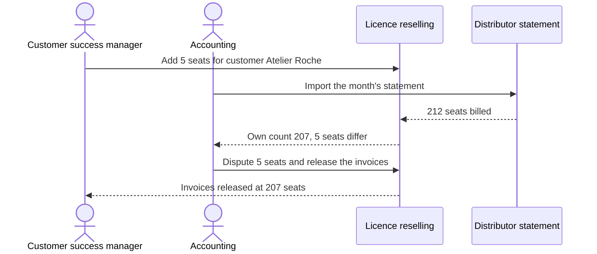

🏠 [Specs](../../../../README.md) › 🏷️ [Sectors](../../../README.md) › 💻 [SC14 IT and software](../../README.md) ›
📝 [Use cases](../README.md) ›
📝 [Use cases: FL-SC14-07 Hardware, licences, research tax credit and sponsorship](README.md) ›
📝 UC-SC14-23 Resell cloud licences

# 📝 UC-SC14-23 Resell cloud licences

**Status:** ✅ specified

## Summary

A reseller sells the cloud and software licences of a distributor to its customers by seat. The customer success manager
orders and changes seats for each customer, the distributor sends a monthly statement of what the reseller must pay, and
accounting invoices each customer for the seats actually in use and checks the statement against its own count.

## Personas

- [U41 Customer success manager](../../../../01-users/personas/u41-customer-success-manager.md)
- [U05 Accounting](../../../../01-users/personas/u05-accounting.md)

## Goal

Every customer is billed for the seats they hold, the reseller pays the distributor for the same seats, and any
difference between the two is explained before the invoices leave.

## Trigger

A customer orders, adds or removes seats, the distributor's monthly statement arrives, or a renewal date approaches.

## Frequency

A handful of changes a week, one reconciliation a month.

## Preconditions

- The distributor and its price list are a supplier
  ([E-F7-01](../../../../02-functional/f07-purchasing-and-stock/data/e-f07-01-supplier-record.md)).
- The customer is a record with a subscription contract
  ([E-F6-01](../../../../02-functional/f06-customers-and-sales/data/e-f06-01-customer-record.md),
  [E-F6-07](../../../../02-functional/f06-customers-and-sales/data/e-f06-07-subscription-contract.md)).
- The margin rule of each product is entered in the settings.

## Postconditions

- **Succeeded:** each customer's licence subscription is saved
  ([E-SC14-18 Licence subscription](../../data/e-sc14-18-licence-subscription.md)) with its seats, price and renewal
  date, and the invoices match the distributor's statement.
- **Failed:** an invoice is not released while its seats differ from the statement without an explanation, and the
  differences are listed.

## Main flow

1. The customer success manager opens the licence reselling screen
   ([S-SC14-23](../../screens/07-hardware-licences-and-tax-credits/s-sc14-23-licence-reselling.md)) and orders seats of
   a product for a customer.
2. SimpleERP creates the subscription with its seats, the customer price and the cost price of the distributor.
3. During the month the manager adds and removes seats and the changes are kept with their date.
4. When the distributor's statement arrives, accounting imports it and SimpleERP compares the seats per customer with
   its own ([BR-SC14-17](../../business-rules/br-sc14-17-seats-billed-match-the-distributors-statement.md)).
5. Differences are explained or corrected, then accounting releases the month's invoices
   ([UC-SC14-02](../01-subscriptions-and-billing/uc-sc14-02-meter-usage-and-bill-it.md)).
6. Before the renewal date the manager is reminded and renews or cancels
   ([UC-SC14-10](../02-licences-and-renewals/uc-sc14-10-run-renewals-and-expansion.md)).

## Alternative flows

- 3a. Seats are removed mid-month: the credit follows the rule of the distributor, which the product carries.
- 4a. The statement bills seats the reseller never ordered: they are disputed with the distributor and left out of the
  customer's invoice.
- 6a. A customer moves to another distributor's product: the subscription is cancelled and a new one is created.

## Error flows

- 4e. The statement cannot be read: the import is refused and the format is shown.
- 5e. An invoice is released while a difference is open: the release is refused.
- 2e. A product has no cost price: the margin cannot be computed and the order is held.
- Any step: a service does not answer; the call is retried first
  ([BR-F3-32](../../../../02-functional/f03-assistant/business-rules/br-f03-32-retry-before-an-error.md)), then the
  message follows the error pattern ([D122](../../../../06-decisions/ux/d122-error-message-standard.md)) and what the
  user typed stays on the screen.

## Business rules

- [BR-SC14-17](../../business-rules/br-sc14-17-seats-billed-match-the-distributors-statement.md)
- [BR-SC14-02](../../business-rules/br-sc14-02-seats-and-usage-billed-from-records.md)

## Entities

- [E-SC14-18 Licence subscription](../../data/e-sc14-18-licence-subscription.md): created, changed, renewed
- [E-F6-07](../../../../02-functional/f06-customers-and-sales/data/e-f06-07-subscription-contract.md): read and changed,
  the customer's recurring contract
- [E-F7-05](../../../../02-functional/f07-purchasing-and-stock/data/e-f07-05-supplier-invoice.md): created, the
  distributor's monthly statement as a supplier invoice
- [E-F6-05 Invoice](../../../../02-functional/f06-customers-and-sales/data/e-f06-05-invoice.md): created, the customer's
  invoice

## Permissions

Customer success manager orders and changes seats; accounting imports the statement and releases invoices.
The manager sees prices and margins, the customer sees only their own seats.

## Notifications

The customer success manager, in the app: a renewal in sixty days or a difference with the statement. Accounting: the
statement is waiting.

## Audit events

Each seat change, each statement imported, each difference and its explanation, each release of invoices, who and when.

## AI involvement

No AI step of its own. The AI assistant may open the screen and prefill it from the user's words; the user checks and
confirms
[BR-F3-07](../../../../02-functional/f03-assistant/business-rules/br-f03-07-no-deletes-no-irreversible-acts.md).

## API, MCP and A2A exposure

T5 operations of the capability for the personas above: create, read, update and list. The MCP tool of the
capability may read and propose, never confirm alone. No A2A skill.

## Screens

- [S-SC14-23](../../screens/07-hardware-licences-and-tax-credits/s-sc14-23-licence-reselling.md)

## Flowchart

See
[FL-SC14-07 Hardware, licences, research tax credit and sponsorship](../../flows/fl-sc14-07-hardware-licences-and-tax-credits.md#flowchart).

## Sequence diagram

## Acceptance criteria

1. **Given** a customer with 40 seats at 12.00 EUR a seat and the statement showing 40 seats **when** accounting
   compares them **then** no difference is shown and the invoice of 480.00 EUR can be released.
2. **Given** a statement showing 45 seats for a customer who holds 40 **when** accounting opens the comparison **then**
   5 seats are listed as a difference and the invoice is held.
3. **Given** a difference that is explained as a seat added late in the month **when** accounting records the
   explanation **then** the invoice can be released with the date of the change.
4. **Given** a product with no cost price **when** the manager orders seats **then** the order is held until the cost
   price is entered.

## Non-functional notes

The screen answers within 2 seconds for 10,000 records; every change is audited.

## Regulatory references

A reseller of cloud services contracts with the distributor under a reseller agreement that sets prices,
minimum commitments and the way seats are counted and credited, and with its customers under its own terms. Services
sold to businesses in other countries follow the place-of-supply rules of VAT. The France-pack rule is written later.
Related: [CR-FR-100](../../../../10-country-packs/france/tax-and-vat/cr-fr-100-vat-on-services-abroad.md),
[CR-FR-171](../../../../10-country-packs/france/trade/cr-fr-171-supplier-distributor-agreement.md),
[CR-FR-015](../../../../10-country-packs/france/invoicing/cr-fr-015-invoice-mandatory-mentions.md),
[CR-FR-011](../../../../10-country-packs/france/tax-and-vat/cr-fr-011-vat-returns-and-filings.md).

## Related use cases

- [UC-SC14-22 Resell and lease IT hardware](uc-sc14-22-resell-and-lease-it-hardware.md)
- [UC-SC14-24 Claim research tax credits](uc-sc14-24-claim-research-tax-credits.md)
- [UC-SC14-04](../02-licences-and-renewals/uc-sc14-04-manage-licences-keys-and-renewals.md)
- [UC-SC14-19](../02-licences-and-renewals/uc-sc14-19-manage-partners-and-resellers.md)

## Open questions

None.

---

⬅️ [UC-SC14-22 Resell and lease IT hardware](uc-sc14-22-resell-and-lease-it-hardware.md) · ⬆️ [Up](README.md) ·
➡️ [UC-SC14-24 Claim research tax credits](uc-sc14-24-claim-research-tax-credits.md)
