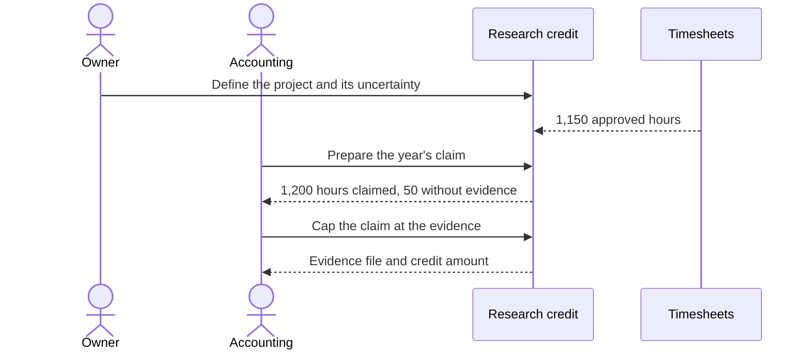

🏠 [Specs](../../../../README.md) › 🏷️ [Sectors](../../../README.md) › 💻 [SC14 IT and software](../../README.md) ›
📝 [Use cases](../README.md) ›
📝 [Use cases: FL-SC14-07 Hardware, licences, research tax credit and sponsorship](README.md) ›
📝 UC-SC14-24 Claim research tax credits

# 📝 UC-SC14-24 Claim research tax credits

**Status:** 🔄 waiting for the owner

## Summary

A software company that does research and development claims the research tax credit (CIR) or the innovation tax credit
(CII), and sometimes the young innovative company status. The owner defines each R&D project and its scientific or
technical uncertainty, the team records its hours on it, and accounting prepares the expenses and the evidence file from
the timesheets.

## Personas

- [U13 Owner](../../../../01-users/personas/u13-owner.md)
- [U05 Accounting](../../../../01-users/personas/u05-accounting.md)

## Goal

Every hour claimed in a tax credit is backed by an approved timesheet line of a qualified person on a defined project,
and the evidence file is ready if the tax office asks for it.

## Trigger

A project starts, hours are recorded, or the year closes and the credit is prepared.

## Frequency

A few projects a year, hours every week, one claim a year.

## Preconditions

- The projects exist with their tasks and the team's timesheets
  ([E-F9-18](../../../../02-functional/f09-hr-and-projects/data/e-f09-18-project-and-task.md),
  [E-F9-17](../../../../02-functional/f09-hr-and-projects/data/e-f09-17-timesheet-line.md)).
- The qualifications of the staff are recorded
  ([E-F9-29 Degree](../../../../02-functional/f09-hr-and-projects/data/e-f09-29-degree.md)).
- The rates and the list of eligible expenses of the country pack are loaded for the year.

## Postconditions

- **Succeeded:** each project is saved ([E-SC14-19 R&D project](../../data/e-sc14-19-r-d-project.md)) with its
  description, its hours by person, its eligible expenses and the evidence file, and the claim is added to the year's
  tax computation.
- **Failed:** hours without timesheet evidence are left out of the claim, and the gaps are listed with the people and
  the weeks.

## Main flow

1. The owner opens the research screen
   ([S-SC14-24](../../screens/07-hardware-licences-and-tax-credits/s-sc14-24-research-tax-credit.md)) and defines a
   project: its aim, the uncertainty it tries to remove, its dates and its team.
2. During the year the team records its hours on the project's tasks and the managers approve them.
3. At year end accounting selects the project and simple-ERP sums the approved hours by person and the staff cost per
   hour.
4. simple-ERP lists the other eligible expenses: depreciation of research equipment, patent costs, approved
   subcontracting.
5. The hours claimed are compared with the timesheets
   ([BR-SC14-18](../../business-rules/br-sc14-18-claimed-hours-have-timesheet-evidence.md)) and the gaps are listed.
6. Accounting exports the evidence file and adds the credit to the year's tax computation
   [UC-F8-24](../../../../02-functional/f08-accounting/use-cases/08-year-end-duties/uc-f08-24-compute-and-pay-corporate-tax-and-local-business-taxes.md).

## Alternative flows

- 3a. A person works on several projects: the hours are split by task and never counted twice.
- 4a. A project is financed by a public grant: the grant is deducted from the eligible expenses.
- 5a. A person has no recorded qualification: the hours are held until the qualification is entered.

## Error flows

- 3e. A week has no approved timesheet: its hours are not counted and the week is listed.
- 5e. The claimed hours exceed the approved hours of a person: the claim is capped at the evidence.
- 2e. A project has no description of its uncertainty: the evidence file cannot be exported.
- Any step: a service does not answer; the call is retried first
  ([BR-F3-32](../../../../02-functional/f03-assistant/business-rules/br-f03-32-retry-before-an-error.md)), then the
  message follows the error pattern ([D122](../../../../06-decisions/ux/d122-error-message-standard.md)) and what the
  user typed stays on the screen.

## Business rules

- [BR-SC14-18](../../business-rules/br-sc14-18-claimed-hours-have-timesheet-evidence.md)
- [BR-SC14-01](../../business-rules/br-sc14-01-software-follows-the-country-pack.md)

## Entities

- [E-SC14-19 R&D project](../../data/e-sc14-19-r-d-project.md): created, changed, claimed
- [E-F9-17](../../../../02-functional/f09-hr-and-projects/data/e-f09-17-timesheet-line.md): read, the approved timesheet
  lines
- [E-F9-18](../../../../02-functional/f09-hr-and-projects/data/e-f09-18-project-and-task.md): read, the project and its
  tasks
- [E-F8-21](../../../../02-functional/f08-accounting/data/e-f08-21-corporate-tax-computation.md): changed, the year's
  tax computation with the credit

## Permissions

Owner defines projects and signs the claim; accounting prepares expenses and the evidence file. Developers
see their own hours and the project's description only.

## Notifications

The owner, in the app: a project has hours without approval before the year's closing. Managers: timesheets waiting for
approval.

## Audit events

Each project defined, each hour counted or left out, each expense added, each evidence export and each claim, who and
when.

## AI involvement

No AI step of its own. The AI assistant may open the screen and prefill it from the user's words; the user checks and
confirms
[BR-F3-07](../../../../02-functional/f03-assistant/business-rules/br-f03-07-no-deletes-no-irreversible-acts.md).

## API, MCP and A2A exposure

T5 operations of the capability for the personas above: create, read, update and list. The MCP tool of the
capability may read and propose, never confirm alone. No A2A skill.

## Screens

- [S-SC14-24](../../screens/07-hardware-licences-and-tax-credits/s-sc14-24-research-tax-credit.md)

## Flowchart

See
[FL-SC14-07 Hardware, licences, research tax credit and sponsorship](../../flows/fl-sc14-07-hardware-licences-and-tax-credits.md#flowchart).

## Sequence diagram

## Acceptance criteria

1. **Given** a project with 1,200 hours claimed by the team and 1,150 approved timesheet hours **when** accounting
   prepares the claim **then** the claim is capped at 1,150 hours and the 50 missing hours are listed.
2. **Given** a developer with 1,150 approved hours at a staff cost of 38.00 EUR an hour **when** the eligible staff cost
   is computed **then** it is 43,700.00 EUR for that person.
3. **Given** a project with no description of its uncertainty **when** accounting exports the evidence file **then** the
   export is refused and the description is asked for.
4. **Given** a project financed by a grant of 10,000.00 EUR **when** the expenses are computed **then** the grant is
   deducted from the eligible expenses.

## Non-functional notes

The screen answers within 2 seconds for 10,000 records; every change is audited.

## Regulatory references

The research tax credit relates to the expenses of research operations that remove a scientific or technical
uncertainty, and the innovation tax credit to the design of new products by small companies. The eligible expenses
include the staff cost of researchers and technicians, the depreciation of research equipment, patent costs and approved
subcontracting, from which grants are deducted. The company must justify the work and the hours if the tax office asks,
and the credit is claimed with the year's tax return. A young innovative company status gives social and tax relief to
small companies with a high share of research expenses. The rates and the lists are data of the France pack, written
later. Related:
[CR-FR-002](../../../../10-country-packs/france/accounting/cr-fr-002-accounting-records-kept-ten-years.md),
[CR-FR-047](../../../../10-country-packs/france/labour/cr-fr-047-hr-records-retention.md),
[CR-FR-203](../../../../10-country-packs/france/digital/cr-fr-203-software-copyright-assignment.md).

- France-pack rule, (Proposed) until its law is read:
  [CR-FR-246 Research and innovation tax credits](../../../../10-country-packs/france/tax-and-vat/cr-fr-246-research-tax-credit.md)

## Related use cases

- [UC-SC14-23 Resell cloud licences](uc-sc14-23-resell-cloud-licences.md)
- [UC-SC14-25 Accept open-source sponsorship](uc-sc14-25-accept-open-source-sponsorship.md)
- [UC-SC14-07](../04-product-delivery/uc-sc14-07-plan-it-projects-in-sprints-with-time.md)
- [UC-SC14-08](../04-product-delivery/uc-sc14-08-publish-release-notes-to-customers.md)

## Open questions

None.

---

⬅️ [UC-SC14-23 Resell cloud licences](uc-sc14-23-resell-cloud-licences.md) · ⬆️ [Up](README.md) ·
➡️ [UC-SC14-25 Accept open-source sponsorship](uc-sc14-25-accept-open-source-sponsorship.md)
