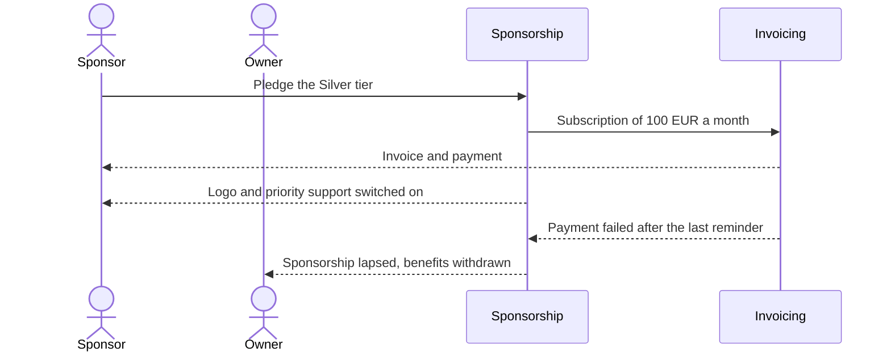

🏠 [Specs](../../../../README.md) › 🏷️ [Sectors](../../../README.md) › 💻 [SC14 IT and software](../../README.md) ›
📝 [Use cases](../README.md) ›
📝 [Use cases: FL-SC14-07 Hardware, licences, research tax credit and sponsorship](README.md) ›
📝 UC-SC14-25 Accept open-source sponsorship

# 📝 UC-SC14-25 Accept open-source sponsorship

**Status:** ✅ specified

## Summary

An open-source project or its company lets companies and individuals sponsor it through tiers, each with its recurring
fee and its benefits such as a logo on the site or priority support. The owner defines the tiers, a sponsor pledges on
the phone or the web, and the fees are invoiced and collected like any other subscription.

## Personas

- [U13 Owner](../../../../01-users/personas/u13-owner.md)
- [U09 Customer](../../../../01-users/personas/u09-customer.md)

## Goal

Every sponsor is invoiced for the tier they pledged on the same calendar as a subscription, their benefits are shown
only while they pay, and the money raised is reported.

## Trigger

A sponsor pledges, a payment is due, a payment fails, or a sponsor changes or stops.

## Frequency

A few pledges a week and a monthly or yearly invoice for each sponsor.

## Preconditions

- The tiers with their price, period and benefits are defined in the settings.
- The sponsor is a customer
  ([E-F6-01](../../../../02-functional/f06-customers-and-sales/data/e-f06-01-customer-record.md)), a company or an
  individual.
- A payment provider is connected
  ([E-F11-06](../../../../02-functional/f11-online-shop/data/e-f11-06-payment-provider.md)).

## Postconditions

- **Succeeded:** each sponsor is saved ([E-SC14-20 Sponsorship](../../data/e-sc14-20-sponsorship.md)) with its tier,
  period, next invoice and benefits, and the invoices and payments follow the subscription calendar.
- **Failed:** a benefit is withdrawn when the sponsorship lapses, and a failed payment follows the dunning steps
  ([BR-SC14-12 Dunning steps](../../business-rules/br-sc14-12-dunning-steps.md)).

## Main flow

1. The owner opens the sponsorship screen
   ([S-SC14-25](../../screens/07-hardware-licences-and-tax-credits/s-sc14-25-sponsorship.md)) and sees the tiers and the
   sponsors.
2. A sponsor chooses a tier on the phone and pays the first fee
   ([UC-F11-06](../../../../02-functional/f11-online-shop/use-cases/02-shop-and-check-out/uc-f11-06-pay-online.md)).
3. simple-ERP creates the sponsorship and the subscription that invoices it each period
   ([BR-SC14-19](../../business-rules/br-sc14-19-sponsor-tiers-are-invoiced-like-subscriptions.md)).
4. The benefits of the tier are switched on: logo in the sponsors' list, a badge, priority support.
5. Each period the invoice is sent and the payment collected, and a failed payment starts the dunning steps.
6. The owner follows the money raised by tier and the sponsors who are about to lapse.

## Alternative flows

- 2a. A company sponsors through an invoice instead of a card: the invoice is paid by transfer and the sponsorship
  starts when it is paid.
- 5a. A sponsor changes tier: the new tier applies at the next period and the difference is not refunded.
- 6a. A sponsor asks to stop: the sponsorship ends at the end of the period paid.

## Error flows

- 2e. The first payment fails: the sponsorship stays Pledged and the sponsor is told.
- 5e. A payment stays unpaid after the last dunning step: the sponsorship lapses and the benefits are withdrawn.
- 1e. A tier has no price: it cannot be offered.
- Any step: a service does not answer; the call is retried first
  ([BR-F3-32](../../../../02-functional/f03-assistant/business-rules/br-f03-32-retry-before-an-error.md)), then the
  message follows the error pattern ([D122](../../../../06-decisions/ux/d122-error-message-standard.md)) and what the
  user typed stays on the screen.

## Business rules

- [BR-SC14-19](../../business-rules/br-sc14-19-sponsor-tiers-are-invoiced-like-subscriptions.md)
- [BR-SC14-12 Dunning steps](../../business-rules/br-sc14-12-dunning-steps.md)

## Entities

- [E-SC14-20 Sponsorship](../../data/e-sc14-20-sponsorship.md): created, changed, ended
- [E-F6-07](../../../../02-functional/f06-customers-and-sales/data/e-f06-07-subscription-contract.md): created, the
  subscription that invoices the tier
- [E-F6-05 Invoice](../../../../02-functional/f06-customers-and-sales/data/e-f06-05-invoice.md): created, each period's
  invoice
- [E-SC14-14 Dunning case](../../data/e-sc14-14-dunning-case.md): read, the dunning case of an unpaid fee

## Permissions

Owner defines tiers and reads the sponsors; accounting follows the invoices; the sponsor manages their own sponsorship.
The public list shows a sponsor's name and logo only with its consent.

## Notifications

The sponsor, by email: the invoice, the payment received, a failed payment and the end of the sponsorship. The owner, in
the app: a new sponsor or a lapsed one.

## Audit events

Each pledge, tier change, invoice, payment and lapse, each benefit switched on or off, who and when.

## AI involvement

No AI step of its own. The AI assistant may open the screen and prefill it from the user's words; the user checks and
confirms
[BR-F3-07](../../../../02-functional/f03-assistant/business-rules/br-f03-07-no-deletes-no-irreversible-acts.md).

## API, MCP and A2A exposure

T5 operations of the capability for the personas above: create, read, update and list. The MCP tool of the
capability may read and propose, never confirm alone. No A2A skill.

## Screens

- [S-SC14-25](../../screens/07-hardware-licences-and-tax-credits/s-sc14-25-sponsorship.md)

## Flowchart

See
[FL-SC14-07 Hardware, licences, research tax credit and sponsorship](../../flows/fl-sc14-07-hardware-licences-and-tax-credits.md#flowchart).

## Sequence diagram

## Acceptance criteria

1. **Given** a tier called Silver at 100.00 EUR a month **when** a sponsor pledges it and pays **then** the sponsorship
   is Active and its subscription invoices 100.00 EUR each month.
2. **Given** a sponsor whose payment stays unpaid after the last dunning step **when** the period ends **then** the
   sponsorship lapses and the logo leaves the sponsors' list.
3. **Given** a sponsor who moves from Silver to Gold **when** they confirm **then** the new tier applies at the next
   period.
4. **Given** a sponsor who has not consented to be listed **when** the sponsors' list is built **then** their name is
   left out.

## Non-functional notes

The screen answers within 2 seconds for 10,000 records; every change is audited.

## Regulatory references

A payment made in return for visibility, such as a logo or a mention, is a service with VAT, not a gift, and
gives no tax receipt. A gift without a counterpart to a qualifying body gives a tax receipt under the rules of gifts.
The sponsor's name and logo are shown only with its consent. The France-pack rule is written later. Related:
[CR-FR-124](../../../../10-country-packs/france/non-profit/cr-fr-124-gift-tax-receipts.md),
[CR-FR-008 VAT rates](../../../../10-country-packs/france/tax-and-vat/cr-fr-008-vat-rates.md),
[CR-FR-063](../../../../10-country-packs/france/consumer/cr-fr-063-electronic-marketing-consent.md),
[CR-FR-018](../../../../10-country-packs/france/invoicing/cr-fr-018-payment-terms-cap.md).

## Related use cases

- [UC-SC14-24 Claim research tax credits](uc-sc14-24-claim-research-tax-credits.md)
- [UC-SC14-16](../01-subscriptions-and-billing/uc-sc14-16-handle-failed-payments-and-dunning.md)
- [UC-SC14-01](../01-subscriptions-and-billing/uc-sc14-01-sell-subscriptions-with-plans-and-seats.md)

## Open questions

None.

---

⬅️ [UC-SC14-24 Claim research tax credits](uc-sc14-24-claim-research-tax-credits.md) · ⬆️ [Up](README.md)
