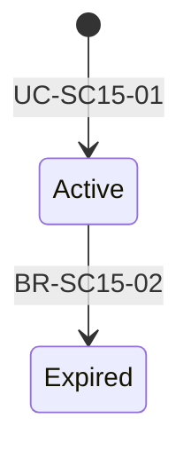

🏠 [Specs](../../../README.md) › 🏷️ [Sectors](../../README.md) › 📦 [SC15 Wholesale and distribution](../README.md) ›
🗃️ [Data](README.md) › 🗃️ E-SC15-01 Price agreement

# 🗃️ E-SC15-01 Price agreement

**Status:** 🔄 waiting for the owner

## Purpose

A customer's agreed prices.

## Fields

| Name | Type | Required | Validation | Default | Example | Personal data | Custom fields |
|---|---|---|---|---|---|---|---|
| customer, products, prices | records | yes | BR-SC15-02 | - | Bistro Group, 120 lines | no | no |
| valid from, to | dates | yes | - | - | 2027 | no | no |

## Relations

(Proposed) As its use cases.

## Lifecycle

## Indexes and search

(Proposed) By number, date, partner.

## Retention

Kept for the period of its kind of record in the country pack (D293), or else its kind's default in the
[retention schedule](../../../05-non-functional/data-retention.md).

## Audit

Every change.

## Import and export

(Proposed) CSV, FEC where relevant.

## Used by

- [UC-SC15-01](../use-cases/01-prices-and-agreements/uc-sc15-01-agree-customer-prices-and-tiers.md)
- [UC-SC15-18](../use-cases/02-orders/uc-sc15-18-give-customers-a-b2b-portal-and-catalogue.md)
- [UC-SC15-20](../use-cases/05-sales-force-and-performance/uc-sc15-20-ask-the-assistant.md)

## Open questions

None.

---

⬆️ [Up](README.md) · ➡️ [E-SC15-02 Rebate rule](e-sc15-02-rebate-rule.md)
