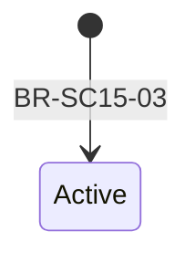

🏠 [Specs](../../../README.md) › 🏷️ [Sectors](../../README.md) › 📦 [SC15 Wholesale and distribution](../README.md) ›
🗃️ [Data](README.md) › 🗃️ E-SC15-02 Rebate rule

# 🗃️ E-SC15-02 Rebate rule

**Status:** ✅ specified

## Purpose

A conditional rebate.

## Fields

| Name | Type | Required | Validation | Default | Example | Personal data | Custom fields |
|---|---|---|---|---|---|---|---|
| customer, basis, threshold, rate | records | yes | BR-SC15-03 | - | Bistro Group, turnover, 500 000, 2 % | no | no |
| accrued | amount | no | - | - | 8 400 | no | no |

## Relations

As its use cases.

## Lifecycle

## Indexes and search

By number, date, partner.

## Retention

As an accounting record:
[CR-FR-002 Accounting records kept 10 years](../../../10-country-packs/france/accounting/cr-fr-002-accounting-records-kept-ten-years.md).

## Audit

Every change.

## Import and export

CSV, FEC where relevant.

## Used by

- [UC-SC15-02](../use-cases/01-prices-and-agreements/uc-sc15-02-manage-rebates-and-year-end-discounts.md)
- [UC-SC15-15](../use-cases/05-sales-force-and-performance/uc-sc15-15-follow-margins-per-customer-product-and-rep.md)

## Open questions

None.

---

⬅️ [E-SC15-01 Price agreement](e-sc15-01-price-agreement.md) · ⬆️ [Up](README.md) ·
➡️ [E-SC15-03 Yearly agreement](e-sc15-03-yearly-agreement.md)
