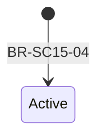

🏠 [Specs](../../../README.md) › 🏷️ [Sectors](../../README.md) › 📦 [SC15 Wholesale and distribution](../README.md) ›
🗃️ [Data](README.md) › 🗃️ E-SC15-03 Yearly agreement

# 🗃️ E-SC15-03 Yearly agreement

**Status:** 🔄 waiting for the owner

## Purpose

The supplier–distributor agreement.

## Fields

| Name | Type | Required | Validation | Default | Example | Personal data | Custom fields |
|---|---|---|---|---|---|---|---|
| parties, year | records | yes | BR-SC15-04 | - | Acme and MegaMart, 2027 | no | no |
| terms sent, signed | dates | no | - | - | 28 Nov, 26 Feb | no | no |

## Relations

(Proposed) As its use cases.

## Lifecycle

## Indexes and search

(Proposed) By number, date, partner.

## Retention

As an accounting record:
[CR-FR-002 Accounting records kept 10 years](../../../10-country-packs/france/accounting/cr-fr-002-accounting-records-kept-ten-years.md).

## Audit

Every change.

## Import and export

(Proposed) CSV, FEC where relevant.

## Used by

- [UC-SC15-03](../use-cases/01-prices-and-agreements/uc-sc15-03-negotiate-the-yearly-agreement-with-retailers.md)

## Open questions

None.

---

⬅️ [E-SC15-02 Rebate rule](e-sc15-02-rebate-rule.md) · ⬆️ [Up](README.md) ·
➡️ [E-SC15-04 Sales order](e-sc15-04-sales-order.md)
