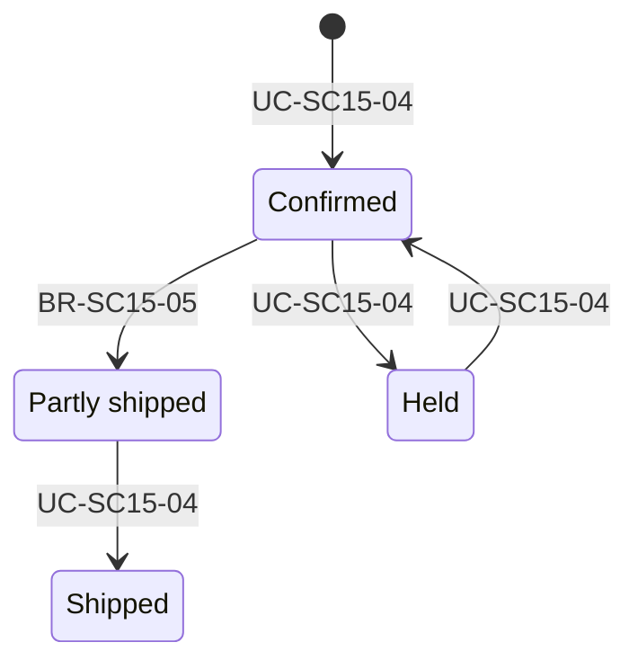

🏠 [Specs](../../../README.md) › 🏷️ [Sectors](../../README.md) › 📦 [SC15 Wholesale and distribution](../README.md) ›
🗃️ [Data](README.md) › 🗃️ E-SC15-04 Sales order

# 🗃️ E-SC15-04 Sales order

**Status:** ✅ specified

## Purpose

An order from any channel.

## Fields

| Name | Type | Required | Validation | Default | Example | Personal data | Custom fields |
|---|---|---|---|---|---|---|---|
| customer, channel, lines | records | yes | BR-SC15-05 | - | Bistro Group, rep, 14 | no | no |
| state | held, confirmed, partly shipped, shipped | yes | BR-SC15-07 | confirmed | partly shipped | no | no |

## Relations

As its use cases.

## Lifecycle

## Indexes and search

By number, date, partner.

## Retention

As an accounting record:
[CR-FR-002 Accounting records kept 10 years](../../../10-country-packs/france/accounting/cr-fr-002-accounting-records-kept-ten-years.md).

## Audit

Every change.

## Import and export

CSV, FEC where relevant.

## Used by

- [UC-SC15-04](../use-cases/02-orders/uc-sc15-04-take-orders-by-edi-from-retailers.md)
- [UC-SC15-05](../use-cases/02-orders/uc-sc15-05-take-orders-on-the-road-offline.md)
- [UC-SC15-06](../use-cases/02-orders/uc-sc15-06-handle-back-orders-and-partial-deliveries.md)
- [UC-SC15-07](../use-cases/02-orders/uc-sc15-07-drop-ship-from-suppliers.md)
- [UC-SC15-15](../use-cases/05-sales-force-and-performance/uc-sc15-15-follow-margins-per-customer-product-and-rep.md)
- [UC-SC15-18](../use-cases/02-orders/uc-sc15-18-give-customers-a-b2b-portal-and-catalogue.md)
- [UC-SC15-20](../use-cases/05-sales-force-and-performance/uc-sc15-20-ask-the-assistant.md)

## Open questions

None.

---

⬅️ [E-SC15-03 Yearly agreement](e-sc15-03-yearly-agreement.md) · ⬆️ [Up](README.md) ·
➡️ [E-SC15-05 Pick wave](e-sc15-05-pick-wave.md)
