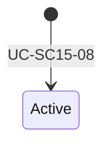

🏠 [Specs](../../../README.md) › 🏷️ [Sectors](../../README.md) › 📦 [SC15 Wholesale and distribution](../README.md) ›
🗃️ [Data](README.md) › 🗃️ E-SC15-05 Pick wave

# 🗃️ E-SC15-05 Pick wave

**Status:** 🔄 waiting for the owner

## Purpose

A group of picks.

## Fields

| Name | Type | Required | Validation | Default | Example | Personal data | Custom fields |
|---|---|---|---|---|---|---|---|
| date, orders, zone | records | yes | - | - | 12 Nov, 38, dry | no | no |

## Relations

(Proposed) As its use cases.

## Lifecycle

## Indexes and search

(Proposed) By number, date, partner.

## Retention

Kept for the period of its kind of record in the country pack (D293), or else its kind's default in the
[retention schedule](../../../05-non-functional/data-retention.md).

## Audit

Every change.

## Import and export

(Proposed) CSV, FEC where relevant.

## Used by

- [UC-SC15-08](../use-cases/03-warehouse/uc-sc15-08-pick-in-waves-and-cross-dock.md)
- [UC-SC15-09](../use-cases/03-warehouse/uc-sc15-09-build-pallets-and-gs1-labels.md)

## Open questions

None.

---

⬅️ [E-SC15-04 Sales order](e-sc15-04-sales-order.md) · ⬆️ [Up](README.md) ·
➡️ [E-SC15-06 Purchase proposal](e-sc15-06-purchase-proposal.md)
