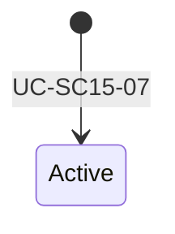

🏠 [Specs](../../../README.md) › 🏷️ [Sectors](../../README.md) › 📦 [SC15 Wholesale and distribution](../README.md) ›
🗃️ [Data](README.md) › 🗃️ E-SC15-06 Purchase proposal

# 🗃️ E-SC15-06 Purchase proposal

**Status:** ✅ specified

## Purpose

A proposed purchase.

## Fields

| Name | Type | Required | Validation | Default | Example | Personal data | Custom fields |
|---|---|---|---|---|---|---|---|
| supplier, lines, minimum | records | yes | - | - | Acme, 22, 1 pallet | no | no |

## Relations

As its use cases.

## Lifecycle

## Indexes and search

By number, date, partner.

## Retention

Kept for the period of its kind of record in the country pack (D293), or else its kind's default in the
[retention schedule](../../../05-non-functional/data-retention.md).

## Audit

Every change.

## Import and export

CSV, FEC where relevant.

## Used by

- [UC-SC15-07](../use-cases/02-orders/uc-sc15-07-drop-ship-from-suppliers.md)
- [UC-SC15-17](../use-cases/04-import-and-suppliers/uc-sc15-17-buy-against-forecasts-and-supplier-minimums.md)

## Open questions

None.

---

⬅️ [E-SC15-05 Pick wave](e-sc15-05-pick-wave.md) · ⬆️ [Up](README.md) ·
➡️ [E-SC15-07 Return authorisation](e-sc15-07-return-authorisation.md)
