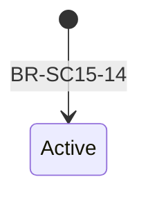

🏠 [Specs](../../../README.md) › 🏷️ [Sectors](../../README.md) › 📦 [SC15 Wholesale and distribution](../README.md) ›
🗃️ [Data](README.md) › 🗃️ E-SC15-07 Return authorisation

# 🗃️ E-SC15-07 Return authorisation

**Status:** 🔄 waiting for the owner

## Purpose

An authorised return.

## Fields

| Name | Type | Required | Validation | Default | Example | Personal data | Custom fields |
|---|---|---|---|---|---|---|---|
| order, number, reason | records | yes | BR-SC15-14 | - | SO-88, RA-12, damaged | no | no |

## Relations

(Proposed) As its use cases.

## Lifecycle

## Indexes and search

(Proposed) By number, date, partner.

## Retention

Kept for the period of its kind of record in the country pack (D293), or else its kind's default in the
[retention schedule](../../../05-non-functional/data-retention.md).

## Audit

Every change.

## Import and export

(Proposed) CSV, FEC where relevant.

## Used by

- [UC-SC15-10](../use-cases/03-warehouse/uc-sc15-10-manage-returns-and-credit-notes.md)

## Open questions

None.

---

⬅️ [E-SC15-06 Purchase proposal](e-sc15-06-purchase-proposal.md) · ⬆️ [Up](README.md) ·
➡️ [E-SC15-08 Supplier fund](e-sc15-08-supplier-fund.md)
