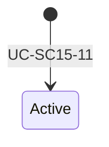

🏠 [Specs](../../../README.md) › 🏷️ [Sectors](../../README.md) › 📦 [SC15 Wholesale and distribution](../README.md) ›
🗃️ [Data](README.md) › 🗃️ E-SC15-08 Supplier fund

# 🗃️ E-SC15-08 Supplier fund

**Status:** 🔄 waiting for the owner

## Purpose

A supplier promotion or fee.

## Fields

| Name | Type | Required | Validation | Default | Example | Personal data | Custom fields |
|---|---|---|---|---|---|---|---|
| supplier, kind, amount | records | yes | BR-SC15-12 | - | Acme, listing fee, 3 000 | no | no |

## Relations

(Proposed) As its use cases.

## Lifecycle

## Indexes and search

(Proposed) By number, date, partner.

## Retention

As an accounting record:
[CR-FR-002 Accounting records kept 10 years](../../../10-country-packs/france/accounting/cr-fr-002-accounting-records-kept-ten-years.md).

## Audit

Every change.

## Import and export

(Proposed) CSV, FEC where relevant.

## Used by

- [UC-SC15-11](../use-cases/01-prices-and-agreements/uc-sc15-11-run-supplier-promotions-and-listing-fees.md)

## Open questions

None.

---

⬅️ [E-SC15-07 Return authorisation](e-sc15-07-return-authorisation.md) · ⬆️ [Up](README.md) ·
➡️ [E-SC15-09 Import file](e-sc15-09-import-file.md)
