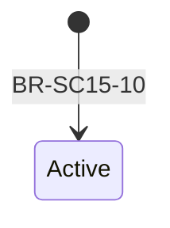

🏠 [Specs](../../../README.md) › 🏷️ [Sectors](../../README.md) › 📦 [SC15 Wholesale and distribution](../README.md) ›
🗃️ [Data](README.md) › 🗃️ E-SC15-09 Import file

# 🗃️ E-SC15-09 Import file

**Status:** 🔄 waiting for the owner

## Purpose

An import and its customs data.

## Fields

| Name | Type | Required | Validation | Default | Example | Personal data | Custom fields |
|---|---|---|---|---|---|---|---|
| shipment, EORI, duties | records | yes | BR-SC15-10 | - | CNT-41, FR123456789, 2 140 | no | no |

## Relations

(Proposed) As its use cases.

## Lifecycle

## Indexes and search

(Proposed) By number, date, partner.

## Retention

As an accounting record:
[CR-FR-002 Accounting records kept 10 years](../../../10-country-packs/france/accounting/cr-fr-002-accounting-records-kept-ten-years.md).

## Audit

Every change.

## Import and export

(Proposed) CSV, FEC where relevant.

## Used by

- [UC-SC15-12](../use-cases/04-import-and-suppliers/uc-sc15-12-import-goods.md)

## Open questions

None.

---

⬅️ [E-SC15-08 Supplier fund](e-sc15-08-supplier-fund.md) · ⬆️ [Up](README.md) ·
➡️ [E-SC15-10 Statistics return](e-sc15-10-statistics-return.md)
