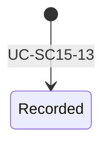

🏠 [Specs](../../../README.md) › 🏷️ [Sectors](../../README.md) › 📦 [SC15 Wholesale and distribution](../README.md) ›
🗃️ [Data](README.md) › 🗃️ E-SC15-10 Statistics return

# 🗃️ E-SC15-10 Statistics return

**Status:** 🔄 waiting for the owner

## Purpose

A monthly EU statistics return.

## Fields

| Name | Type | Required | Validation | Default | Example | Personal data | Custom fields |
|---|---|---|---|---|---|---|---|
| month, lines | records | yes | BR-SC15-11 | - | Nov, 64 | no | no |

## Relations

(Proposed) As its use cases.

## Lifecycle

## Indexes and search

(Proposed) By number, date, partner.

## Retention

As an accounting record:
[CR-FR-002 Accounting records kept 10 years](../../../10-country-packs/france/accounting/cr-fr-002-accounting-records-kept-ten-years.md).

## Audit

Every change.

## Import and export

(Proposed) CSV, FEC where relevant.

## Used by

- [UC-SC15-13](../use-cases/04-import-and-suppliers/uc-sc15-13-declare-eu-trade-statistics.md)

## Open questions

None.

---

⬅️ [E-SC15-09 Import file](e-sc15-09-import-file.md) · ⬆️ [Up](README.md) ·
➡️ [E-SC15-11 Visit report](e-sc15-11-visit-report.md)
