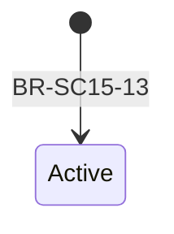

🏠 [Specs](../../../README.md) › 🏷️ [Sectors](../../README.md) › 📦 [SC15 Wholesale and distribution](../README.md) ›
🗃️ [Data](README.md) › 🗃️ E-SC15-11 Visit report

# 🗃️ E-SC15-11 Visit report

**Status:** 🔄 waiting for the owner

## Purpose

A rep's visit.

## Fields

| Name | Type | Required | Validation | Default | Example | Personal data | Custom fields |
|---|---|---|---|---|---|---|---|
| rep, customer, date | records | yes | BR-SC15-13 | - | U42, Bistro Lyon 2, 12 Nov | yes | no |
| notes, order | text, order | no | - | - | new menu, SO-91 | no | no |

## Relations

(Proposed) As its use cases.

## Lifecycle

## Indexes and search

(Proposed) By number, date, partner.

## Retention

Kept for the period of its kind of record in the country pack (D293), or else its kind's default in the
[retention schedule](../../../05-non-functional/data-retention.md).

## Audit

Every change.

## Import and export

(Proposed) CSV, FEC where relevant.

## Used by

- [UC-SC15-14](../use-cases/05-sales-force-and-performance/uc-sc15-14-follow-sales-reps-visits-routes-and-targets.md)

## Open questions

None.

---

⬅️ [E-SC15-10 Statistics return](e-sc15-10-statistics-return.md) · ⬆️ [Up](README.md) ·
➡️ [E-SC15-12 Credit limit](e-sc15-12-credit-limit.md)
