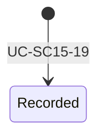

🏠 [Specs](../../../README.md) › 🏷️ [Sectors](../../README.md) › 📦 [SC15 Wholesale and distribution](../README.md) ›
🗃️ [Data](README.md) › 🗃️ E-SC15-13 Supplier scorecard

# 🗃️ E-SC15-13 Supplier scorecard

**Status:** ✅ specified

## Purpose

A supplier's performance.

## Fields

| Name | Type | Required | Validation | Default | Example | Personal data | Custom fields |
|---|---|---|---|---|---|---|---|
| supplier, period, on time, complete | records | yes | - | - | Acme, Q4, 94 %, 98 % | no | no |

## Relations

As its use cases.

## Lifecycle

## Indexes and search

By number, date, partner.

## Retention

Kept for the period of its kind of record in the country pack (D293), or else its kind's default in the
[retention schedule](../../../05-non-functional/data-retention.md).

## Audit

Every change.

## Import and export

CSV, FEC where relevant.

## Used by

- [UC-SC15-19](../use-cases/04-import-and-suppliers/uc-sc15-19-follow-supplier-performance.md)

## Open questions

None.

---

⬅️ [E-SC15-12 Credit limit](e-sc15-12-credit-limit.md) · ⬆️ [Up](README.md) ·
➡️ [E-SC15-14 Pallet](e-sc15-14-pallet.md)
