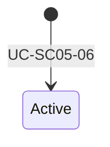

🏠 [Specs](../../../README.md) › 🏷️ [Sectors](../../README.md) › 📦 [SC15 Wholesale and distribution](../README.md) ›
🗃️ [Data](README.md) › 🗃️ E-SC15-14 Pallet

# 🗃️ E-SC15-14 Pallet

**Status:** 🔄 waiting for the owner

## Purpose

(Proposed) The pallet the flow charts name with the words "Pallet", "Pallets"
([FL-SC05-03](../../sc05-manufacturing/flows/fl-sc05-03-packaging.md), [FL-SC15-03](../flows/fl-sc15-03-warehouse.md)).
The owner decided to create it
([D516](../../../06-decisions/foundations/d516-naming-rules-and-the-seven-classes-of-names.md)); what it holds waits for
the owner's confirmation.

## Fields

(Proposed) To define with the owner: the flow charts name the record, not its fields.

## Relations

(Proposed) To define with the owner, from the use cases below.

## Lifecycle

## Indexes and search

(Proposed) To define with the owner.

## Retention

(Proposed) As the other records of its capability, to confirm with the owner.

## Audit

(Proposed) Every change, as the other records of its capability.

## Import and export

(Proposed) To define with the owner.

## Used by

- [UC-SC05-06 Package and label](../../sc05-manufacturing/use-cases/03-packaging/uc-sc05-06-package-and-label.md)
- [UC-SC15-09 Build pallets and GS1 labels](../use-cases/03-warehouse/uc-sc15-09-build-pallets-and-gs1-labels.md)

## Open questions

(Proposed) Its fields, relations and states wait for the owner (waiting list, step 36e).

---

⬅️ [E-SC15-13 Supplier scorecard](e-sc15-13-supplier-scorecard.md) · ⬆️ [Up](README.md) ·
➡️ [E-SC15-15 Bar loan](e-sc15-15-bar-loan.md)
