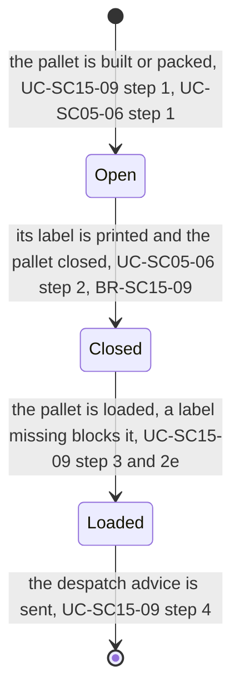

🏠 [Specs](../../../README.md) › 🏷️ [Sectors](../../README.md) › 📦 [SC15 Wholesale and distribution](../README.md) ›
🗃️ [Data](README.md) › 🗃️ E-SC15-14 Pallet

# 🗃️ E-SC15-14 Pallet

**Status:** ✅ specified

## Purpose

The pallet the flow charts name with the words "Pallet", "Pallets"
([FL-SC05-03](../../sc05-manufacturing/flows/fl-sc05-03-packaging.md), [FL-SC15-03](../flows/fl-sc15-03-warehouse.md)).
The owner decided to create it
([D516](../../../06-decisions/foundations/d516-naming-rules-and-the-seven-classes-of-names.md)); its fields are derived
from the specifications and confirmed by the owner (D572).

## Fields

| Name | Type | Required | Validation | Default | Example | Personal data | Custom fields |
|---|---|---|---|---|---|---|---|
| title | text | yes | not empty | - | Pallet P-04412 | no | no |
| SSCC | text | yes | a GS1 serial shipping code, unique, BR-SC15-09 | - | 3 761234 500000012 3 | no | no |
| customer | customer (E-F6-01) | no | a customer of the company | - | MegaMart | no | no |
| order | sales order (E-SC15-04) | no | an order of the customer | - | MegaMart, 14 lines | no | no |
| pick wave | pick wave (E-SC15-05) | no | the wave that picked the order | - | 12 Nov, dry | no | no |
| contents | lines with item (E-F7-06), quantity, lot (E-F7-10) and dates | yes | at least one line, the lot of each traced item, BR-SC05-06 | - | 42 cases, lot mix | no | no |
| label template | label template (E-SC05-06) | no | the customer's template when it has one | - | MegaMart pallet | no | no |
| label printed on | date and time | no | required to close and to load | - | 2026-11-12 10:40 | no | no |
| location | location (E-F7-07) | no | set when the pallet is stored | - | dry zone, A-03 | no | no |
| despatch advice sent on | date and time | no | set when the advice is sent | - | 2026-11-12 14:05 | no | no |
| state | Open, Closed, Loaded | yes | the lifecycle below | Open | Closed | no | no |

The production operator packs the output, prints the pallet label with barcode, lot and dates and closes the pallet,
then the warehouse operator scans and stores it
([UC-SC05-06](../../sc05-manufacturing/use-cases/03-packaging/uc-sc05-06-package-and-label.md) steps 1 to 3, 2a, 2e,
[BR-SC05-06](../../sc05-manufacturing/business-rules/br-sc05-06-labels-carry-lot-and-barcode.md)); in the warehouse the
operator builds the pallet, lists the contents of a mixed pallet, prints its GS1 label with the serial shipping code,
loads it and sends the despatch advice, and a pallet without its label is not loaded
([UC-SC15-09](../use-cases/03-warehouse/uc-sc15-09-build-pallets-and-gs1-labels.md) steps 1 to 4, 1a, 2e,
[BR-SC15-09](../business-rules/br-sc15-09-pallets-labelled.md)). The title and the state are the columns of
[S-SC15-L14 Pallets](../screens/00-lists/s-sc15-l14-pallets.md), whose example rows read "Pallet P-04412"; the customer,
SSCC and contents are those of the [S-SC15-09 Pallets](../screens/03-warehouse/s-sc15-09-pallets.md) mock-up, "Pallet
for MegaMart, SSCC 3 761234 500000012 3, 42 cases · lot mix".

## Relations

```mermaid
erDiagram
  PALLET }o--o| CUSTOMER_RECORD : ships to
  PALLET }o--o| SALES_ORDER : carries
  PALLET }o--o| PICK_WAVE : built from
  PALLET ||--o{ LOT_OR_SERIAL : holds
  PALLET }o--o| LABEL_TEMPLATE : labelled with
  PALLET }o--o| LOCATION : stored in
```

- [E-F6-01 Customer record](../../../02-functional/f06-customers-and-sales/data/e-f06-01-customer-record.md)
- [E-SC15-04 Sales order](e-sc15-04-sales-order.md)
- [E-SC15-05 Pick wave](e-sc15-05-pick-wave.md)
- [E-F7-06 Item](../../../02-functional/f07-purchasing-and-stock/data/e-f07-06-item.md) and
  [E-F7-10 Lot or serial](../../../02-functional/f07-purchasing-and-stock/data/e-f07-10-lot-or-serial.md): the contents
- [E-SC05-06 Label template](../../sc05-manufacturing/data/e-sc05-06-label-template.md)
- [E-F7-07 Location](../../../02-functional/f07-purchasing-and-stock/data/e-f07-07-location.md)
- [E-F7-22 Delivery note](../../../02-functional/f07-purchasing-and-stock/data/e-f07-22-delivery-note.md): the pallet
  ships with its SSCC on the delivery note
  ([UC-F7-06](../../../02-functional/f07-purchasing-and-stock/use-cases/04-pick-pack-and-ship/uc-f07-06-pick-pack-and-ship.md))
- [E-F7-26 EDI message](../../../02-functional/f07-purchasing-and-stock/data/e-f07-26-edi-message.md): the despatch
  advice

## Lifecycle



## Indexes and search

By title and state, the sort and facet of [S-SC15-L14 Pallets](../screens/00-lists/s-sc15-l14-pallets.md); the SSCC
is unique and scanned to find a pallet; searched by title, SSCC, customer and lot.

## Retention

As the other records of its capability.

## Audit

Every change, as the other records of its capability.

## Import and export

CSV or XLSX export of the rows and columns the user may see, from
[S-SC15-L14 Pallets](../screens/00-lists/s-sc15-l14-pallets.md), audited (T3); the despatch advice goes to the
customer as an EDI message ([E-F7-26](../../../02-functional/f07-purchasing-and-stock/data/e-f07-26-edi-message.md));
no import.

## Used by

- [UC-SC05-06 Package and label](../../sc05-manufacturing/use-cases/03-packaging/uc-sc05-06-package-and-label.md)
- [UC-SC15-09 Build pallets and GS1 labels](../use-cases/03-warehouse/uc-sc15-09-build-pallets-and-gs1-labels.md)

## Open questions

None.

---

⬅️ [E-SC15-13 Supplier scorecard](e-sc15-13-supplier-scorecard.md) · ⬆️ [Up](README.md) ·
➡️ [E-SC15-15 Bar loan](e-sc15-15-bar-loan.md)
