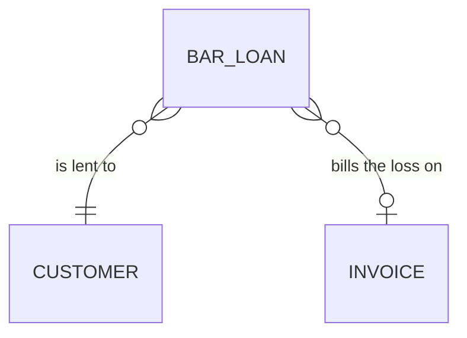
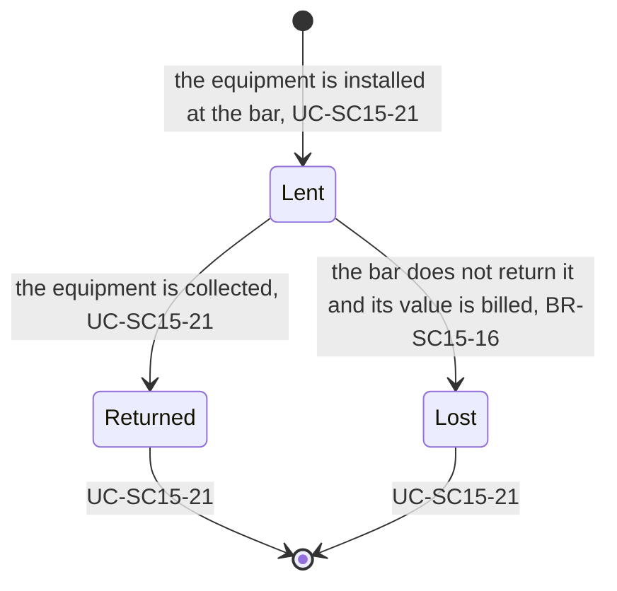

🏠 [Specs](../../../README.md) › 🏷️ [Sectors](../../README.md) › 📦 [SC15 Wholesale and distribution](../README.md) ›
🗃️ [Data](README.md) › 🗃️ E-SC15-15 Bar loan

# 🗃️ E-SC15-15 Bar loan

**Status:** ✅ specified

## Purpose

One piece of equipment lent to a bar under a supply contract with a yearly volume commitment
([D559](../../../06-decisions/sectors/d559-benchmark-gaps-sc15-wholesale-and-distribution.md)). It is not the stock of
the item ([E-F7-10](../../../02-functional/f07-purchasing-and-stock/data/e-f07-10-lot-or-serial.md)) nor a rental
([E-F6-09 Rental](../../../02-functional/f06-customers-and-sales/data/e-f06-09-rental.md)): it is lent without a fee
against the commitment and comes back with the contract.

## Fields

| Name | Type | Required | Validation | Default | Example | Personal data | Custom fields |
|---|---|---|---|---|---|---|---|
| customer | customer (E-F6-01) | yes | a customer of the company | - | Bar Le Phare | no | no |
| equipment | text | yes | a type of equipment | - | Draught system, 4 taps | no | no |
| serial | text | yes | unique | - | DS-4410 | no | no |
| value | amount in EUR | yes | 0 or more | - | 1,800.00 | no | no |
| volume commitment | number in hectolitres | yes | above 0 | - | 120 | no | no |
| volume bought | number in hectolitres | no | computed from the invoices | 0 | 74 | no | no |
| lent on | date | yes | - | today | 2025-03-01 | no | no |
| returned on | date | no | after the loan date | - | 2027-03-01 | no | no |
| state | Lent, Returned, Lost | yes | the lifecycle below | Lent | Returned | no | no |
| owner | user | yes | a user of the company | the creator | Claire P. | yes | no |

## Relations

- [E-F6-01](../../../02-functional/f06-customers-and-sales/data/e-f06-01-customer-record.md)
- [E-F6-05 Invoice](../../../02-functional/f06-customers-and-sales/data/e-f06-05-invoice.md)
- [E-F7-25](../../../02-functional/f07-purchasing-and-stock/data/e-f07-25-packaging-deposit.md)

## Lifecycle

## Indexes and search

By customer, equipment, serial number, state and commitment reached.

## Retention

Kept ten years with the invoices
([CR-FR-002](../../../10-country-packs/france/accounting/cr-fr-002-accounting-records-kept-ten-years.md)).

## Audit

Every loan, return, loss, volume update and billing, with who, when and the old and new value.

## Import and export

Export of the loans of a customer as PDF for the contract; import of existing loans as CSV.

## Used by

- [UC-SC15-21](../use-cases/06-beverages-vans-weights-and-devices/uc-sc15-21-distribute-beverages.md)
- [UC-SC15-05](../use-cases/02-orders/uc-sc15-05-take-orders-on-the-road-offline.md)

## Open questions

None.

---

⬅️ [E-SC15-14 Pallet](e-sc15-14-pallet.md) · ⬆️ [Up](README.md) · ➡️ [E-SC15-16 Van stock](e-sc15-16-van-stock.md)
