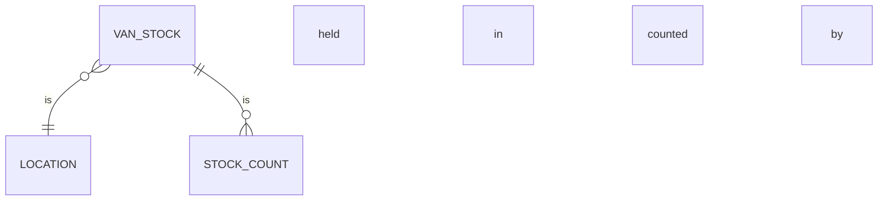
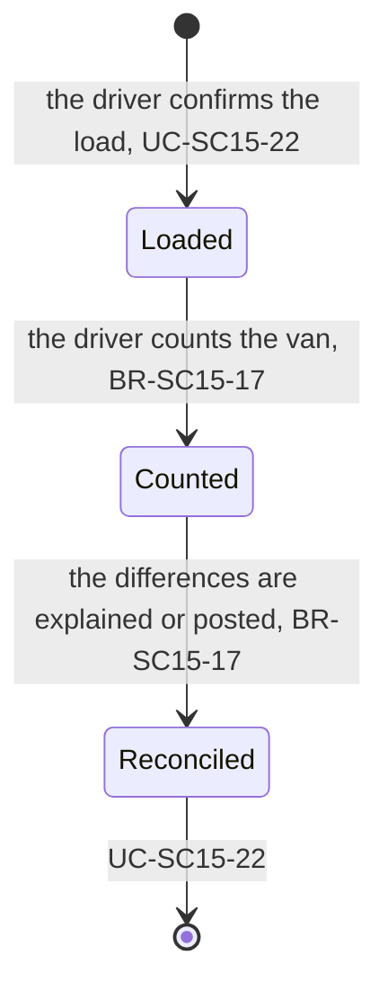

🏠 [Specs](../../../README.md) › 🏷️ [Sectors](../../README.md) › 📦 [SC15 Wholesale and distribution](../README.md) ›
🗃️ [Data](README.md) › 🗃️ E-SC15-16 Van stock

# 🗃️ E-SC15-16 Van stock

**Status:** ✅ specified

## Purpose

The stock of one van for one round: what was loaded, sold, returned and counted
([D559](../../../06-decisions/sectors/d559-benchmark-gaps-sc15-wholesale-and-distribution.md)). It is not the stock
count of a warehouse ([E-F7-11](../../../02-functional/f07-purchasing-and-stock/data/e-f07-11-stock-count.md)): it
follows the expected stock through the day and blocks the next load until it is reconciled.

## Fields

| Name | Type | Required | Validation | Default | Example | Personal data | Custom fields |
|---|---|---|---|---|---|---|---|
| van | location (E-F7-07) | yes | a van location | - | Van 4 | no | no |
| date | date | yes | - | today | 2026-11-12 | no | no |
| driver | user | yes | a user of the company | the creator | Lucas M. | no | no |
| loaded | number | yes | 0 or more | - | 120 | no | no |
| sold | number | no | 0 or more, not above loaded | 0 | 18 | no | no |
| returned | number | no | 0 or more | 0 | 0 | no | no |
| expected | number | no | loaded minus sold plus returned | computed | 102 | no | no |
| counted | number | no | 0 or more | - | 98 | no | no |
| difference | number | no | counted minus expected | computed | -4 | no | no |
| explanation | text | no | required to reconcile a difference | - | Broken in transit | no | no |
| state | Loaded, Counted, Reconciled | yes | the lifecycle below | Loaded | Counted | no | no |
| owner | user | yes | a user of the company | the creator | Claire P. | yes | no |

## Relations

- [E-F7-07 Location](../../../02-functional/f07-purchasing-and-stock/data/e-f07-07-location.md)
- [E-F7-11](../../../02-functional/f07-purchasing-and-stock/data/e-f07-11-stock-count.md)
- [E-F6-05 Invoice](../../../02-functional/f06-customers-and-sales/data/e-f06-05-invoice.md)

## Lifecycle

## Indexes and search

By van, date, driver, state and difference.

## Retention

Kept ten years with the accounting records
([CR-FR-002](../../../10-country-packs/france/accounting/cr-fr-002-accounting-records-kept-ten-years.md)) and the counts
six years ([CR-FR-007](../../../10-country-packs/france/accounting/cr-fr-007-annual-stock-count.md)).

## Audit

Every load, sale, return, count and explanation, with who, when and the old and new value.

## Import and export

Export of the round's sales as PDF; import of the planned load as CSV.

## Used by

- [UC-SC15-22](../use-cases/06-beverages-vans-weights-and-devices/uc-sc15-22-sell-from-the-van.md)
- [UC-SC15-05](../use-cases/02-orders/uc-sc15-05-take-orders-on-the-road-offline.md)

## Open questions

None.

---

⬅️ [E-SC15-15 Bar loan](e-sc15-15-bar-loan.md) · ⬆️ [Up](README.md) ·
➡️ [E-SC15-17 Device lot](e-sc15-17-device-lot.md)
