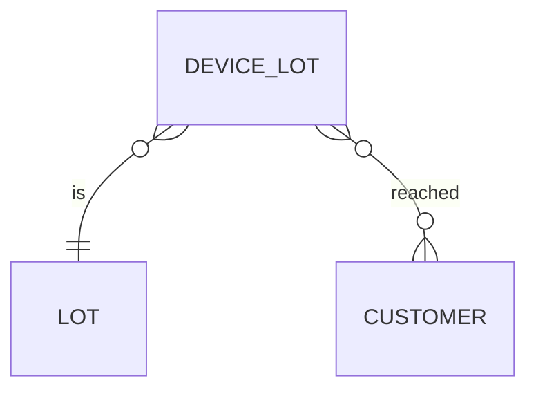
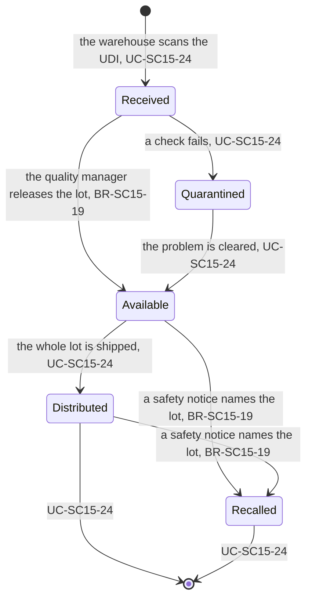

🏠 [Specs](../../../README.md) › 🏷️ [Sectors](../../README.md) › 📦 [SC15 Wholesale and distribution](../README.md) ›
🗃️ [Data](README.md) › 🗃️ E-SC15-17 Device lot

# 🗃️ E-SC15-17 Device lot

**Status:** ✅ specified

## Purpose

One lot of a medical device, identified by its UDI, with its reception checks, quantities and the customers who received
it ([D559](../../../06-decisions/sectors/d559-benchmark-gaps-sc15-wholesale-and-distribution.md)). It is not the stock
lot ([E-F7-10](../../../02-functional/f07-purchasing-and-stock/data/e-f07-10-lot-or-serial.md)): it adds the checks, the
customers reached and the recall state that regulated devices need.

## Fields

| Name | Type | Required | Validation | Default | Example | Personal data | Custom fields |
|---|---|---|---|---|---|---|---|
| lot | lot (E-F7-10) | yes | a lot of the company | - | L-5521 | no | no |
| device | item (E-F7-06) | yes | a medical device item | - | Syringe pump 50 ml | no | no |
| UDI | text | yes | a device identifier and a production identifier | - | 0381200055211 | no | no |
| expiry | date | yes | after reception | - | 2028-06-30 | no | no |
| received | number | yes | above 0 | - | 120 | no | no |
| shipped | number | no | not above received | 0 | 80 | no | no |
| checks | list of check and result | yes | one result per check of the family | - | Marking passed | no | no |
| customers | list of customers | no | customers of the deliveries | - | 3 | no | no |
| notice | text | no | a reference of the manufacturer | - | FSN-2026-114 | no | no |
| state | Received, Available, Quarantined, Distributed, Recalled | yes | the lifecycle below | Received | Available | no | no |
| owner | user | yes | a user of the company | the creator | Claire P. | yes | no |

## Relations

- [E-F7-10](../../../02-functional/f07-purchasing-and-stock/data/e-f07-10-lot-or-serial.md)
- [E-F7-06 Item](../../../02-functional/f07-purchasing-and-stock/data/e-f07-06-item.md)
- [E-F6-01](../../../02-functional/f06-customers-and-sales/data/e-f06-01-customer-record.md)

## Lifecycle

## Indexes and search

By UDI, lot, device, expiry, customer and state.

## Retention

Kept for the lifetime of the device and a number of years after, set by the France pack, and not less than
ten years with the accounting records
([CR-FR-002](../../../10-country-packs/france/accounting/cr-fr-002-accounting-records-kept-ten-years.md)).

## Audit

Every reception, check, release, quarantine, shipment, complaint, notice and recall step, with who, when and the old and
new value.

## Import and export

Import of the manufacturer's lot list as CSV; export of the customers of a lot as PDF for the notice.

## Used by

- [UC-SC15-24](../use-cases/06-beverages-vans-weights-and-devices/uc-sc15-24-distribute-medical-devices.md)
- [UC-SC15-10](../use-cases/03-warehouse/uc-sc15-10-manage-returns-and-credit-notes.md)

## Open questions

None.

---

⬅️ [E-SC15-16 Van stock](e-sc15-16-van-stock.md) · ⬆️ [Up](README.md)
