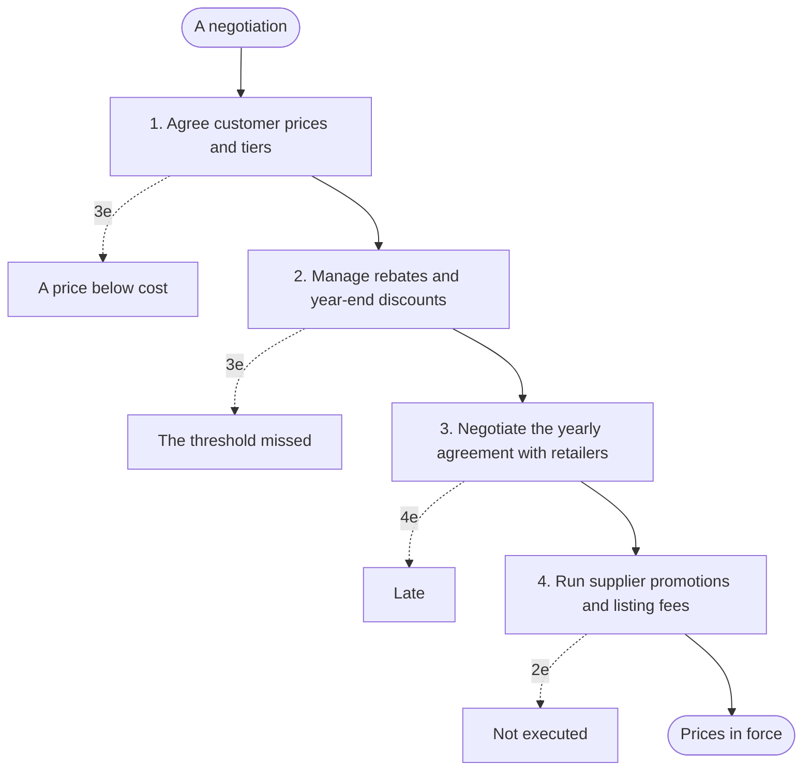

🏠 [Specs](../../../README.md) › 🏷️ [Sectors](../../README.md) › 📦 [SC15 Wholesale and distribution](../README.md) ›
🔀 [Flows](README.md) › 🔀 FL-SC15-01 Prices and agreements

# 🔀 FL-SC15-01 Prices and agreements

**Status:** ✅ specified

## Summary

Prices, rebates, yearly agreements and supplier funds. It covers
[UC-SC15-01 Agree customer prices and tiers](../use-cases/01-prices-and-agreements/uc-sc15-01-agree-customer-prices-and-tiers.md),
[UC-SC15-02 Manage rebates and year-end discounts](../use-cases/01-prices-and-agreements/uc-sc15-02-manage-rebates-and-year-end-discounts.md),
[UC-SC15-03 Negotiate the yearly agreement with retailers](../use-cases/01-prices-and-agreements/uc-sc15-03-negotiate-the-yearly-agreement-with-retailers.md),
[UC-SC15-11 Run supplier promotions and listing fees](../use-cases/01-prices-and-agreements/uc-sc15-11-run-supplier-promotions-and-listing-fees.md).

## Personas

- [U03 Sales](../../../01-users/personas/u03-sales.md)
- [U04 Purchasing and stock](../../../01-users/personas/u04-purchasing.md)
- [U05 Accounting](../../../01-users/personas/u05-accounting.md)
- [U13 Owner](../../../01-users/personas/u13-owner.md)
- [U42 Sales representative](../../../01-users/personas/u42-sales-representative.md)

## Flowchart

## Sequence diagram

See each use case.

## Steps

| Step | Persona | Screen | Use case | What happens |
|---|---|---|---|---|
| 1 | U03, U42 | [S-SC15-01](../screens/01-prices-and-agreements/s-sc15-01-price-agreements.md) | [UC-SC15-01](../use-cases/01-prices-and-agreements/uc-sc15-01-agree-customer-prices-and-tiers.md) | Sales agrees prices and tiers with a customer for a period and publishes them to reps and the portal, an order takes the agreed price, then the tier, then the list price |
| 2 | U03, U05 | [S-SC15-02](../screens/01-prices-and-agreements/s-sc15-02-rebates.md) | [UC-SC15-02](../use-cases/01-prices-and-agreements/uc-sc15-02-manage-rebates-and-year-end-discounts.md) | Sales sets rebate rules, simple-ERP accrues them as sales happen, accounting settles them at the agreed period |
| 3 | U03, U13 | [S-SC15-03](../screens/01-prices-and-agreements/s-sc15-03-yearly-agreement.md) | [UC-SC15-03](../use-cases/01-prices-and-agreements/uc-sc15-03-negotiate-the-yearly-agreement-with-retailers.md) | Sales sends general terms, negotiates and signs the yearly agreement with a retailer by the legal deadline, the owner approves |
| 4 | U04, U03 | [S-SC15-11](../screens/01-prices-and-agreements/s-sc15-11-supplier-funds.md) | [UC-SC15-11](../use-cases/01-prices-and-agreements/uc-sc15-11-run-supplier-promotions-and-listing-fees.md) | Purchasing records supplier funds, sales executes the promotions, and the supplier is invoiced as agreed |

### Entities and screens

| Entity | States in this flow | Shown at step and screen | Aggregated view |
|---|---|---|---|
| [E-SC15-01 Price agreement](../data/e-sc15-01-price-agreement.md) | Active, Expired | 1 [S-SC15-01](../screens/01-prices-and-agreements/s-sc15-01-price-agreements.md) | Price agreements |
| [E-SC15-02 Rebate rule](../data/e-sc15-02-rebate-rule.md) | Active | 2 [S-SC15-02](../screens/01-prices-and-agreements/s-sc15-02-rebates.md) | Rebate rules |
| [E-SC15-03 Yearly agreement](../data/e-sc15-03-yearly-agreement.md) | Active | 3 [S-SC15-03](../screens/01-prices-and-agreements/s-sc15-03-yearly-agreement.md) | Yearly agreements |
| [E-F10-08 Price promotion](../../../02-functional/f10-point-of-sale/data/e-f10-08-price-promotion.md) | Active | Shown elsewhere: [S-F10-06 Prices and promotions](../../../02-functional/f10-point-of-sale/screens/02-sell-at-the-counter/s-f10-06-prices-and-promotions.md) | Price promotions |
| [E-SC15-08 Supplier fund](../data/e-sc15-08-supplier-fund.md) | Active | 4 [S-SC15-11](../screens/01-prices-and-agreements/s-sc15-11-supplier-funds.md) | Supplier funds |

## Errors

- [UC-SC15-01](../use-cases/01-prices-and-agreements/uc-sc15-01-agree-customer-prices-and-tiers.md) 3e. A price below
  cost: approval is asked.
- [UC-SC15-01](../use-cases/01-prices-and-agreements/uc-sc15-01-agree-customer-prices-and-tiers.md) 2e. Overlapping
  agreements: the latest wins and the overlap is shown.
- [UC-SC15-02](../use-cases/01-prices-and-agreements/uc-sc15-02-manage-rebates-and-year-end-discounts.md) 3e. The
  threshold missed: no rebate is due.
- [UC-SC15-02](../use-cases/01-prices-and-agreements/uc-sc15-02-manage-rebates-and-year-end-discounts.md) 2e. A return
  after the accrual: the accrual is reduced.
- [UC-SC15-03](../use-cases/01-prices-and-agreements/uc-sc15-03-negotiate-the-yearly-agreement-with-retailers.md) 4e.
  Late: sales and the owner are alerted.
- [UC-SC15-03](../use-cases/01-prices-and-agreements/uc-sc15-03-negotiate-the-yearly-agreement-with-retailers.md) 2e. A
  practice that is unfair: the owner is warned
  ([BR-SC15-15](../business-rules/br-sc15-15-fair-dealing-with-partners.md)).
- [UC-SC15-11](../use-cases/01-prices-and-agreements/uc-sc15-11-run-supplier-promotions-and-listing-fees.md) 2e. Not
  executed: it is not invoiced.
- [UC-SC15-11](../use-cases/01-prices-and-agreements/uc-sc15-11-run-supplier-promotions-and-listing-fees.md) 4e. No
  agreement: it is flagged.

## Images

Every step and error, for each persona taking part, in light and dark mode (D120). Steps are numbered as in the Steps
table; E rows are the error cases.

| Step | Persona | Device | Light | Dark |
|---|---|---|---|---|
| 1 | U03 | desktop | [light](../images/01-prices-and-agreements/u03-sales/1-price-agreement-desktop-light.png) | [dark](../images/01-prices-and-agreements/u03-sales/1-price-agreement-desktop-dark.png) |
| 1 | U03 | phone | [light](../images/01-prices-and-agreements/u03-sales/1-price-agreement-phone-light.png) | [dark](../images/01-prices-and-agreements/u03-sales/1-price-agreement-phone-dark.png) |
| 1 | U03 | tablet | [light](../images/01-prices-and-agreements/u03-sales/1-price-agreement-tablet-light.png) | [dark](../images/01-prices-and-agreements/u03-sales/1-price-agreement-tablet-dark.png) |
| 1 | U42 | desktop | [light](../images/01-prices-and-agreements/u42-sales-representative/1-price-agreement-desktop-light.png) | [dark](../images/01-prices-and-agreements/u42-sales-representative/1-price-agreement-desktop-dark.png) |
| 1 | U42 | phone | [light](../images/01-prices-and-agreements/u42-sales-representative/1-price-agreement-phone-light.png) | [dark](../images/01-prices-and-agreements/u42-sales-representative/1-price-agreement-phone-dark.png) |
| 1 | U42 | tablet | [light](../images/01-prices-and-agreements/u42-sales-representative/1-price-agreement-tablet-light.png) | [dark](../images/01-prices-and-agreements/u42-sales-representative/1-price-agreement-tablet-dark.png) |
| 2 | U05 | desktop | [light](../images/01-prices-and-agreements/u05-accounting/2-rebates-desktop-light.png) | [dark](../images/01-prices-and-agreements/u05-accounting/2-rebates-desktop-dark.png) |
| 2 | U03 | desktop | [light](../images/01-prices-and-agreements/u03-sales/2-rebates-desktop-light.png) | [dark](../images/01-prices-and-agreements/u03-sales/2-rebates-desktop-dark.png) |
| 2 | U03 | phone | [light](../images/01-prices-and-agreements/u03-sales/2-rebates-phone-light.png) | [dark](../images/01-prices-and-agreements/u03-sales/2-rebates-phone-dark.png) |
| 2 | U03 | tablet | [light](../images/01-prices-and-agreements/u03-sales/2-rebates-tablet-light.png) | [dark](../images/01-prices-and-agreements/u03-sales/2-rebates-tablet-dark.png) |
| 3 | U03 | desktop | [light](../images/01-prices-and-agreements/u03-sales/3-yearly-agreement-desktop-light.png) | [dark](../images/01-prices-and-agreements/u03-sales/3-yearly-agreement-desktop-dark.png) |
| 3 | U03 | phone | [light](../images/01-prices-and-agreements/u03-sales/3-yearly-agreement-phone-light.png) | [dark](../images/01-prices-and-agreements/u03-sales/3-yearly-agreement-phone-dark.png) |
| 3 | U03 | tablet | [light](../images/01-prices-and-agreements/u03-sales/3-yearly-agreement-tablet-light.png) | [dark](../images/01-prices-and-agreements/u03-sales/3-yearly-agreement-tablet-dark.png) |
| 3 | U13 | desktop | [light](../images/01-prices-and-agreements/u13-owner/3-yearly-agreement-desktop-light.png) | [dark](../images/01-prices-and-agreements/u13-owner/3-yearly-agreement-desktop-dark.png) |
| 3 | U13 | phone | [light](../images/01-prices-and-agreements/u13-owner/3-yearly-agreement-phone-light.png) | [dark](../images/01-prices-and-agreements/u13-owner/3-yearly-agreement-phone-dark.png) |
| 4 | U04 | desktop | [light](../images/01-prices-and-agreements/u04-purchasing/4-supplier-funds-desktop-light.png) | [dark](../images/01-prices-and-agreements/u04-purchasing/4-supplier-funds-desktop-dark.png) |
| 4 | U03 | desktop | [light](../images/01-prices-and-agreements/u03-sales/4-supplier-funds-desktop-light.png) | [dark](../images/01-prices-and-agreements/u03-sales/4-supplier-funds-desktop-dark.png) |
| 4 | U03 | phone | [light](../images/01-prices-and-agreements/u03-sales/4-supplier-funds-phone-light.png) | [dark](../images/01-prices-and-agreements/u03-sales/4-supplier-funds-phone-dark.png) |
| 4 | U03 | tablet | [light](../images/01-prices-and-agreements/u03-sales/4-supplier-funds-tablet-light.png) | [dark](../images/01-prices-and-agreements/u03-sales/4-supplier-funds-tablet-dark.png) |
| E1 | U03 | desktop | [light](../images/01-prices-and-agreements/u03-sales/e1-agreement-late-desktop-light.png) | [dark](../images/01-prices-and-agreements/u03-sales/e1-agreement-late-desktop-dark.png) |
| E1 | U03 | phone | [light](../images/01-prices-and-agreements/u03-sales/e1-agreement-late-phone-light.png) | [dark](../images/01-prices-and-agreements/u03-sales/e1-agreement-late-phone-dark.png) |
| E1 | U03 | tablet | [light](../images/01-prices-and-agreements/u03-sales/e1-agreement-late-tablet-light.png) | [dark](../images/01-prices-and-agreements/u03-sales/e1-agreement-late-tablet-dark.png) |

## Open questions

None.

---

⬆️ [Up](README.md) · ➡️ [FL-SC15-02 Orders](fl-sc15-02-orders.md)
