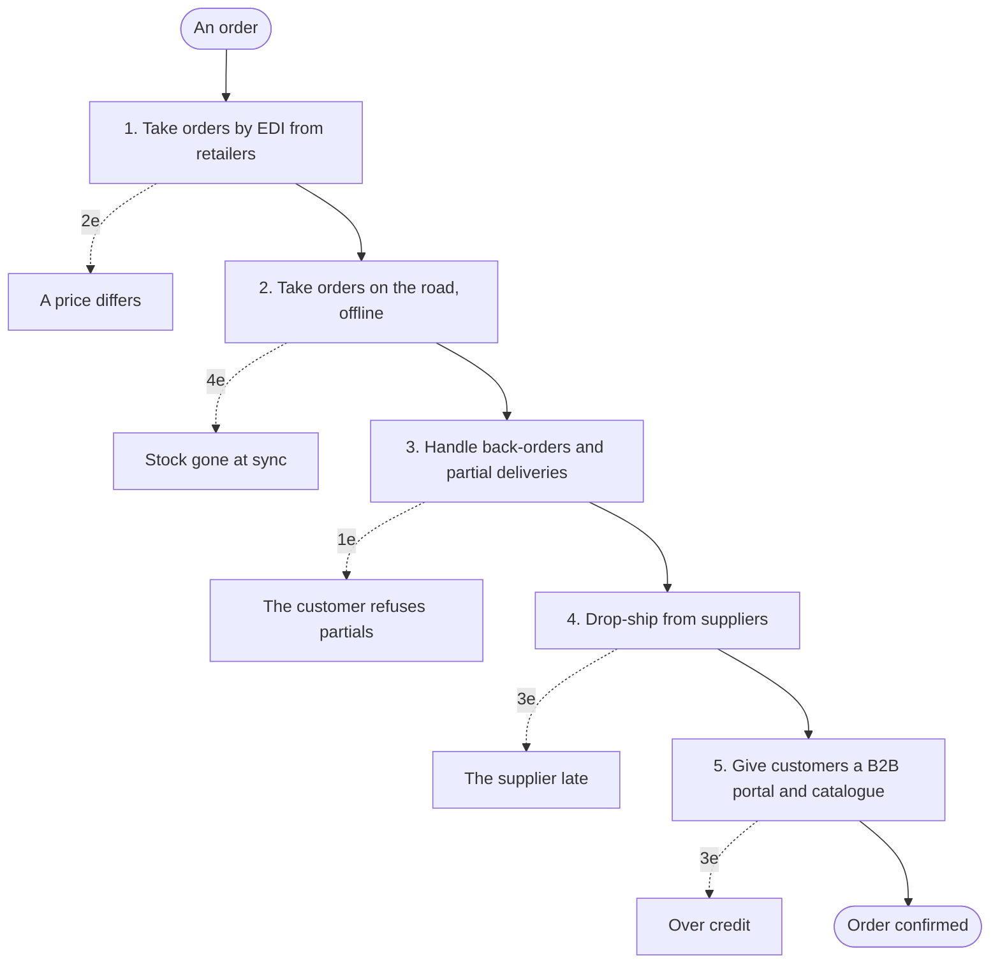

🏠 [Specs](../../../README.md) › 🏷️ [Sectors](../../README.md) › 📦 [SC15 Wholesale and distribution](../README.md) ›
🔀 [Flows](README.md) › 🔀 FL-SC15-02 Orders

# 🔀 FL-SC15-02 Orders

**Status:** ✅ specified

## Summary

Orders by EDI, on the road offline, back-orders, drop-ship and the B2B portal. It covers
[UC-SC15-04 Take orders by EDI from retailers](../use-cases/02-orders/uc-sc15-04-take-orders-by-edi-from-retailers.md),
[UC-SC15-05 Take orders on the road, offline](../use-cases/02-orders/uc-sc15-05-take-orders-on-the-road-offline.md),
[UC-SC15-06 Handle back-orders and partial deliveries](../use-cases/02-orders/uc-sc15-06-handle-back-orders-and-partial-deliveries.md),
[UC-SC15-07 Drop-ship from suppliers](../use-cases/02-orders/uc-sc15-07-drop-ship-from-suppliers.md),
[UC-SC15-18 Give customers a B2B portal and catalogue](../use-cases/02-orders/uc-sc15-18-give-customers-a-b2b-portal-and-catalogue.md).

## Personas

- [U03 Sales](../../../01-users/personas/u03-sales.md)
- [U04 Purchasing and stock](../../../01-users/personas/u04-purchasing.md)
- [U09 Customer](../../../01-users/personas/u09-customer.md)
- [U15 Warehouse operator](../../../01-users/personas/u15-warehouse-operator.md)
- [U42 Sales representative](../../../01-users/personas/u42-sales-representative.md)

## Flowchart

## Sequence diagram

See each use case.

## Steps

| Step | Persona | Screen | Use case | What happens |
|---|---|---|---|---|
| 1 | U03, U15 | [S-SC15-04](../screens/02-orders/s-sc15-04-edi-orders.md), [S-SC15-08](../screens/02-orders/s-sc15-08-waves.md) | [UC-SC15-04](../use-cases/02-orders/uc-sc15-04-take-orders-by-edi-from-retailers.md) | Sales receives EDI orders, simple-ERP validates them against the agreement and catalogue, and confirms them |
| 2 | U42, U09 | [S-SC15-05](../screens/02-orders/s-sc15-05-rep-orders.md) | [UC-SC15-05](../use-cases/02-orders/uc-sc15-05-take-orders-on-the-road-offline.md) | The sales representative visits customers and takes orders on the tablet offline, using the shared offline order capability, orders sync and are rechecked |
| 3 | U15, U03 | [S-SC15-06](../screens/02-orders/s-sc15-06-back-orders.md) | [UC-SC15-06](../use-cases/02-orders/uc-sc15-06-handle-back-orders-and-partial-deliveries.md) | The warehouse ships what is in stock and keeps the rest as a back-order, unless the customer refuses partials |
| 4 | U04, U03 | [S-SC15-07](../screens/02-orders/s-sc15-07-drop-shipping.md) | [UC-SC15-07](../use-cases/02-orders/uc-sc15-07-drop-ship-from-suppliers.md) | Purchasing orders from the supplier who ships to the customer, sales bills the customer |
| 5 | U09 | [S-SC15-18](../screens/02-orders/s-sc15-18-b2b-portal.md) | [UC-SC15-18](../use-cases/02-orders/uc-sc15-18-give-customers-a-b2b-portal-and-catalogue.md) | Customers sign in to the B2B portal, order at their own prices and follow deliveries and invoices |

### Entities and screens

| Entity | States in this flow | Shown at step and screen | Aggregated view |
|---|---|---|---|
| [E-SC15-04 Sales order](../data/e-sc15-04-sales-order.md) | Confirmed, Held | 1 [S-SC15-04](../screens/02-orders/s-sc15-04-edi-orders.md); 1 [S-SC15-08](../screens/02-orders/s-sc15-08-waves.md); 2 [S-SC15-05](../screens/02-orders/s-sc15-05-rep-orders.md); 3 [S-SC15-06](../screens/02-orders/s-sc15-06-back-orders.md); 4 [S-SC15-07](../screens/02-orders/s-sc15-07-drop-shipping.md); 5 [S-SC15-18](../screens/02-orders/s-sc15-18-b2b-portal.md) | Sales orders |
| [E-F24-02 Tool connection](../../../02-functional/f24-integrations-hub/data/e-f24-02-tool-connection.md) | Proposed | Shown elsewhere: [S-F21-10 Connections](../../../02-functional/f21-onboarding-and-modules/screens/03-team-and-data/s-f21-10-connections.md) | Tool connections |
| [E-F7-06 Item](../../../02-functional/f07-purchasing-and-stock/data/e-f07-06-item.md) | Active | Shown elsewhere: [S-F7-21 Stock levels](../../../02-functional/f07-purchasing-and-stock/screens/03-replenish/s-f07-21-stock-levels.md) | Items |
| [E-F7-03 Purchase order](../../../02-functional/f07-purchasing-and-stock/data/e-f07-03-purchase-order.md) | Confirmed | Shown elsewhere: [S-F7-02 Purchase order](../../../02-functional/f07-purchasing-and-stock/screens/01-procure/s-f07-02-purchase-order.md) | Purchase orders |
| [E-F1-17 Portal account](../../../02-functional/f01-administration/data/e-f01-17-portal-account.md) | Invited, Active, Blocked, Deactivated | Shown elsewhere: [S-F1-19 Portal accounts](../../../02-functional/f01-administration/screens/12-portal-accounts-and-integrations/s-f01-19-portal-accounts.md) | Portal accounts |
| [E-F11-03 Online product](../../../02-functional/f11-online-shop/data/e-f11-03-online-product.md) | New, Published, Delivered, Complete | Shown elsewhere: [S-F11-13 Digital products](../../../02-functional/f11-online-shop/screens/04-special-sales/s-f11-13-digital-products.md) | Online products |
| [E-F6-12 Credit limit](../../../02-functional/f06-customers-and-sales/data/e-f06-12-credit-limit.md) | Active | Shown elsewhere: [S-SC15-16 Credit limits](../screens/05-sales-force-and-performance/s-sc15-16-credit-limits.md) | Credit limits |

## Errors

- [UC-SC15-04](../use-cases/02-orders/uc-sc15-04-take-orders-by-edi-from-retailers.md) 2e. A price differs: the order is
  held.
- [UC-SC15-04](../use-cases/02-orders/uc-sc15-04-take-orders-by-edi-from-retailers.md) 2f. A product unknown: the line
  is refused.
- [UC-SC15-05](../use-cases/02-orders/uc-sc15-05-take-orders-on-the-road-offline.md) 4e. Stock gone at sync: the line
  becomes a back-order.
- [UC-SC15-05](../use-cases/02-orders/uc-sc15-05-take-orders-on-the-road-offline.md) 4f. A price changed since the last
  sync: the customer is told.
- [UC-SC15-06](../use-cases/02-orders/uc-sc15-06-handle-back-orders-and-partial-deliveries.md) 1e. The customer refuses
  partials: the order waits.
- [UC-SC15-06](../use-cases/02-orders/uc-sc15-06-handle-back-orders-and-partial-deliveries.md) 4e. A back-order too old:
  it is cancelled.
- [UC-SC15-07](../use-cases/02-orders/uc-sc15-07-drop-ship-from-suppliers.md) 3e. The supplier late: the customer is
  told.
- [UC-SC15-07](../use-cases/02-orders/uc-sc15-07-drop-ship-from-suppliers.md) 2e. The supplier refuses: another is
  proposed.
- [UC-SC15-18](../use-cases/02-orders/uc-sc15-18-give-customers-a-b2b-portal-and-catalogue.md) 3e. Over credit: the
  order is held ([BR-SC15-08](../business-rules/br-sc15-08-credit-limit-before-shipping.md)).
- [UC-SC15-18](../use-cases/02-orders/uc-sc15-18-give-customers-a-b2b-portal-and-catalogue.md) 2e. A product not in the
  agreement: the list price shows.

## Images

Every step and error, for each persona taking part, in light and dark mode (D120). Steps are numbered as in the Steps
table; E rows are the error cases.

| Step | Persona | Device | Light | Dark |
|---|---|---|---|---|
| 1 | U03 | desktop | [light](../images/02-orders/u03-sales/1-edi-desktop-light.png) | [dark](../images/02-orders/u03-sales/1-edi-desktop-dark.png) |
| 1 | U03 | phone | [light](../images/02-orders/u03-sales/1-edi-phone-light.png) | [dark](../images/02-orders/u03-sales/1-edi-phone-dark.png) |
| 1 | U03 | tablet | [light](../images/02-orders/u03-sales/1-edi-tablet-light.png) | [dark](../images/02-orders/u03-sales/1-edi-tablet-dark.png) |
| 1 | U15 | phone | [light](../images/02-orders/u15-warehouse-operator/1-edi-phone-light.png) | [dark](../images/02-orders/u15-warehouse-operator/1-edi-phone-dark.png) |
| 1 | U15 | tablet | [light](../images/02-orders/u15-warehouse-operator/1-edi-tablet-light.png) | [dark](../images/02-orders/u15-warehouse-operator/1-edi-tablet-dark.png) |
| 2 | U42 | phone | [light](../images/02-orders/u42-sales-representative/2-rep-order-phone-light.png) | [dark](../images/02-orders/u42-sales-representative/2-rep-order-phone-dark.png) |
| 2 | U42 | desktop | [light](../images/02-orders/u42-sales-representative/2-rep-order-desktop-light.png) | [dark](../images/02-orders/u42-sales-representative/2-rep-order-desktop-dark.png) |
| 2 | U42 | tablet | [light](../images/02-orders/u42-sales-representative/2-rep-order-tablet-light.png) | [dark](../images/02-orders/u42-sales-representative/2-rep-order-tablet-dark.png) |
| 2 | U09 | phone | [light](../images/02-orders/u09-customer/2-rep-order-phone-light.png) | [dark](../images/02-orders/u09-customer/2-rep-order-phone-dark.png) |
| 3 | U15 | phone | [light](../images/02-orders/u15-warehouse-operator/3-back-order-phone-light.png) | [dark](../images/02-orders/u15-warehouse-operator/3-back-order-phone-dark.png) |
| 3 | U15 | tablet | [light](../images/02-orders/u15-warehouse-operator/3-back-order-tablet-light.png) | [dark](../images/02-orders/u15-warehouse-operator/3-back-order-tablet-dark.png) |
| 3 | U03 | desktop | [light](../images/02-orders/u03-sales/3-back-order-desktop-light.png) | [dark](../images/02-orders/u03-sales/3-back-order-desktop-dark.png) |
| 3 | U03 | phone | [light](../images/02-orders/u03-sales/3-back-order-phone-light.png) | [dark](../images/02-orders/u03-sales/3-back-order-phone-dark.png) |
| 3 | U03 | tablet | [light](../images/02-orders/u03-sales/3-back-order-tablet-light.png) | [dark](../images/02-orders/u03-sales/3-back-order-tablet-dark.png) |
| 4 | U04 | desktop | [light](../images/02-orders/u04-purchasing/4-drop-ship-desktop-light.png) | [dark](../images/02-orders/u04-purchasing/4-drop-ship-desktop-dark.png) |
| 4 | U03 | desktop | [light](../images/02-orders/u03-sales/4-drop-ship-desktop-light.png) | [dark](../images/02-orders/u03-sales/4-drop-ship-desktop-dark.png) |
| 4 | U03 | phone | [light](../images/02-orders/u03-sales/4-drop-ship-phone-light.png) | [dark](../images/02-orders/u03-sales/4-drop-ship-phone-dark.png) |
| 4 | U03 | tablet | [light](../images/02-orders/u03-sales/4-drop-ship-tablet-light.png) | [dark](../images/02-orders/u03-sales/4-drop-ship-tablet-dark.png) |
| 5 | U09 | phone | [light](../images/02-orders/u09-customer/5-portal-phone-light.png) | [dark](../images/02-orders/u09-customer/5-portal-phone-dark.png) |
| E1 | U03 | desktop | [light](../images/02-orders/u03-sales/e1-edi-price-desktop-light.png) | [dark](../images/02-orders/u03-sales/e1-edi-price-desktop-dark.png) |
| E1 | U03 | phone | [light](../images/02-orders/u03-sales/e1-edi-price-phone-light.png) | [dark](../images/02-orders/u03-sales/e1-edi-price-phone-dark.png) |
| E1 | U03 | tablet | [light](../images/02-orders/u03-sales/e1-edi-price-tablet-light.png) | [dark](../images/02-orders/u03-sales/e1-edi-price-tablet-dark.png) |

## Open questions

None.

---

⬅️ [FL-SC15-01 Prices and agreements](fl-sc15-01-prices-and-agreements.md) · ⬆️ [Up](README.md) ·
➡️ [FL-SC15-03 Warehouse](fl-sc15-03-warehouse.md)
