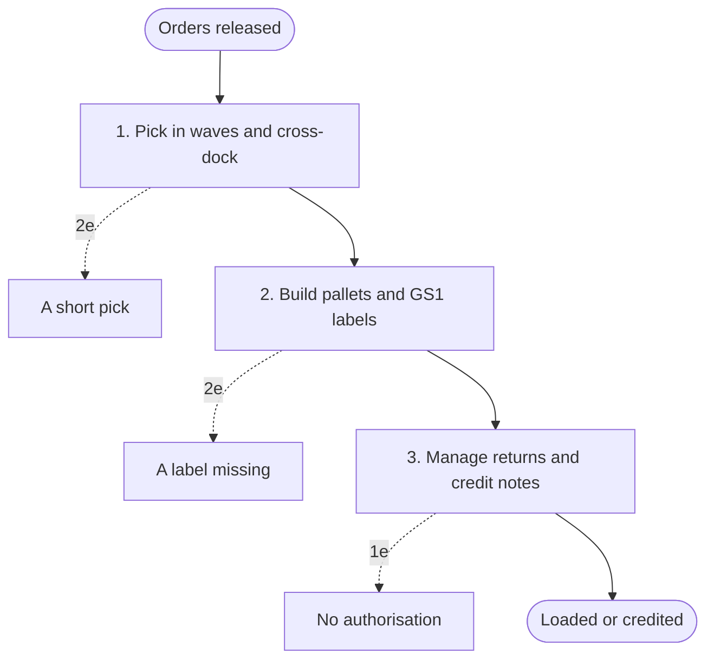

🏠 [Specs](../../../README.md) › 🏷️ [Sectors](../../README.md) › 📦 [SC15 Wholesale and distribution](../README.md) ›
🔀 [Flows](README.md) › 🔀 FL-SC15-03 Warehouse

# 🔀 FL-SC15-03 Warehouse

**Status:** ✅ specified

## Summary

The warehouse: waves, pallets and returns. It covers
[UC-SC15-08 Pick in waves and cross-dock](../use-cases/03-warehouse/uc-sc15-08-pick-in-waves-and-cross-dock.md),
[UC-SC15-09 Build pallets and GS1 labels](../use-cases/03-warehouse/uc-sc15-09-build-pallets-and-gs1-labels.md),
[UC-SC15-10 Manage returns and credit notes](../use-cases/03-warehouse/uc-sc15-10-manage-returns-and-credit-notes.md).

## Personas

- [U03 Sales](../../../01-users/personas/u03-sales.md)
- [U15 Warehouse operator](../../../01-users/personas/u15-warehouse-operator.md)

## Flowchart

## Sequence diagram

See each use case.

## Steps

| Step | Persona | Screen | Use case | What happens |
|---|---|---|---|---|
| 1 | U15 | [S-SC15-08](../screens/02-orders/s-sc15-08-waves.md) | [UC-SC15-08](../use-cases/03-warehouse/uc-sc15-08-pick-in-waves-and-cross-dock.md) | The warehouse operator builds pick waves, picks and cross-docks incoming goods to waiting orders |
| 2 | U15 | [S-SC15-09](../screens/03-warehouse/s-sc15-09-pallets.md) | [UC-SC15-09](../use-cases/03-warehouse/uc-sc15-09-build-pallets-and-gs1-labels.md) | The operator builds pallets, prints GS1 labels with the serial shipping code, and loads them |
| 3 | U03, U15 | [S-SC15-10](../screens/03-warehouse/s-sc15-10-returns.md) | [UC-SC15-10](../use-cases/03-warehouse/uc-sc15-10-manage-returns-and-credit-notes.md) | Sales authorises returns, the warehouse inspects goods, the customer is credited per condition |

### Entities and screens

| Entity | States in this flow | Shown at step and screen | Aggregated view |
|---|---|---|---|
| [E-SC15-04 Sales order](../data/e-sc15-04-sales-order.md) | Confirmed, Partly shipped, Held, Shipped | 1 [S-SC15-08](../screens/02-orders/s-sc15-08-waves.md) | Sales orders |
| [E-SC15-05 Pick wave](../data/e-sc15-05-pick-wave.md) | Active | 1 [S-SC15-08](../screens/02-orders/s-sc15-08-waves.md); 2 [S-SC15-09](../screens/03-warehouse/s-sc15-09-pallets.md) | Pick waves |
| [E-SC15-14 Pallet](../data/e-sc15-14-pallet.md) | Active | 2 [S-SC15-09](../screens/03-warehouse/s-sc15-09-pallets.md) | Pallets |
| [E-SC15-07 Return authorisation](../data/e-sc15-07-return-authorisation.md) | Active | 3 [S-SC15-10](../screens/03-warehouse/s-sc15-10-returns.md) | Return authorisations |
| [E-F6-05 Invoice](../../../02-functional/f06-customers-and-sales/data/e-f06-05-invoice.md) | Refused | Shown elsewhere: [S-F6-06 Invoice](../../../02-functional/f06-customers-and-sales/screens/03-invoice-and-get-paid/s-f06-06-invoice.md) | Invoices |

## Errors

- [UC-SC15-08](../use-cases/03-warehouse/uc-sc15-08-pick-in-waves-and-cross-dock.md) 2e. A short pick: a back-order is
  kept.
- [UC-SC15-08](../use-cases/03-warehouse/uc-sc15-08-pick-in-waves-and-cross-dock.md) 2f. No network in an aisle: scans
  are kept and synced,
  [UC-F2-22](../../../02-functional/f02-no-code-configuration/use-cases/09-portals-and-offline-forms/uc-f02-22-fill-a-form-offline-on-the-phone.md).
- [UC-SC15-09](../use-cases/03-warehouse/uc-sc15-09-build-pallets-and-gs1-labels.md) 2e. A label missing: loading is
  blocked.
- [UC-SC15-09](../use-cases/03-warehouse/uc-sc15-09-build-pallets-and-gs1-labels.md) 2f. The printer offline: labels
  wait.
- [UC-SC15-10](../use-cases/03-warehouse/uc-sc15-10-manage-returns-and-credit-notes.md) 1e. No authorisation: the return
  is refused.
- [UC-SC15-10](../use-cases/03-warehouse/uc-sc15-10-manage-returns-and-credit-notes.md) 2e. Goods damaged by the
  customer: a partial credit.

## Images

Every step and error, for each persona taking part, in light and dark mode (D120). Steps are numbered as in the Steps
table; E rows are the error cases.

| Step | Persona | Device | Light | Dark |
|---|---|---|---|---|
| 1 | U15 | phone | [light](../images/03-warehouse/u15-warehouse-operator/1-waves-phone-light.png) | [dark](../images/03-warehouse/u15-warehouse-operator/1-waves-phone-dark.png) |
| 1 | U15 | tablet | [light](../images/03-warehouse/u15-warehouse-operator/1-waves-tablet-light.png) | [dark](../images/03-warehouse/u15-warehouse-operator/1-waves-tablet-dark.png) |
| 2 | U15 | phone | [light](../images/03-warehouse/u15-warehouse-operator/2-pallets-phone-light.png) | [dark](../images/03-warehouse/u15-warehouse-operator/2-pallets-phone-dark.png) |
| 2 | U15 | tablet | [light](../images/03-warehouse/u15-warehouse-operator/2-pallets-tablet-light.png) | [dark](../images/03-warehouse/u15-warehouse-operator/2-pallets-tablet-dark.png) |
| 3 | U03 | desktop | [light](../images/03-warehouse/u03-sales/3-returns-desktop-light.png) | [dark](../images/03-warehouse/u03-sales/3-returns-desktop-dark.png) |
| 3 | U03 | phone | [light](../images/03-warehouse/u03-sales/3-returns-phone-light.png) | [dark](../images/03-warehouse/u03-sales/3-returns-phone-dark.png) |
| 3 | U03 | tablet | [light](../images/03-warehouse/u03-sales/3-returns-tablet-light.png) | [dark](../images/03-warehouse/u03-sales/3-returns-tablet-dark.png) |
| 3 | U15 | phone | [light](../images/03-warehouse/u15-warehouse-operator/3-returns-phone-light.png) | [dark](../images/03-warehouse/u15-warehouse-operator/3-returns-phone-dark.png) |
| 3 | U15 | tablet | [light](../images/03-warehouse/u15-warehouse-operator/3-returns-tablet-light.png) | [dark](../images/03-warehouse/u15-warehouse-operator/3-returns-tablet-dark.png) |
| E1 | U15 | phone | [light](../images/03-warehouse/u15-warehouse-operator/e1-no-authorisation-phone-light.png) | [dark](../images/03-warehouse/u15-warehouse-operator/e1-no-authorisation-phone-dark.png) |
| E1 | U15 | tablet | [light](../images/03-warehouse/u15-warehouse-operator/e1-no-authorisation-tablet-light.png) | [dark](../images/03-warehouse/u15-warehouse-operator/e1-no-authorisation-tablet-dark.png) |

## Open questions

None.

---

⬅️ [FL-SC15-02 Orders](fl-sc15-02-orders.md) · ⬆️ [Up](README.md) ·
➡️ [FL-SC15-04 Import and suppliers](fl-sc15-04-import-and-suppliers.md)
