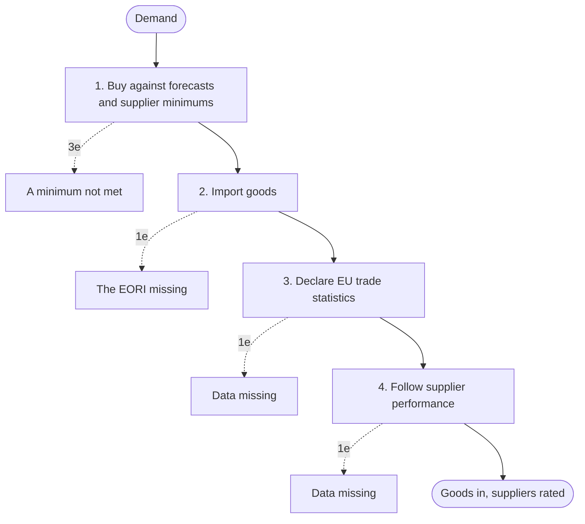

🏠 [Specs](../../../README.md) › 🏷️ [Sectors](../../README.md) › 📦 [SC15 Wholesale and distribution](../README.md) ›
🔀 [Flows](README.md) › 🔀 FL-SC15-04 Import and suppliers

# 🔀 FL-SC15-04 Import and suppliers

**Status:** ✅ specified

## Summary

Buying, imports, statistics and supplier performance. It covers
[UC-SC15-17 Buy against forecasts and supplier minimums](../use-cases/04-import-and-suppliers/uc-sc15-17-buy-against-forecasts-and-supplier-minimums.md),
[UC-SC15-12 Import goods](../use-cases/04-import-and-suppliers/uc-sc15-12-import-goods.md),
[UC-SC15-13 Declare EU trade statistics](../use-cases/04-import-and-suppliers/uc-sc15-13-declare-eu-trade-statistics.md),
[UC-SC15-19 Follow supplier performance](../use-cases/04-import-and-suppliers/uc-sc15-19-follow-supplier-performance.md).

## Personas

- [U04 Purchasing and stock](../../../01-users/personas/u04-purchasing.md)
- [U05 Accounting](../../../01-users/personas/u05-accounting.md)

## Flowchart

## Sequence diagram

See each use case.

## Steps

| Step | Persona | Screen | Use case | What happens |
|---|---|---|---|---|
| 1 | U04 | [S-SC15-17](../screens/04-import-and-suppliers/s-sc15-17-buying.md) | [UC-SC15-17](../use-cases/04-import-and-suppliers/uc-sc15-17-buy-against-forecasts-and-supplier-minimums.md) | Purchasing forecasts demand, gets proposals and orders to suppliers' minimums |
| 2 | U04, U05 | [S-SC15-12](../screens/04-import-and-suppliers/s-sc15-12-imports.md) | [UC-SC15-12](../use-cases/04-import-and-suppliers/uc-sc15-12-import-goods.md) | Purchasing and accounting prepare the import declaration with the EORI number, pay duties and receive the goods |
| 3 | U05 | [S-SC15-13](../screens/04-import-and-suppliers/s-sc15-13-eu-statistics.md) | [UC-SC15-13](../use-cases/04-import-and-suppliers/uc-sc15-13-declare-eu-trade-statistics.md) | Accounting compiles EU deliveries monthly for the statistical survey and the VAT statement and files them |
| 4 | U04 | [S-SC15-19](../screens/04-import-and-suppliers/s-sc15-19-supplier-performance.md) | [UC-SC15-19](../use-cases/04-import-and-suppliers/uc-sc15-19-follow-supplier-performance.md) | Purchasing measures suppliers' on-time and complete deliveries and quality, reviews and acts |

### Entities and screens

| Entity | States in this flow | Shown at step and screen | Aggregated view |
|---|---|---|---|
| [E-SC15-06 Purchase proposal](../data/e-sc15-06-purchase-proposal.md) | Active | 1 [S-SC15-17](../screens/04-import-and-suppliers/s-sc15-17-buying.md) | Purchase proposals |
| [E-F7-04 Transfer](../../../02-functional/f07-purchasing-and-stock/data/e-f07-04-transfer.md) | Sent, Received, Lost, Reserved, Flagged | Shown elsewhere: [S-F10-25 Store stock and transfers](../../../02-functional/f10-point-of-sale/screens/10-clienteling-transfers-and-tax-free/s-f10-25-store-stock-and-transfers.md) | Transfers |
| [E-SC15-10 Statistics return](../data/e-sc15-10-statistics-return.md) | Recorded | 3 [S-SC15-13](../screens/04-import-and-suppliers/s-sc15-13-eu-statistics.md) | Statistics returns |
| [E-SC15-13 Supplier scorecard](../data/e-sc15-13-supplier-scorecard.md) | Recorded | 4 [S-SC15-19](../screens/04-import-and-suppliers/s-sc15-19-supplier-performance.md) | Supplier scorecards |

## Errors

- [UC-SC15-17](../use-cases/04-import-and-suppliers/uc-sc15-17-buy-against-forecasts-and-supplier-minimums.md) 3e. A
  minimum not met: lines are grouped with the next cycle.
- [UC-SC15-17](../use-cases/04-import-and-suppliers/uc-sc15-17-buy-against-forecasts-and-supplier-minimums.md) 1e. No
  history: the buyer enters quantities.
- [UC-SC15-12](../use-cases/04-import-and-suppliers/uc-sc15-12-import-goods.md) 1e. The EORI missing: the declaration is
  blocked.
- [UC-SC15-12](../use-cases/04-import-and-suppliers/uc-sc15-12-import-goods.md) 2e. Duties differ: the difference is
  checked.
- [UC-SC15-13](../use-cases/04-import-and-suppliers/uc-sc15-13-declare-eu-trade-statistics.md) 1e. Data missing: it is
  listed.
- [UC-SC15-13](../use-cases/04-import-and-suppliers/uc-sc15-13-declare-eu-trade-statistics.md) 3e. The deadline near:
  accounting is reminded.
- [UC-SC15-19](../use-cases/04-import-and-suppliers/uc-sc15-19-follow-supplier-performance.md) 1e. Data missing: it is
  shown.
- [UC-SC15-19](../use-cases/04-import-and-suppliers/uc-sc15-19-follow-supplier-performance.md) 2e. A score under target:
  a review meeting is proposed.

## Images

Every step and error, for each persona taking part, in light and dark mode (D120). Steps are numbered as in the Steps
table; E rows are the error cases.

| Step | Persona | Device | Light | Dark |
|---|---|---|---|---|
| 1 | U04 | desktop | [light](../images/04-import-and-suppliers/u04-purchasing/1-buying-desktop-light.png) | [dark](../images/04-import-and-suppliers/u04-purchasing/1-buying-desktop-dark.png) |
| 2 | U04 | desktop | [light](../images/04-import-and-suppliers/u04-purchasing/2-import-desktop-light.png) | [dark](../images/04-import-and-suppliers/u04-purchasing/2-import-desktop-dark.png) |
| 2 | U05 | desktop | [light](../images/04-import-and-suppliers/u05-accounting/2-import-desktop-light.png) | [dark](../images/04-import-and-suppliers/u05-accounting/2-import-desktop-dark.png) |
| 3 | U05 | desktop | [light](../images/04-import-and-suppliers/u05-accounting/3-statistics-desktop-light.png) | [dark](../images/04-import-and-suppliers/u05-accounting/3-statistics-desktop-dark.png) |
| 4 | U04 | desktop | [light](../images/04-import-and-suppliers/u04-purchasing/4-scorecard-desktop-light.png) | [dark](../images/04-import-and-suppliers/u04-purchasing/4-scorecard-desktop-dark.png) |
| E1 | U04 | desktop | [light](../images/04-import-and-suppliers/u04-purchasing/e1-eori-missing-desktop-light.png) | [dark](../images/04-import-and-suppliers/u04-purchasing/e1-eori-missing-desktop-dark.png) |

## Open questions

None.

---

⬅️ [FL-SC15-03 Warehouse](fl-sc15-03-warehouse.md) · ⬆️ [Up](README.md) ·
➡️ [FL-SC15-05 Sales force and performance](fl-sc15-05-sales-force-and-performance.md)
