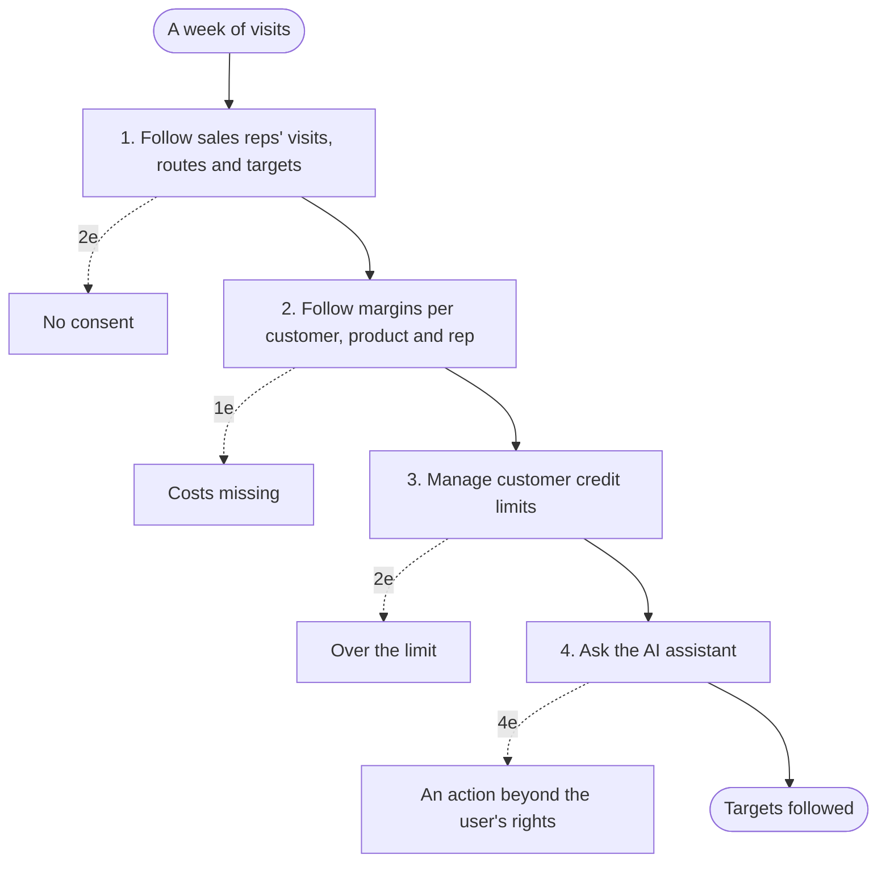

🏠 [Specs](../../../README.md) › 🏷️ [Sectors](../../README.md) › 📦 [SC15 Wholesale and distribution](../README.md) ›
🔀 [Flows](README.md) › 🔀 FL-SC15-05 Sales force and performance

# 🔀 FL-SC15-05 Sales force and performance

**Status:** ✅ specified

## Summary

Reps on the shared rounds optimiser and targets, margins, credit, the AI assistant. It covers
[UC-SC15-14 Follow sales reps' visits, routes and targets](../use-cases/05-sales-force-and-performance/uc-sc15-14-follow-sales-reps-visits-routes-and-targets.md),
[UC-SC15-15 Follow margins per customer, product and rep](../use-cases/05-sales-force-and-performance/uc-sc15-15-follow-margins-per-customer-product-and-rep.md),
[UC-SC15-16 Manage customer credit limits](../use-cases/05-sales-force-and-performance/uc-sc15-16-manage-customer-credit-limits.md),
[UC-SC15-20 Ask the AI assistant](../use-cases/05-sales-force-and-performance/uc-sc15-20-ask-the-assistant.md).

## Personas

- [U03 Sales](../../../01-users/personas/u03-sales.md)
- [U05 Accounting](../../../01-users/personas/u05-accounting.md)
- [U13 Owner](../../../01-users/personas/u13-owner.md)
- [U42 Sales representative](../../../01-users/personas/u42-sales-representative.md)

## Flowchart

## Sequence diagram

See each use case.

## Steps

| Step | Persona | Screen | Use case | What happens |
|---|---|---|---|---|
| 1 | U42, U03 | [S-SC15-14](../screens/05-sales-force-and-performance/s-sc15-14-visits.md) | [UC-SC15-14](../use-cases/05-sales-force-and-performance/uc-sc15-14-follow-sales-reps-visits-routes-and-targets.md) | Sales plans reps' routes with the shared rounds optimiser, reps visit and report, targets follow the shared targets and commissions |
| 2 | U13, U03 | [S-SC15-15](../screens/05-sales-force-and-performance/s-sc15-15-margins.md) | [UC-SC15-15](../use-cases/05-sales-force-and-performance/uc-sc15-15-follow-margins-per-customer-product-and-rep.md) | The owner and sales follow margins net of rebates per customer, product and rep, compare and act |
| 3 | U05, U03 | [S-SC15-16](../screens/05-sales-force-and-performance/s-sc15-16-credit-limits.md) | [UC-SC15-16](../use-cases/05-sales-force-and-performance/uc-sc15-16-manage-customer-credit-limits.md) | Accounting sets credit limits, orders over the available credit are held and released after approval |
| 4 | U42, U03 | [S-SC15-20](../screens/05-sales-force-and-performance/s-sc15-20-sales-assistant.md) | [UC-SC15-20](../use-cases/05-sales-force-and-performance/uc-sc15-20-ask-the-assistant.md) | The rep or sales asks the AI assistant about a customer's price, stock, credit or last orders, within their role's rights |

### Entities and screens

| Entity | States in this flow | Shown at step and screen | Aggregated view |
|---|---|---|---|
| [E-SC15-11 Visit report](../data/e-sc15-11-visit-report.md) | Active | 1 [S-SC15-14](../screens/05-sales-force-and-performance/s-sc15-14-visits.md) | Visit reports |
| [E-F7-08 Route](../../../02-functional/f07-purchasing-and-stock/data/e-f07-08-route.md) | Active | Shown elsewhere: [S-F7-13 Warehouse setup](../../../02-functional/f07-purchasing-and-stock/screens/03-replenish/s-f07-13-warehouse-setup.md) | Routes |
| [E-F6-18 Commission plan and target](../../../02-functional/f06-customers-and-sales/data/e-f06-18-commission-plan-and-target.md) | Draft, Active, Closed | 1 [S-SC15-14](../screens/05-sales-force-and-performance/s-sc15-14-visits.md) | Commission plan and targets |
| [E-F5-10 Consent and suppression record](../../../02-functional/f05-social-media/data/e-f05-10-consent-and-suppression-record.md) | Given, Withdrawn, Suppressed | Shown elsewhere: [S-F5-15 Consent register](../../../02-functional/f05-social-media/screens/06-audiences-consent-and-journeys/s-f05-15-consent-register.md) | Consent and suppression records |
| [E-F7-06 Item](../../../02-functional/f07-purchasing-and-stock/data/e-f07-06-item.md) | Active | Shown elsewhere: [S-F7-21 Stock levels](../../../02-functional/f07-purchasing-and-stock/screens/03-replenish/s-f07-21-stock-levels.md) | Items |
| [E-F6-12 Credit limit](../../../02-functional/f06-customers-and-sales/data/e-f06-12-credit-limit.md) | Active | 3 [S-SC15-16](../screens/05-sales-force-and-performance/s-sc15-16-credit-limits.md) | Credit limits |
| [E-F3-04 Assistant change batch](../../../02-functional/f03-assistant/data/e-f03-04-assistant-change-batch.md) | Cancelled | Shown elsewhere: [S-F3-01 Assistant panel](../../../02-functional/f03-assistant/screens/01-ask-the-assistant/s-f03-01-assistant-panel.md) | Assistant change batches |
| [E-F1-03 User](../../../02-functional/f01-administration/data/e-f01-03-user.md) | Invited, Active, Deactivated | Shown elsewhere: [S-F1-03 Users](../../../02-functional/f01-administration/screens/03-user-lifecycle/s-f01-03-users.md) | Users |
| [E-F1-06 Role](../../../02-functional/f01-administration/data/e-f01-06-role.md) | Active | Shown elsewhere: [S-F1-06 Role editor](../../../02-functional/f01-administration/screens/04-edit-a-role/s-f01-06-role-editor.md) | Roles |

## Errors

- [UC-SC15-14](../use-cases/05-sales-force-and-performance/uc-sc15-14-follow-sales-reps-visits-routes-and-targets.md)
  2e. No consent: no location is recorded.
- [UC-SC15-14](../use-cases/05-sales-force-and-performance/uc-sc15-14-follow-sales-reps-visits-routes-and-targets.md)
  1e. A visit outside the route: it is recorded as unplanned.
- [UC-SC15-15](../use-cases/05-sales-force-and-performance/uc-sc15-15-follow-margins-per-customer-product-and-rep.md)
  1e. Costs missing: they are shown.
- [UC-SC15-15](../use-cases/05-sales-force-and-performance/uc-sc15-15-follow-margins-per-customer-product-and-rep.md)
  2e. Rebates not accrued: margins say so.
- [UC-SC15-16](../use-cases/05-sales-force-and-performance/uc-sc15-16-manage-customer-credit-limits.md) 2e. Over the
  limit: the order is held.
- [UC-SC15-16](../use-cases/05-sales-force-and-performance/uc-sc15-16-manage-customer-credit-limits.md) 3e. Approval
  refused: the order is cancelled.
- [UC-SC15-20](../use-cases/05-sales-force-and-performance/uc-sc15-20-ask-the-assistant.md) 4e. An action beyond the
  user's rights: the AI assistant refuses.
- [UC-SC15-20](../use-cases/05-sales-force-and-performance/uc-sc15-20-ask-the-assistant.md) 2e. No network: the
  AI assistant says it needs the network.

## Images

Every step and error, for each persona taking part, in light and dark mode (D120). Steps are numbered as in the Steps
table; E rows are the error cases.

| Step | Persona | Device | Light | Dark |
|---|---|---|---|---|
| 1 | U42 | phone | [light](../images/05-sales-force-and-performance/u42-sales-representative/1-visits-phone-light.png) | [dark](../images/05-sales-force-and-performance/u42-sales-representative/1-visits-phone-dark.png) |
| 1 | U42 | desktop | [light](../images/05-sales-force-and-performance/u42-sales-representative/1-visits-desktop-light.png) | [dark](../images/05-sales-force-and-performance/u42-sales-representative/1-visits-desktop-dark.png) |
| 1 | U42 | tablet | [light](../images/05-sales-force-and-performance/u42-sales-representative/1-visits-tablet-light.png) | [dark](../images/05-sales-force-and-performance/u42-sales-representative/1-visits-tablet-dark.png) |
| 1 | U03 | desktop | [light](../images/05-sales-force-and-performance/u03-sales/1-visits-desktop-light.png) | [dark](../images/05-sales-force-and-performance/u03-sales/1-visits-desktop-dark.png) |
| 1 | U03 | phone | [light](../images/05-sales-force-and-performance/u03-sales/1-visits-phone-light.png) | [dark](../images/05-sales-force-and-performance/u03-sales/1-visits-phone-dark.png) |
| 1 | U03 | tablet | [light](../images/05-sales-force-and-performance/u03-sales/1-visits-tablet-light.png) | [dark](../images/05-sales-force-and-performance/u03-sales/1-visits-tablet-dark.png) |
| 2 | U13 | desktop | [light](../images/05-sales-force-and-performance/u13-owner/2-margins-desktop-light.png) | [dark](../images/05-sales-force-and-performance/u13-owner/2-margins-desktop-dark.png) |
| 2 | U13 | phone | [light](../images/05-sales-force-and-performance/u13-owner/2-margins-phone-light.png) | [dark](../images/05-sales-force-and-performance/u13-owner/2-margins-phone-dark.png) |
| 2 | U03 | desktop | [light](../images/05-sales-force-and-performance/u03-sales/2-margins-desktop-light.png) | [dark](../images/05-sales-force-and-performance/u03-sales/2-margins-desktop-dark.png) |
| 2 | U03 | phone | [light](../images/05-sales-force-and-performance/u03-sales/2-margins-phone-light.png) | [dark](../images/05-sales-force-and-performance/u03-sales/2-margins-phone-dark.png) |
| 2 | U03 | tablet | [light](../images/05-sales-force-and-performance/u03-sales/2-margins-tablet-light.png) | [dark](../images/05-sales-force-and-performance/u03-sales/2-margins-tablet-dark.png) |
| 3 | U05 | desktop | [light](../images/05-sales-force-and-performance/u05-accounting/3-credit-desktop-light.png) | [dark](../images/05-sales-force-and-performance/u05-accounting/3-credit-desktop-dark.png) |
| 3 | U03 | desktop | [light](../images/05-sales-force-and-performance/u03-sales/3-credit-desktop-light.png) | [dark](../images/05-sales-force-and-performance/u03-sales/3-credit-desktop-dark.png) |
| 3 | U03 | phone | [light](../images/05-sales-force-and-performance/u03-sales/3-credit-phone-light.png) | [dark](../images/05-sales-force-and-performance/u03-sales/3-credit-phone-dark.png) |
| 3 | U03 | tablet | [light](../images/05-sales-force-and-performance/u03-sales/3-credit-tablet-light.png) | [dark](../images/05-sales-force-and-performance/u03-sales/3-credit-tablet-dark.png) |
| 4 | U42 | phone | [light](../images/05-sales-force-and-performance/u42-sales-representative/4-assistant-phone-light.png) | [dark](../images/05-sales-force-and-performance/u42-sales-representative/4-assistant-phone-dark.png) |
| 4 | U42 | desktop | [light](../images/05-sales-force-and-performance/u42-sales-representative/4-assistant-desktop-light.png) | [dark](../images/05-sales-force-and-performance/u42-sales-representative/4-assistant-desktop-dark.png) |
| 4 | U42 | tablet | [light](../images/05-sales-force-and-performance/u42-sales-representative/4-assistant-tablet-light.png) | [dark](../images/05-sales-force-and-performance/u42-sales-representative/4-assistant-tablet-dark.png) |
| 4 | U03 | desktop | [light](../images/05-sales-force-and-performance/u03-sales/4-assistant-desktop-light.png) | [dark](../images/05-sales-force-and-performance/u03-sales/4-assistant-desktop-dark.png) |
| 4 | U03 | phone | [light](../images/05-sales-force-and-performance/u03-sales/4-assistant-phone-light.png) | [dark](../images/05-sales-force-and-performance/u03-sales/4-assistant-phone-dark.png) |
| 4 | U03 | tablet | [light](../images/05-sales-force-and-performance/u03-sales/4-assistant-tablet-light.png) | [dark](../images/05-sales-force-and-performance/u03-sales/4-assistant-tablet-dark.png) |
| E1 | U42 | phone | [light](../images/05-sales-force-and-performance/u42-sales-representative/e1-over-credit-phone-light.png) | [dark](../images/05-sales-force-and-performance/u42-sales-representative/e1-over-credit-phone-dark.png) |
| E1 | U42 | desktop | [light](../images/05-sales-force-and-performance/u42-sales-representative/e1-over-credit-desktop-light.png) | [dark](../images/05-sales-force-and-performance/u42-sales-representative/e1-over-credit-desktop-dark.png) |
| E1 | U42 | tablet | [light](../images/05-sales-force-and-performance/u42-sales-representative/e1-over-credit-tablet-light.png) | [dark](../images/05-sales-force-and-performance/u42-sales-representative/e1-over-credit-tablet-dark.png) |

## Open questions

None.

---

⬅️ [FL-SC15-04 Import and suppliers](fl-sc15-04-import-and-suppliers.md) · ⬆️ [Up](README.md) ·
➡️ [FL-SC15-06](fl-sc15-06-beverages-vans-weights-and-devices.md)
