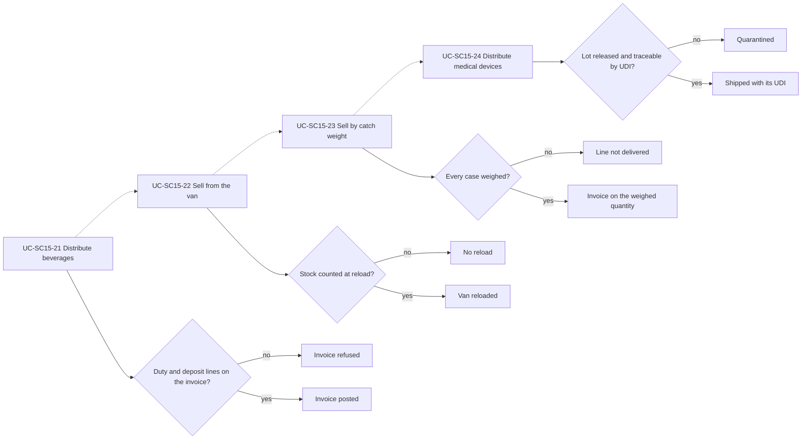
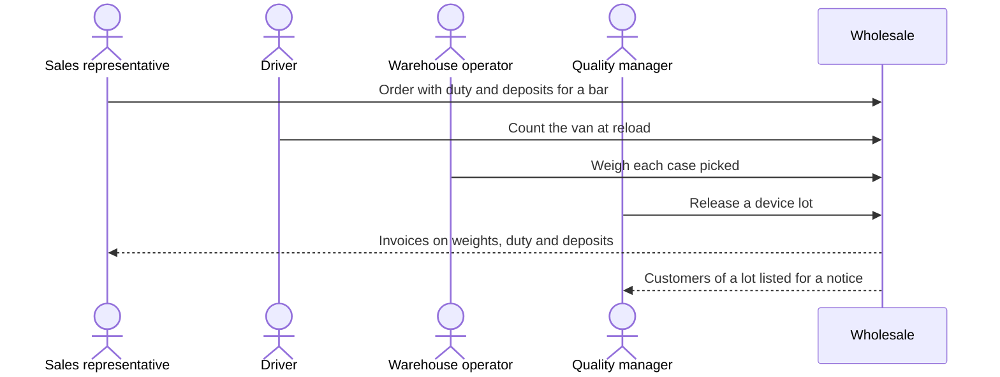

🏠 [Specs](../../../README.md) › 🏷️ [Sectors](../../README.md) › 📦 [SC15 Wholesale and distribution](../README.md) ›
🔀 [Flows](README.md) › 🔀 FL-SC15-06 Beverages, van sales, catch weight and medical devices

# 🔀 FL-SC15-06 Beverages, van sales, catch weight and medical devices

**Status:** 🔄 waiting for the owner

## Summary

Four situations of wholesalers that the sector had not covered: beverages with excise, deposits and equipment lent to
bars, sales from a van that is counted at each reload, food sold by catch weight and invoiced on the weighed quantity,
and medical devices traced by their UDI
([D559](../../../06-decisions/sectors/d559-benchmark-gaps-sc15-wholesale-and-distribution.md)).

## Personas

- [U42 Sales representative](../../../01-users/personas/u42-sales-representative.md), who sells beverages and runs the
  van round on the phone
- [U04 Purchasing and stock](../../../01-users/personas/u04-purchasing.md), who follows the loans, the counts and the
  supplies of devices
- [U15 Warehouse operator](../../../01-users/personas/u15-warehouse-operator.md), who weighs the cases at picking
- [U03 Sales](../../../01-users/personas/u03-sales.md), who prepares the weighted orders
- [U27 Quality manager](../../../01-users/personas/u27-quality-manager.md), who releases the device lots and runs the
  recalls

## Flowchart

## Sequence diagram

## Steps

| Step | Persona | Screen | Use case | What happens |
|---|---|---|---|---|
| 1 | [U42](../../../01-users/personas/u42-sales-representative.md) | [S-SC15-21](../screens/06-beverages-vans-weights-and-devices/s-sc15-21-beverage-distribution.md) | [UC-SC15-21](../use-cases/06-beverages-vans-weights-and-devices/uc-sc15-21-distribute-beverages.md) | The representative orders beverages for a bar and the invoice shows the duty and the deposits, with the equipment lent |
| 2 | [U42](../../../01-users/personas/u42-sales-representative.md) | [S-SC15-22](../screens/06-beverages-vans-weights-and-devices/s-sc15-22-van-sales.md) | [UC-SC15-22](../use-cases/06-beverages-vans-weights-and-devices/uc-sc15-22-sell-from-the-van.md) | The driver sells from the van, counts it on return and the manager reconciles the differences |
| 3 | [U15](../../../01-users/personas/u15-warehouse-operator.md) | [S-SC15-23](../screens/06-beverages-vans-weights-and-devices/s-sc15-23-catch-weight.md) | [UC-SC15-23](../use-cases/06-beverages-vans-weights-and-devices/uc-sc15-23-sell-by-catch-weight.md) | The operator weighs each case and the invoice is made on the weight delivered |
| 4 | [U04](../../../01-users/personas/u04-purchasing.md) | [S-SC15-24](../screens/06-beverages-vans-weights-and-devices/s-sc15-24-medical-devices.md) | [UC-SC15-24](../use-cases/06-beverages-vans-weights-and-devices/uc-sc15-24-distribute-medical-devices.md) | The quality manager releases each device lot and finds its customers if a notice arrives |

### Entities and screens

| Entity | States in this flow | Shown at step and screen | Aggregated view |
|---|---|---|---|
| [E-SC15-15 Bar loan](../data/e-sc15-15-bar-loan.md) | Lent, Returned, Lost | 1 [S-SC15-21](../screens/06-beverages-vans-weights-and-devices/s-sc15-21-beverage-distribution.md) | Bar loans |
| [E-SC15-16 Van stock](../data/e-sc15-16-van-stock.md) | Loaded, Counted, Reconciled | 2 [S-SC15-22](../screens/06-beverages-vans-weights-and-devices/s-sc15-22-van-sales.md) | Van stocks |
| [E-SC15-17 Device lot](../data/e-sc15-17-device-lot.md) | Received, Available, Quarantined, Distributed, Recalled | 4 [S-SC15-24](../screens/06-beverages-vans-weights-and-devices/s-sc15-24-medical-devices.md) | Device lots |

## Errors

- **E1 The lot is not traceable.** A shipment is attempted from a device lot that is quarantined, recalled or has no
  readable UDI: the shipment is refused and the lot's state is shown
  ([BR-SC15-19](../business-rules/br-sc15-19-every-lot-is-traceable-by-its-udi.md), step 4).

## Images

Every step and error, for each persona taking part, in light and dark mode (D120). Steps are numbered as in the Steps
table; E rows are the error cases.

| Step | Persona | Device | Light | Dark |
|---|---|---|---|---|
| 1 | U42 | phone | [light](../images/06-beverages-vans-weights-and-devices/u42-sales-representative/1-beverage-distribution-phone-light.png) | [dark](../images/06-beverages-vans-weights-and-devices/u42-sales-representative/1-beverage-distribution-phone-dark.png) |
| 1 | U04 | desktop | [light](../images/06-beverages-vans-weights-and-devices/u04-purchasing/1-beverage-distribution-desktop-light.png) | [dark](../images/06-beverages-vans-weights-and-devices/u04-purchasing/1-beverage-distribution-desktop-dark.png) |
| 1 | U42 | desktop | [light](../images/06-beverages-vans-weights-and-devices/u42-sales-representative/1-beverage-distribution-desktop-light.png) | [dark](../images/06-beverages-vans-weights-and-devices/u42-sales-representative/1-beverage-distribution-desktop-dark.png) |
| 1 | U42 | tablet | [light](../images/06-beverages-vans-weights-and-devices/u42-sales-representative/1-beverage-distribution-tablet-light.png) | [dark](../images/06-beverages-vans-weights-and-devices/u42-sales-representative/1-beverage-distribution-tablet-dark.png) |
| 2 | U42 | phone | [light](../images/06-beverages-vans-weights-and-devices/u42-sales-representative/2-van-sales-phone-light.png) | [dark](../images/06-beverages-vans-weights-and-devices/u42-sales-representative/2-van-sales-phone-dark.png) |
| 2 | U04 | desktop | [light](../images/06-beverages-vans-weights-and-devices/u04-purchasing/2-van-sales-desktop-light.png) | [dark](../images/06-beverages-vans-weights-and-devices/u04-purchasing/2-van-sales-desktop-dark.png) |
| 2 | U42 | desktop | [light](../images/06-beverages-vans-weights-and-devices/u42-sales-representative/2-van-sales-desktop-light.png) | [dark](../images/06-beverages-vans-weights-and-devices/u42-sales-representative/2-van-sales-desktop-dark.png) |
| 2 | U42 | tablet | [light](../images/06-beverages-vans-weights-and-devices/u42-sales-representative/2-van-sales-tablet-light.png) | [dark](../images/06-beverages-vans-weights-and-devices/u42-sales-representative/2-van-sales-tablet-dark.png) |
| 3 | U15 | phone | [light](../images/06-beverages-vans-weights-and-devices/u15-warehouse-operator/3-catch-weight-phone-light.png) | [dark](../images/06-beverages-vans-weights-and-devices/u15-warehouse-operator/3-catch-weight-phone-dark.png) |
| 3 | U03 | desktop | [light](../images/06-beverages-vans-weights-and-devices/u03-sales/3-catch-weight-desktop-light.png) | [dark](../images/06-beverages-vans-weights-and-devices/u03-sales/3-catch-weight-desktop-dark.png) |
| 3 | U15 | tablet | [light](../images/06-beverages-vans-weights-and-devices/u15-warehouse-operator/3-catch-weight-tablet-light.png) | [dark](../images/06-beverages-vans-weights-and-devices/u15-warehouse-operator/3-catch-weight-tablet-dark.png) |
| 4 | U04 | desktop | [light](../images/06-beverages-vans-weights-and-devices/u04-purchasing/4-medical-devices-desktop-light.png) | [dark](../images/06-beverages-vans-weights-and-devices/u04-purchasing/4-medical-devices-desktop-dark.png) |
| 4 | U27 | desktop | [light](../images/06-beverages-vans-weights-and-devices/u27-quality-manager/4-medical-devices-desktop-light.png) | [dark](../images/06-beverages-vans-weights-and-devices/u27-quality-manager/4-medical-devices-desktop-dark.png) |
| E1 | U42 | phone | [light](../images/06-beverages-vans-weights-and-devices/u42-sales-representative/e1-the-lot-is-not-traceable-phone-light.png) | [dark](../images/06-beverages-vans-weights-and-devices/u42-sales-representative/e1-the-lot-is-not-traceable-phone-dark.png) |
| E1 | U42 | desktop | [light](../images/06-beverages-vans-weights-and-devices/u42-sales-representative/e1-the-lot-is-not-traceable-desktop-light.png) | [dark](../images/06-beverages-vans-weights-and-devices/u42-sales-representative/e1-the-lot-is-not-traceable-desktop-dark.png) |
| E1 | U42 | tablet | [light](../images/06-beverages-vans-weights-and-devices/u42-sales-representative/e1-the-lot-is-not-traceable-tablet-light.png) | [dark](../images/06-beverages-vans-weights-and-devices/u42-sales-representative/e1-the-lot-is-not-traceable-tablet-dark.png) |

## Open questions

None.

---

⬅️ [FL-SC15-05 Sales force and performance](fl-sc15-05-sales-force-and-performance.md) · ⬆️ [Up](README.md)
