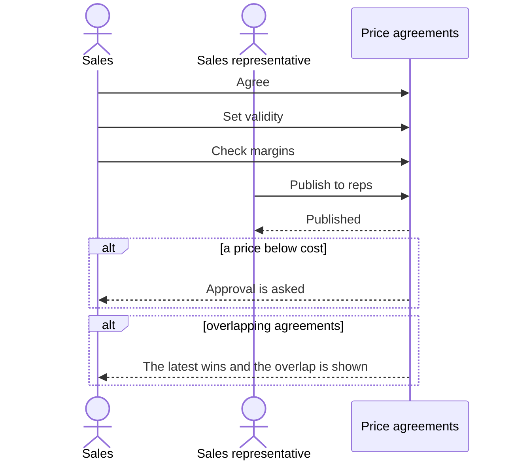

🏠 [Specs](../../../../README.md) › 🏷️ [Sectors](../../../README.md) ›
📦 [SC15 Wholesale and distribution](../../README.md) › 📝 [Use cases](../README.md) ›
📝 [Use cases: FL-SC15-01 Prices and agreements](README.md) › 📝 UC-SC15-01 Agree customer prices and tiers

# 📝 UC-SC15-01 Agree customer prices and tiers

**Status:** ✅ specified

## Summary

Sales agrees prices and tiers with a customer for a period and publishes them to reps and the portal; an order takes the
agreed price, then the tier, then the list price.

## Personas

- [U03 Sales](../../../../01-users/personas/u03-sales.md)
- [U42 Sales representative](../../../../01-users/personas/u42-sales-representative.md)

## Goal

Every order line at the agreed price.

## Trigger

A negotiation or a new year.

## Frequency

Yearly per customer, with changes.

## Preconditions

- The SC15 sector pack is installed for the company,
  [UC-F14-02](../../../../02-functional/f14-plugin-store/use-cases/01-find-and-install/uc-f14-02-install-a-plugin-or-sector-pack.md),
  and its users have their roles,
  [UC-F1-06](../../../../02-functional/f01-administration/use-cases/04-edit-a-role/uc-f01-06-edit-a-role-and-its-record-rules.md).

## Postconditions

- **Success:** the agreement is active and published.
- **Failed:** the old prices stay.

## Main flow

1. Sales records the agreement on
   [S-SC15-01 Price agreements](../../screens/01-prices-and-agreements/s-sc15-01-price-agreements.md),
   [UC-F6-12](../../../../02-functional/f06-customers-and-sales/use-cases/01-lead-to-quote/uc-f06-12-manage-price-lists-and-discounts.md).
2. Sales sets dates and tiers.
3. Lines below cost need approval,
   [BR-F6-04](../../../../02-functional/f06-customers-and-sales/business-rules/br-f06-04-large-discounts-need-approval.md).
4. Reps get the prices on their tablet ([BR-SC15-02](../../business-rules/br-sc15-02-price-from-the-agreement.md)).

## Alternative flows

- 1a. A group of customers: the agreement covers each member.

## Error flows

- 3e. A price below cost: approval is asked.
- 2e. Overlapping agreements: the latest wins and the overlap is shown.
- Any step: a call to a service or an outside system fails: it is retried first
  ([BR-F3-32](../../../../02-functional/f03-assistant/business-rules/br-f03-32-retry-before-an-error.md)), then the
  error message pattern ([D122](../../../../06-decisions/ux/d122-error-message-standard.md)) says what failed; what was
  typed is kept.

## Business rules

- [BR-SC15-02 Price from the agreement](../../business-rules/br-sc15-02-price-from-the-agreement.md)
- [BR-F6-04 Large discounts need approval](../../../../02-functional/f06-customers-and-sales/business-rules/br-f06-04-large-discounts-need-approval.md)

## Entities

- [E-SC15-01 Price agreement](../../data/e-sc15-01-price-agreement.md)

## Permissions

The sales and sales representative roles; the record rules of their role and site apply,
[UC-F1-06](../../../../02-functional/f01-administration/use-cases/04-edit-a-role/uc-f01-06-edit-a-role-and-its-record-rules.md).

## Notifications

None beyond the in-app updates of the records concerned.

## Audit events

Every creation, change and state change of price agreement records, with who, when and the values before and after (T3).

## AI involvement

The AI assistant answers questions on the price agreement records of this use case, with links, and prepares them as
drafts the user confirms. It works within the user's rights,
[BR-F3-34](../../../../02-functional/f03-assistant/business-rules/br-f03-34-every-capability-is-reachable-from-the-assistant.md),
and never deletes or does anything irreversible without the user's confirmation,
[BR-F3-07](../../../../02-functional/f03-assistant/business-rules/br-f03-07-no-deletes-no-irreversible-acts.md).

## API, MCP and A2A exposure

Through the API and webhooks (T5) and the MCP and A2A gateway (T6), with the caller's rights,
[BR-F3-34](../../../../02-functional/f03-assistant/business-rules/br-f03-34-every-capability-is-reachable-from-the-assistant.md),
reading, creating and changing the records of this use case; nothing irreversible without a person's confirmation.

## Screens

- [S-SC15-01 Price agreements](../../screens/01-prices-and-agreements/s-sc15-01-price-agreements.md)

## Flowchart

See [FL-SC15-01 Prices and agreements](../../flows/fl-sc15-01-prices-and-agreements.md#flowchart).

## Sequence diagram

## Acceptance criteria

1. **Given** the example wholesaler's Bistro Group agreement with 120 lines for 2027 **when** a rep orders a listed
   product **then** the line takes the agreed price.
2. **Given** a line 3 % under cost for Bistro Group **when** it is saved **then** approval is asked.

## Non-functional notes

[D408](../../../../06-decisions/technical/d408-performance-and-profiles.md)'s targets
([performance](../../../../05-non-functional/performance.md)): 95 % of screens within 1 second; lists paged on the
server, the first page within 1 second; reports within 5 seconds or in the background. WCAG 2.2 AA and RGAA
([D46](../../../../06-decisions/ux/d46-accessibility-standard.md)).

## Regulatory references

None specific to this use case; the sector's legal rules are listed in [SC15 regulatory](../../regulatory.md).

## Related use cases

- [UC-SC15-02 Manage rebates and year-end discounts](uc-sc15-02-manage-rebates-and-year-end-discounts.md)

## Open questions

None.

---

⬆️ [Up](README.md) ·
➡️ [UC-SC15-02 Manage rebates and year-end discounts](uc-sc15-02-manage-rebates-and-year-end-discounts.md)
