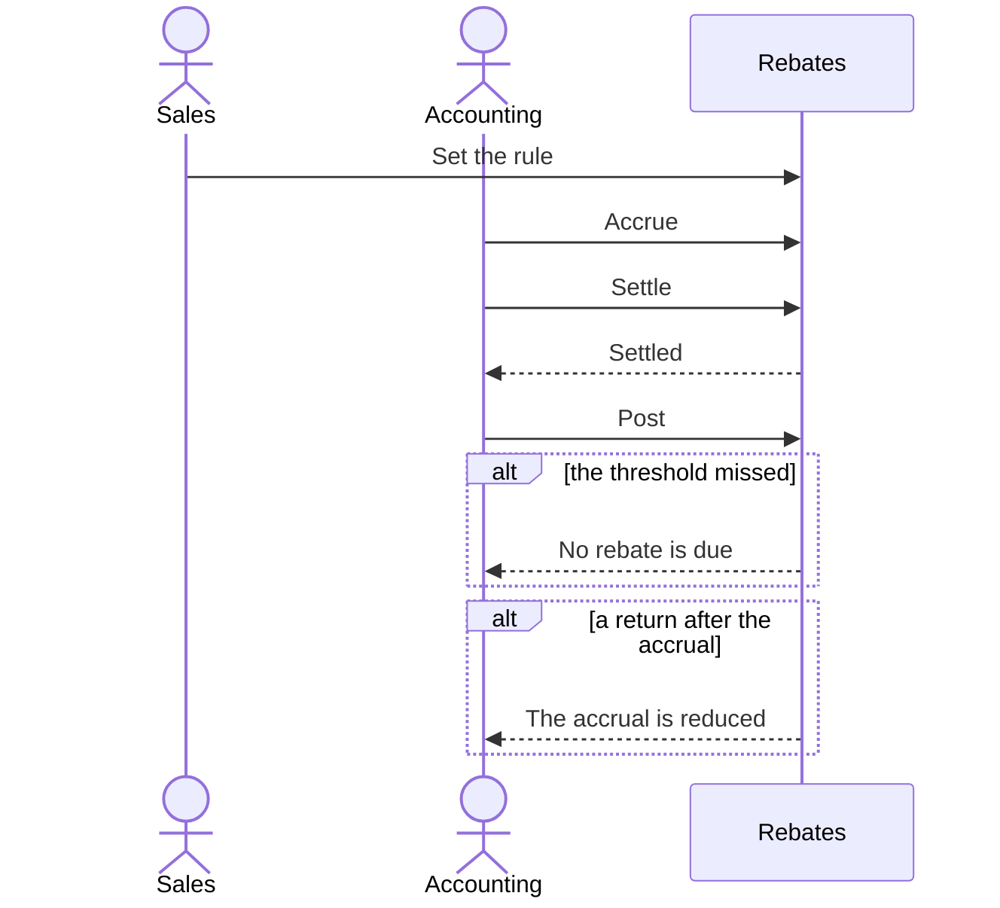

🏠 [Specs](../../../../README.md) › 🏷️ [Sectors](../../../README.md) ›
📦 [SC15 Wholesale and distribution](../../README.md) › 📝 [Use cases](../README.md) ›
📝 [Use cases: FL-SC15-01 Prices and agreements](README.md) › 📝 UC-SC15-02 Manage rebates and year-end discounts

# 📝 UC-SC15-02 Manage rebates and year-end discounts

**Status:** ✅ specified

## Summary

Sales sets rebate rules; simple-ERP accrues them as sales happen; accounting settles them at the agreed period.

## Personas

- [U03 Sales](../../../../01-users/personas/u03-sales.md)
- [U05 Accounting](../../../../01-users/personas/u05-accounting.md)

## Goal

Rebates accrued and settled as agreed.

## Trigger

A rebate agreement.

## Frequency

Accrued daily; settled yearly.

## Preconditions

- The SC15 sector pack is installed for the company,
  [UC-F14-02](../../../../02-functional/f14-plugin-store/use-cases/01-find-and-install/uc-f14-02-install-a-plugin-or-sector-pack.md),
  and its users have their roles,
  [UC-F1-06](../../../../02-functional/f01-administration/use-cases/04-edit-a-role/uc-f01-06-edit-a-role-and-its-record-rules.md).

## Postconditions

- **Success:** the rebate is settled by credit note.
- **Failed:** no rebate below the threshold.

## Main flow

1. Sales sets the rule on [S-SC15-02 Rebates](../../screens/01-prices-and-agreements/s-sc15-02-rebates.md).
2. Rebates accrue with sales ([BR-SC15-03](../../business-rules/br-sc15-03-rebates-accrued-and-settled.md)).
3. At period end, a credit note settles it,
   [UC-F6-09](../../../../02-functional/f06-customers-and-sales/use-cases/03-invoice-and-get-paid/uc-f06-09-credit-note-and-refund.md).
4. The accrual is reversed.

## Alternative flows

- 1a. A tiered rebate: the rate rises with turnover.

## Error flows

- 3e. The threshold missed: no rebate is due.
- 2e. A return after the accrual: the accrual is reduced.
- Any step: a call to a service or an outside system fails: it is retried first
  ([BR-F3-32](../../../../02-functional/f03-assistant/business-rules/br-f03-32-retry-before-an-error.md)), then the
  error message pattern ([D122](../../../../06-decisions/ux/d122-error-message-standard.md)) says what failed; what was
  typed is kept.

## Business rules

- [BR-SC15-03 Rebates accrued and settled](../../business-rules/br-sc15-03-rebates-accrued-and-settled.md)

## Entities

- [E-SC15-02 Rebate rule](../../data/e-sc15-02-rebate-rule.md)

## Permissions

The sales and accounting roles; the record rules of their role and site apply,
[UC-F1-06](../../../../02-functional/f01-administration/use-cases/04-edit-a-role/uc-f01-06-edit-a-role-and-its-record-rules.md).

## Notifications

None beyond the in-app updates of the records concerned.

## Audit events

Every creation, change and state change of rebate rule records, with who, when and the values before and after (T3).

## AI involvement

The AI assistant answers questions on the rebate rule records of this use case, with links, and prepares them as drafts
the user confirms. It works within the user's rights,
[BR-F3-34](../../../../02-functional/f03-assistant/business-rules/br-f03-34-every-capability-is-reachable-from-the-assistant.md),
and never deletes or does anything irreversible without the user's confirmation,
[BR-F3-07](../../../../02-functional/f03-assistant/business-rules/br-f03-07-no-deletes-no-irreversible-acts.md).

## API, MCP and A2A exposure

Through the API and webhooks (T5) and the MCP and A2A gateway (T6), with the caller's rights,
[BR-F3-34](../../../../02-functional/f03-assistant/business-rules/br-f03-34-every-capability-is-reachable-from-the-assistant.md),
reading, creating and changing the records of this use case; nothing irreversible without a person's confirmation.

## Screens

- [S-SC15-02 Rebates](../../screens/01-prices-and-agreements/s-sc15-02-rebates.md)

## Flowchart

See [FL-SC15-01 Prices and agreements](../../flows/fl-sc15-01-prices-and-agreements.md#flowchart).

## Sequence diagram

## Acceptance criteria

1. **Given** the example wholesaler's Bistro Group at 2 % over 500,000 EUR **when** turnover reaches 520,000 EUR
   **then** a credit note of 10,400 EUR settles it.
2. **Given** Bistro Group at 480,000 EUR with a 500,000 EUR threshold **when** the year is settled **then** no rebate is
   due.

## Non-functional notes

[D408](../../../../06-decisions/technical/d408-performance-and-profiles.md)'s targets
([performance](../../../../05-non-functional/performance.md)): 95 % of screens within 1 second; lists paged on the
server, the first page within 1 second; reports within 5 seconds or in the background. WCAG 2.2 AA and RGAA
([D46](../../../../06-decisions/ux/d46-accessibility-standard.md)).

## Regulatory references

Legal values from the France country pack:
[CR-FR-174 Discounts and later rebates on invoices](../../../../10-country-packs/france/invoicing/cr-fr-174-discounts-on-invoices.md).

## Related use cases

- [UC-SC15-15 Follow margins per customer, product and rep](../05-sales-force-and-performance/uc-sc15-15-follow-margins-per-customer-product-and-rep.md)

## Open questions

None.

---

⬅️ [UC-SC15-01 Agree customer prices and tiers](uc-sc15-01-agree-customer-prices-and-tiers.md) · ⬆️ [Up](README.md) ·
➡️ [UC-SC15-03](uc-sc15-03-negotiate-the-yearly-agreement-with-retailers.md)
