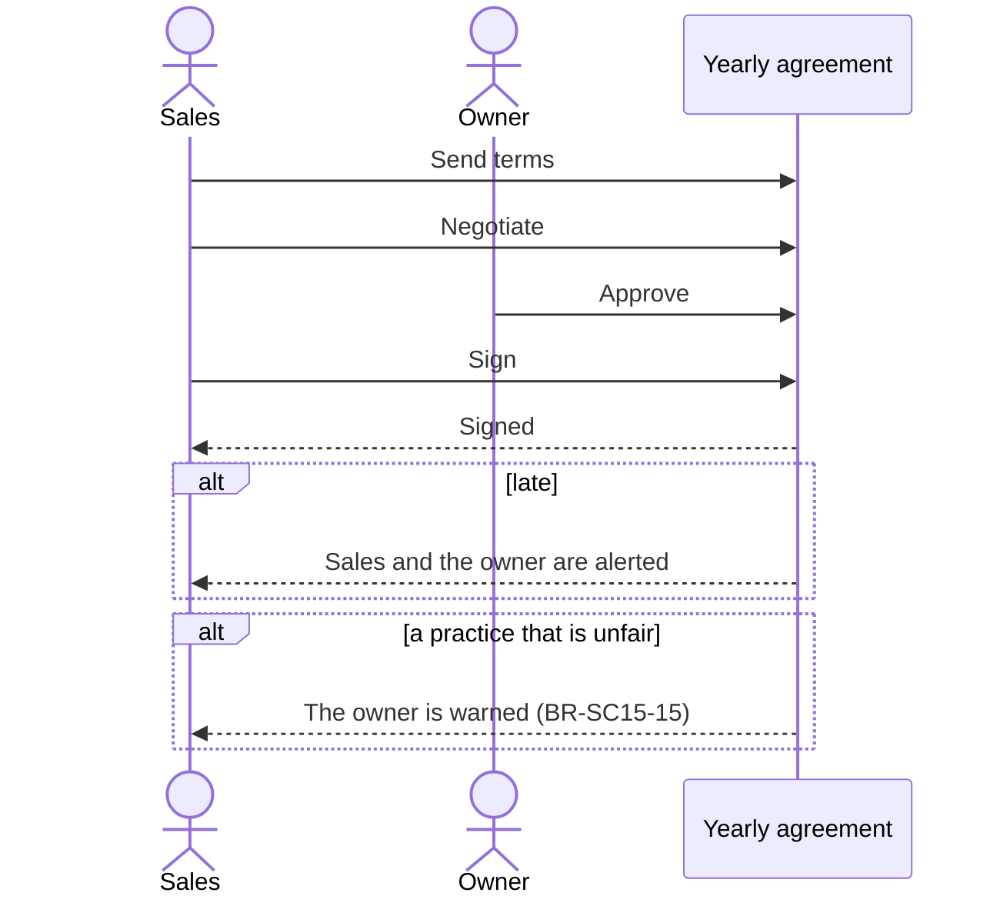

🏠 [Specs](../../../../README.md) › 🏷️ [Sectors](../../../README.md) ›
📦 [SC15 Wholesale and distribution](../../README.md) › 📝 [Use cases](../README.md) ›
📝 [Use cases: FL-SC15-01 Prices and agreements](README.md) › 📝 UC-SC15-03 Negotiate the yearly agreement with retailers

# 📝 UC-SC15-03 Negotiate the yearly agreement with retailers

**Status:** ✅ specified

## Summary

Sales sends general terms, negotiates and signs the yearly agreement with a retailer by the legal deadline; the owner
approves.

## Personas

- [U03 Sales](../../../../01-users/personas/u03-sales.md)
- [U13 Owner](../../../../01-users/personas/u13-owner.md)

## Goal

Agreements signed on time.

## Trigger

The yearly calendar.

## Frequency

Yearly per retailer.

## Preconditions

- The SC15 sector pack is installed for the company,
  [UC-F14-02](../../../../02-functional/f14-plugin-store/use-cases/01-find-and-install/uc-f14-02-install-a-plugin-or-sector-pack.md),
  and its users have their roles,
  [UC-F1-06](../../../../02-functional/f01-administration/use-cases/04-edit-a-role/uc-f01-06-edit-a-role-and-its-record-rules.md).

## Postconditions

- **Success:** the agreement is signed.
- **Failed:** lateness alerts.

## Main flow

1. Sales sends terms on
   [S-SC15-03 Yearly agreement](../../screens/01-prices-and-agreements/s-sc15-03-yearly-agreement.md).
2. Rounds are recorded.
3. The owner approves.
4. Both sign by the deadline ([BR-SC15-04](../../business-rules/br-sc15-04-yearly-agreement-on-time.md)).

## Alternative flows

- 4a. A 3-year agreement: it covers 3 years with yearly prices.

## Error flows

- 4e. Late: sales and the owner are alerted.
- 2e. A practice that is unfair: the owner is warned
  ([BR-SC15-15](../../business-rules/br-sc15-15-fair-dealing-with-partners.md)).
- Any step: a call to a service or an outside system fails: it is retried first
  ([BR-F3-32](../../../../02-functional/f03-assistant/business-rules/br-f03-32-retry-before-an-error.md)), then the
  error message pattern ([D122](../../../../06-decisions/ux/d122-error-message-standard.md)) says what failed; what was
  typed is kept.

## Business rules

- [BR-SC15-04 Yearly agreement on time](../../business-rules/br-sc15-04-yearly-agreement-on-time.md)
- [BR-SC15-15 Fair dealing with partners](../../business-rules/br-sc15-15-fair-dealing-with-partners.md)

## Entities

- [E-SC15-03 Yearly agreement](../../data/e-sc15-03-yearly-agreement.md)

## Permissions

The sales and owner roles; the record rules of their role and site apply,
[UC-F1-06](../../../../02-functional/f01-administration/use-cases/04-edit-a-role/uc-f01-06-edit-a-role-and-its-record-rules.md).

## Notifications

None beyond the in-app updates of the records concerned.

## Audit events

Every creation, change and state change of yearly agreement records, with who, when and the values before and after
(T3).

## AI involvement

The AI assistant answers questions on the yearly agreement records of this use case, with links, and prepares them as
drafts the user confirms. It works within the user's rights,
[BR-F3-34](../../../../02-functional/f03-assistant/business-rules/br-f03-34-every-capability-is-reachable-from-the-assistant.md),
and never deletes or does anything irreversible without the user's confirmation,
[BR-F3-07](../../../../02-functional/f03-assistant/business-rules/br-f03-07-no-deletes-no-irreversible-acts.md).

## API, MCP and A2A exposure

Through the API and webhooks (T5) and the MCP and A2A gateway (T6), with the caller's rights,
[BR-F3-34](../../../../02-functional/f03-assistant/business-rules/br-f03-34-every-capability-is-reachable-from-the-assistant.md),
reading, creating and changing the records of this use case; nothing irreversible without a person's confirmation.

## Screens

- [S-SC15-03 Yearly agreement](../../screens/01-prices-and-agreements/s-sc15-03-yearly-agreement.md)

## Flowchart

See [FL-SC15-01 Prices and agreements](../../flows/fl-sc15-01-prices-and-agreements.md#flowchart).

## Sequence diagram

## Acceptance criteria

1. **Given** the example wholesaler's terms sent on 28 November **when** it is signed on 26 February **then** the
   agreement is on time.
2. **Given** Acme and MegaMart's 2027 agreement unsigned in late February **when** the deadline nears **then** sales and
   the owner are alerted.

## Non-functional notes

[D408](../../../../06-decisions/technical/d408-performance-and-profiles.md)'s targets
([performance](../../../../05-non-functional/performance.md)): 95 % of screens within 1 second; lists paged on the
server, the first page within 1 second; reports within 5 seconds or in the background. WCAG 2.2 AA and RGAA
([D46](../../../../06-decisions/ux/d46-accessibility-standard.md)).

## Regulatory references

Legal values from the France country pack:
[CR-FR-171 Yearly written agreement between supplier and distributor](../../../../10-country-packs/france/trade/cr-fr-171-supplier-distributor-agreement.md),
[CR-FR-175 Unfair practices between businesses](../../../../10-country-packs/france/trade/cr-fr-175-unfair-b2b-practices.md).

## Related use cases

- [UC-SC15-11 Run supplier promotions and listing fees](uc-sc15-11-run-supplier-promotions-and-listing-fees.md)

## Open questions

None.

---

⬅️ [UC-SC15-02 Manage rebates and year-end discounts](uc-sc15-02-manage-rebates-and-year-end-discounts.md) ·
⬆️ [Up](README.md) ·
➡️ [UC-SC15-04 Take orders by EDI from retailers](../02-orders/uc-sc15-04-take-orders-by-edi-from-retailers.md)
