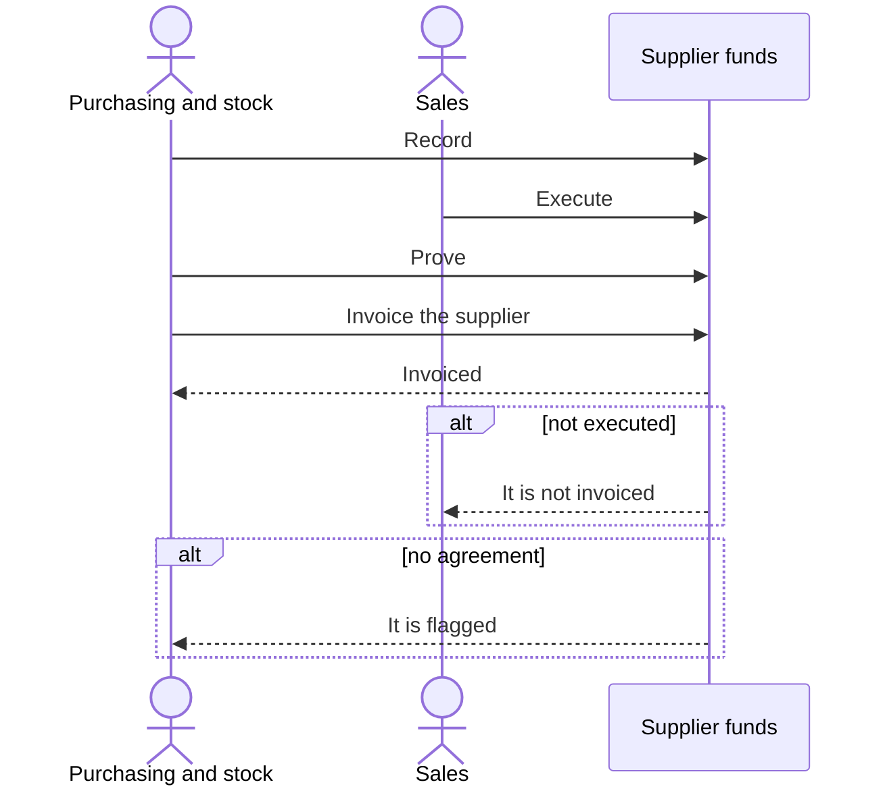

🏠 [Specs](../../../../README.md) › 🏷️ [Sectors](../../../README.md) ›
📦 [SC15 Wholesale and distribution](../../README.md) › 📝 [Use cases](../README.md) ›
📝 [Use cases: FL-SC15-01 Prices and agreements](README.md) › 📝 UC-SC15-11 Run supplier promotions and listing fees

# 📝 UC-SC15-11 Run supplier promotions and listing fees

**Status:** ✅ specified

## Summary

Purchasing records supplier funds, sales executes the promotions, and the supplier is invoiced as agreed.

## Personas

- [U04 Purchasing and stock](../../../../01-users/personas/u04-purchasing.md)
- [U03 Sales](../../../../01-users/personas/u03-sales.md)

## Goal

Supplier funds earned and invoiced.

## Trigger

A supplier promotion.

## Frequency

Monthly.

## Preconditions

- The SC15 sector pack is installed for the company,
  [UC-F14-02](../../../../02-functional/f14-plugin-store/use-cases/01-find-and-install/uc-f14-02-install-a-plugin-or-sector-pack.md),
  and its users have their roles,
  [UC-F1-06](../../../../02-functional/f01-administration/use-cases/04-edit-a-role/uc-f01-06-edit-a-role-and-its-record-rules.md).

## Postconditions

- **Success:** the supplier is invoiced.
- **Failed:** nothing is invoiced.

## Main flow

1. Purchasing records the fund on
   [S-SC15-11 Supplier funds](../../screens/01-prices-and-agreements/s-sc15-11-supplier-funds.md).
2. Sales runs the promotion.
3. Proof of execution is attached ([BR-SC15-12](../../business-rules/br-sc15-12-supplier-funds-tracked.md)).
4. The supplier is invoiced.

## Alternative flows

- 2a. A promotion in the B2B portal: it shows on the portal.

## Error flows

- 2e. Not executed: it is not invoiced.
- 4e. No agreement: it is flagged.
- Any step: a call to a service or an outside system fails: it is retried first
  ([BR-F3-32](../../../../02-functional/f03-assistant/business-rules/br-f03-32-retry-before-an-error.md)), then the
  error message pattern ([D122](../../../../06-decisions/ux/d122-error-message-standard.md)) says what failed; what was
  typed is kept.

## Business rules

- [BR-SC15-12 Supplier funds tracked](../../business-rules/br-sc15-12-supplier-funds-tracked.md)

## Entities

- [E-SC15-08 Supplier fund](../../data/e-sc15-08-supplier-fund.md)

## Permissions

The purchasing and stock and sales roles; the record rules of their role and site apply,
[UC-F1-06](../../../../02-functional/f01-administration/use-cases/04-edit-a-role/uc-f01-06-edit-a-role-and-its-record-rules.md).

## Notifications

None beyond the in-app updates of the records concerned.

## Audit events

Every creation, change and state change of supplier fund records, with who, when and the values before and after (T3).

## AI involvement

The AI assistant answers questions on the supplier fund records of this use case, with links, and prepares them as
drafts the user confirms. It works within the user's rights,
[BR-F3-34](../../../../02-functional/f03-assistant/business-rules/br-f03-34-every-capability-is-reachable-from-the-assistant.md),
and never deletes or does anything irreversible without the user's confirmation,
[BR-F3-07](../../../../02-functional/f03-assistant/business-rules/br-f03-07-no-deletes-no-irreversible-acts.md).

## API, MCP and A2A exposure

Through the API and webhooks (T5) and the MCP and A2A gateway (T6), with the caller's rights,
[BR-F3-34](../../../../02-functional/f03-assistant/business-rules/br-f03-34-every-capability-is-reachable-from-the-assistant.md),
reading, creating and changing the records of this use case; nothing irreversible without a person's confirmation.

## Screens

- [S-SC15-11 Supplier funds](../../screens/01-prices-and-agreements/s-sc15-11-supplier-funds.md)

## Flowchart

See [FL-SC15-01 Prices and agreements](../../flows/fl-sc15-01-prices-and-agreements.md#flowchart).

## Sequence diagram

## Acceptance criteria

1. **Given** the example wholesaler's Acme listing fee of 3,000 EUR **when** it is executed **then** Acme is invoiced
   3,000 EUR.
2. **Given** Acme's promotion not run **when** the period ends **then** it is not invoiced.

## Non-functional notes

[D408](../../../../06-decisions/technical/d408-performance-and-profiles.md)'s targets
([performance](../../../../05-non-functional/performance.md)): 95 % of screens within 1 second; lists paged on the
server, the first page within 1 second; reports within 5 seconds or in the background. WCAG 2.2 AA and RGAA
([D46](../../../../06-decisions/ux/d46-accessibility-standard.md)).

## Regulatory references

None specific to this use case; the sector's legal rules are listed in [SC15 regulatory](../../regulatory.md).

## Related use cases

- [UC-SC15-03 Negotiate the yearly agreement with retailers](uc-sc15-03-negotiate-the-yearly-agreement-with-retailers.md)

## Open questions

None.

---

⬅️ [UC-SC15-10 Manage returns and credit notes](../03-warehouse/uc-sc15-10-manage-returns-and-credit-notes.md) ·
⬆️ [Up](README.md) · ➡️ [UC-SC15-12 Import goods](../04-import-and-suppliers/uc-sc15-12-import-goods.md)
