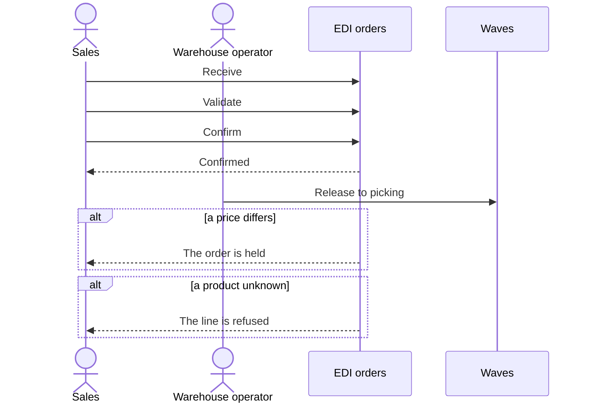

🏠 [Specs](../../../../README.md) › 🏷️ [Sectors](../../../README.md) ›
📦 [SC15 Wholesale and distribution](../../README.md) › 📝 [Use cases](../README.md) ›
📝 [Use cases: FL-SC15-02 Orders](README.md) › 📝 UC-SC15-04 Take orders by EDI from retailers

# 📝 UC-SC15-04 Take orders by EDI from retailers

**Status:** ✅ specified

## Summary

Sales receives EDI orders, simple-ERP validates them against the agreement and catalogue, and confirms them.

## Personas

- [U03 Sales](../../../../01-users/personas/u03-sales.md)
- [U15 Warehouse operator](../../../../01-users/personas/u15-warehouse-operator.md)

## Goal

EDI orders accepted at the right prices.

## Trigger

An EDI order.

## Frequency

Many a day.

## Preconditions

- The SC15 sector pack is installed for the company,
  [UC-F14-02](../../../../02-functional/f14-plugin-store/use-cases/01-find-and-install/uc-f14-02-install-a-plugin-or-sector-pack.md),
  and its users have their roles,
  [UC-F1-06](../../../../02-functional/f01-administration/use-cases/04-edit-a-role/uc-f01-06-edit-a-role-and-its-record-rules.md).

## Postconditions

- **Success:** the order is confirmed.
- **Failed:** it is held.

## Main flow

1. The order arrives on [S-SC15-04 EDI orders](../../screens/02-orders/s-sc15-04-edi-orders.md) through EDI (T12).
2. Prices and products are checked ([BR-SC15-05](../../business-rules/br-sc15-05-edi-orders-validated.md)).
3. The confirmation goes back.
4. The order goes to the next wave ([UC-SC15-08](../03-warehouse/uc-sc15-08-pick-in-waves-and-cross-dock.md)).

## Alternative flows

- 3a. A despatch advice: it is sent at shipping.

## Error flows

- 2e. A price differs: the order is held.
- 2f. A product unknown: the line is refused.
- Any step: a call to a service or an outside system fails: it is retried first
  ([BR-F3-32](../../../../02-functional/f03-assistant/business-rules/br-f03-32-retry-before-an-error.md)), then the
  error message pattern ([D122](../../../../06-decisions/ux/d122-error-message-standard.md)) says what failed; what was
  typed is kept.

## Business rules

- [BR-SC15-05 EDI orders validated](../../business-rules/br-sc15-05-edi-orders-validated.md)

## Entities

- [E-SC15-04 Sales order](../../data/e-sc15-04-sales-order.md)

## Permissions

The sales and warehouse operator roles; the record rules of their role and site apply,
[UC-F1-06](../../../../02-functional/f01-administration/use-cases/04-edit-a-role/uc-f01-06-edit-a-role-and-its-record-rules.md).

## Notifications

None beyond the in-app updates of the records concerned.

## Audit events

Every creation, change and state change of sales order records, with who, when and the values before and after (T3).

## AI involvement

The AI assistant answers questions on the sales order records of this use case, with links, and prepares them as drafts
the user confirms. It works within the user's rights,
[BR-F3-34](../../../../02-functional/f03-assistant/business-rules/br-f03-34-every-capability-is-reachable-from-the-assistant.md),
and never deletes or does anything irreversible without the user's confirmation,
[BR-F3-07](../../../../02-functional/f03-assistant/business-rules/br-f03-07-no-deletes-no-irreversible-acts.md).

## API, MCP and A2A exposure

Through the API and webhooks (T5) and the MCP and A2A gateway (T6), with the caller's rights,
[BR-F3-34](../../../../02-functional/f03-assistant/business-rules/br-f03-34-every-capability-is-reachable-from-the-assistant.md),
reading, creating and changing the records of this use case; nothing irreversible without a person's confirmation.

## Screens

- [S-SC15-04 EDI orders](../../screens/02-orders/s-sc15-04-edi-orders.md)
- [S-SC15-08 Waves](../../screens/02-orders/s-sc15-08-waves.md)

## Flowchart

See [FL-SC15-02 Orders](../../flows/fl-sc15-02-orders.md#flowchart).

## Sequence diagram

## Acceptance criteria

1. **Given** the example wholesaler's MegaMart order at the agreed prices **when** it is validated **then** it is
   confirmed by EDI.
2. **Given** MegaMart ordering at 2.10 EUR with 2.25 EUR agreed **when** it is validated **then** the order is held.

## Non-functional notes

[D408](../../../../06-decisions/technical/d408-performance-and-profiles.md)'s targets
([performance](../../../../05-non-functional/performance.md)): 95 % of screens within 1 second; lists paged on the
server, the first page within 1 second; reports within 5 seconds or in the background. WCAG 2.2 AA and RGAA
([D46](../../../../06-decisions/ux/d46-accessibility-standard.md)).

## Regulatory references

None specific to this use case; the sector's legal rules are listed in [SC15 regulatory](../../regulatory.md).

## Related use cases

- [UC-SC15-06 Handle back-orders and partial deliveries](uc-sc15-06-handle-back-orders-and-partial-deliveries.md)

## Open questions

None.

---

⬅️ [UC-SC15-03](../01-prices-and-agreements/uc-sc15-03-negotiate-the-yearly-agreement-with-retailers.md) ·
⬆️ [Up](README.md) · ➡️ [UC-SC15-05 Take orders on the road, offline](uc-sc15-05-take-orders-on-the-road-offline.md)
