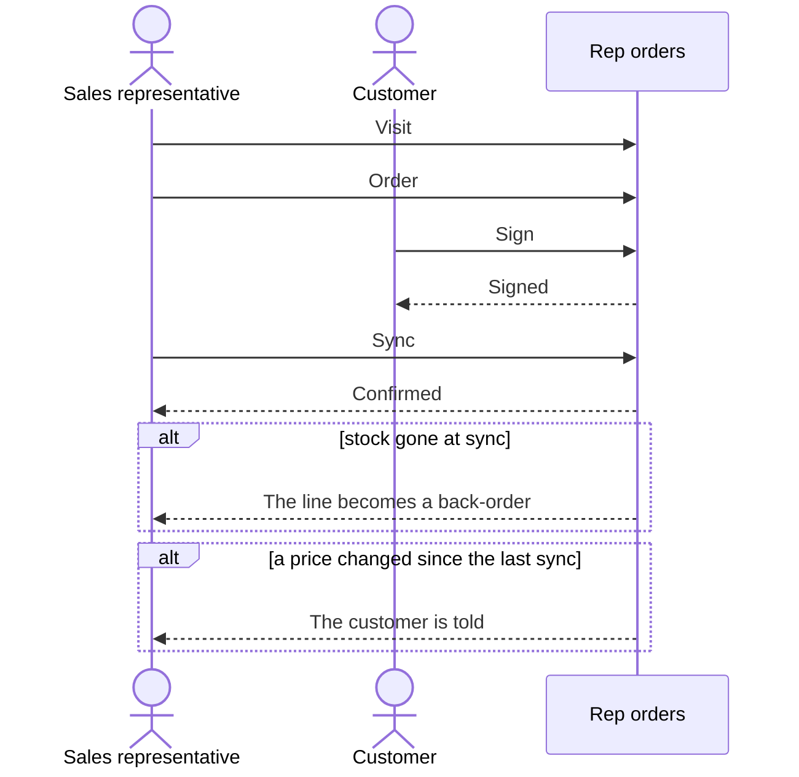

🏠 [Specs](../../../../README.md) › 🏷️ [Sectors](../../../README.md) ›
📦 [SC15 Wholesale and distribution](../../README.md) › 📝 [Use cases](../README.md) ›
📝 [Use cases: FL-SC15-02 Orders](README.md) › 📝 UC-SC15-05 Take orders on the road, offline

# 📝 UC-SC15-05 Take orders on the road, offline

**Status:** ✅ specified

## Summary

The sales representative visits customers and takes orders on the tablet offline, using the shared offline order
capability; orders sync and are rechecked.

## Personas

- [U42 Sales representative](../../../../01-users/personas/u42-sales-representative.md)
- [U09 Customer](../../../../01-users/personas/u09-customer.md)

## Goal

Orders taken anywhere.

## Trigger

A visit.

## Frequency

Daily per rep.

## Preconditions

- The SC15 sector pack is installed for the company,
  [UC-F14-02](../../../../02-functional/f14-plugin-store/use-cases/01-find-and-install/uc-f14-02-install-a-plugin-or-sector-pack.md),
  and its users have their roles,
  [UC-F1-06](../../../../02-functional/f01-administration/use-cases/04-edit-a-role/uc-f01-06-edit-a-role-and-its-record-rules.md).

## Postconditions

- **Success:** the order syncs and is confirmed.
- **Failed:** the order waits on the tablet.

## Main flow

1. The rep opens the customer on [S-SC15-05 Rep orders](../../screens/02-orders/s-sc15-05-rep-orders.md).
2. The rep takes the order offline,
   [UC-F6-21](../../../../02-functional/f06-customers-and-sales/use-cases/09-sell-on-the-road-and-steer-sales/uc-f06-21-take-orders-offline-on-the-road.md).
3. The customer signs on the tablet.
4. The order syncs and is rechecked,
   [BR-F6-14](../../../../02-functional/f06-customers-and-sales/business-rules/br-f06-14-offline-orders-are-checked-again-on-sync.md).

## Alternative flows

- 3a. No signature: the order goes as the rep's.

## Error flows

- 4e. Stock gone at sync: the line becomes a back-order.
- 4f. A price changed since the last sync: the customer is told.
- Any step: a call to a service or an outside system fails: it is retried first
  ([BR-F3-32](../../../../02-functional/f03-assistant/business-rules/br-f03-32-retry-before-an-error.md)), then the
  error message pattern ([D122](../../../../06-decisions/ux/d122-error-message-standard.md)) says what failed; what was
  typed is kept.

## Business rules

- [BR-SC15-06 Offline orders synced](../../business-rules/br-sc15-06-offline-orders-synced.md)
- [BR-SC15-02 Price from the agreement](../../business-rules/br-sc15-02-price-from-the-agreement.md)
- [BR-F6-14 Offline orders are checked again on sync](../../../../02-functional/f06-customers-and-sales/business-rules/br-f06-14-offline-orders-are-checked-again-on-sync.md)

## Entities

- [E-SC15-04 Sales order](../../data/e-sc15-04-sales-order.md)

## Permissions

The sales representative and customer roles; the record rules of their role and site apply,
[UC-F1-06](../../../../02-functional/f01-administration/use-cases/04-edit-a-role/uc-f01-06-edit-a-role-and-its-record-rules.md).

## Notifications

None beyond the in-app updates of the records concerned.

## Audit events

Every creation, change and state change of sales order records, with who, when and the values before and after (T3).

## AI involvement

The AI assistant answers questions on the sales order records of this use case, with links, and prepares them as drafts
the user confirms. It works within the user's rights,
[BR-F3-34](../../../../02-functional/f03-assistant/business-rules/br-f03-34-every-capability-is-reachable-from-the-assistant.md),
and never deletes or does anything irreversible without the user's confirmation,
[BR-F3-07](../../../../02-functional/f03-assistant/business-rules/br-f03-07-no-deletes-no-irreversible-acts.md).

## API, MCP and A2A exposure

Through the API and webhooks (T5) and the MCP and A2A gateway (T6), with the caller's rights,
[BR-F3-34](../../../../02-functional/f03-assistant/business-rules/br-f03-34-every-capability-is-reachable-from-the-assistant.md),
reading, creating and changing the records of this use case; nothing irreversible without a person's confirmation.

## Screens

- [S-SC15-05 Rep orders](../../screens/02-orders/s-sc15-05-rep-orders.md)

## Flowchart

See [FL-SC15-02 Orders](../../flows/fl-sc15-02-orders.md#flowchart).

## Sequence diagram

## Acceptance criteria

1. **Given** the example wholesaler's rep at Bistro Lyon 2 with no network **when** an order of 14 lines is taken
   **then** it waits on the tablet and syncs later.
2. **Given** 6 cases of oil sold out before sync **when** the order syncs **then** the line becomes a back-order.

## Non-functional notes

Works offline on the tablet,
[UC-F6-21](../../../../02-functional/f06-customers-and-sales/use-cases/09-sell-on-the-road-and-steer-sales/uc-f06-21-take-orders-offline-on-the-road.md).
[D408](../../../../06-decisions/technical/d408-performance-and-profiles.md)'s targets
([performance](../../../../05-non-functional/performance.md)): 95 % of screens within 1 second; lists paged on the
server, the first page within 1 second; reports within 5 seconds or in the background. WCAG 2.2 AA and RGAA
([D46](../../../../06-decisions/ux/d46-accessibility-standard.md)).

## Regulatory references

None specific to this use case; the sector's legal rules are listed in [SC15 regulatory](../../regulatory.md).

## Related use cases

- [UC-SC15-06 Handle back-orders and partial deliveries](uc-sc15-06-handle-back-orders-and-partial-deliveries.md)

## Open questions

None.

---

⬅️ [UC-SC15-04 Take orders by EDI from retailers](uc-sc15-04-take-orders-by-edi-from-retailers.md) ·
⬆️ [Up](README.md) ·
➡️ [UC-SC15-06 Handle back-orders and partial deliveries](uc-sc15-06-handle-back-orders-and-partial-deliveries.md)
