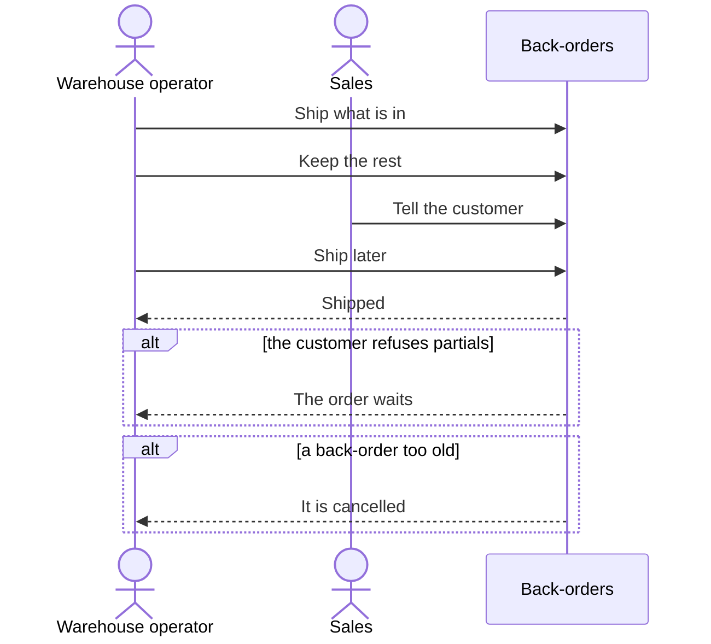

🏠 [Specs](../../../../README.md) › 🏷️ [Sectors](../../../README.md) ›
📦 [SC15 Wholesale and distribution](../../README.md) › 📝 [Use cases](../README.md) ›
📝 [Use cases: FL-SC15-02 Orders](README.md) › 📝 UC-SC15-06 Handle back-orders and partial deliveries

# 📝 UC-SC15-06 Handle back-orders and partial deliveries

**Status:** ✅ specified

## Summary

The warehouse ships what is in stock and keeps the rest as a back-order, unless the customer refuses partials.

## Personas

- [U15 Warehouse operator](../../../../01-users/personas/u15-warehouse-operator.md)
- [U03 Sales](../../../../01-users/personas/u03-sales.md)

## Goal

Customers served as soon as possible.

## Trigger

A short pick.

## Frequency

Daily.

## Preconditions

- The SC15 sector pack is installed for the company,
  [UC-F14-02](../../../../02-functional/f14-plugin-store/use-cases/01-find-and-install/uc-f14-02-install-a-plugin-or-sector-pack.md),
  and its users have their roles,
  [UC-F1-06](../../../../02-functional/f01-administration/use-cases/04-edit-a-role/uc-f01-06-edit-a-role-and-its-record-rules.md).

## Postconditions

- **Success:** the rest ships later.
- **Failed:** the order waits.

## Main flow

1. The warehouse ships on [S-SC15-06 Back-orders](../../screens/02-orders/s-sc15-06-back-orders.md).
2. The rest is a back-order ([BR-SC15-07](../../business-rules/br-sc15-07-back-orders-kept-or-cancelled.md)).
3. Sales tells the customer.
4. The back-order ships on receipt.

## Alternative flows

- 2a. A cancel date: back-orders cancel after it.

## Error flows

- 1e. The customer refuses partials: the order waits.
- 4e. A back-order too old: it is cancelled.
- Any step: a call to a service or an outside system fails: it is retried first
  ([BR-F3-32](../../../../02-functional/f03-assistant/business-rules/br-f03-32-retry-before-an-error.md)), then the
  error message pattern ([D122](../../../../06-decisions/ux/d122-error-message-standard.md)) says what failed; what was
  typed is kept.

## Business rules

- [BR-SC15-07 Back-orders kept or cancelled](../../business-rules/br-sc15-07-back-orders-kept-or-cancelled.md)

## Entities

- [E-SC15-04 Sales order](../../data/e-sc15-04-sales-order.md)

## Permissions

The warehouse operator and sales roles; the record rules of their role and site apply,
[UC-F1-06](../../../../02-functional/f01-administration/use-cases/04-edit-a-role/uc-f01-06-edit-a-role-and-its-record-rules.md).

## Notifications

None beyond the in-app updates of the records concerned.

## Audit events

Every creation, change and state change of sales order records, with who, when and the values before and after (T3).

## AI involvement

The AI assistant answers questions on the sales order records of this use case, with links, and prepares them as drafts
the user confirms. It works within the user's rights,
[BR-F3-34](../../../../02-functional/f03-assistant/business-rules/br-f03-34-every-capability-is-reachable-from-the-assistant.md),
and never deletes or does anything irreversible without the user's confirmation,
[BR-F3-07](../../../../02-functional/f03-assistant/business-rules/br-f03-07-no-deletes-no-irreversible-acts.md).

## API, MCP and A2A exposure

Through the API and webhooks (T5) and the MCP and A2A gateway (T6), with the caller's rights,
[BR-F3-34](../../../../02-functional/f03-assistant/business-rules/br-f03-34-every-capability-is-reachable-from-the-assistant.md),
reading, creating and changing the records of this use case; nothing irreversible without a person's confirmation.

## Screens

- [S-SC15-06 Back-orders](../../screens/02-orders/s-sc15-06-back-orders.md)

## Flowchart

See [FL-SC15-02 Orders](../../flows/fl-sc15-02-orders.md#flowchart).

## Sequence diagram

## Acceptance criteria

1. **Given** the example wholesaler's 14-line order with 1 line short **when** it ships **then** 13 lines ship and 1
   stays a back-order.
2. **Given** Bistro Group refusing partials **when** 1 line is short **then** the order waits.

## Non-functional notes

[D408](../../../../06-decisions/technical/d408-performance-and-profiles.md)'s targets
([performance](../../../../05-non-functional/performance.md)): 95 % of screens within 1 second; lists paged on the
server, the first page within 1 second; reports within 5 seconds or in the background. WCAG 2.2 AA and RGAA
([D46](../../../../06-decisions/ux/d46-accessibility-standard.md)).

## Regulatory references

None specific to this use case; the sector's legal rules are listed in [SC15 regulatory](../../regulatory.md).

## Related use cases

- [UC-SC15-08 Pick in waves and cross-dock](../03-warehouse/uc-sc15-08-pick-in-waves-and-cross-dock.md)

## Open questions

None.

---

⬅️ [UC-SC15-05 Take orders on the road, offline](uc-sc15-05-take-orders-on-the-road-offline.md) · ⬆️ [Up](README.md) ·
➡️ [UC-SC15-07 Drop-ship from suppliers](uc-sc15-07-drop-ship-from-suppliers.md)
