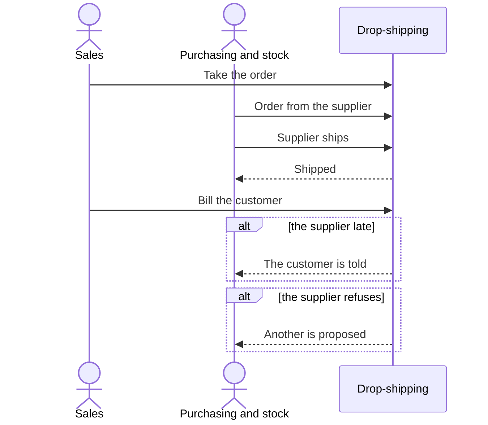

🏠 [Specs](../../../../README.md) › 🏷️ [Sectors](../../../README.md) ›
📦 [SC15 Wholesale and distribution](../../README.md) › 📝 [Use cases](../README.md) ›
📝 [Use cases: FL-SC15-02 Orders](README.md) › 📝 UC-SC15-07 Drop-ship from suppliers

# 📝 UC-SC15-07 Drop-ship from suppliers

**Status:** ✅ specified

## Summary

Purchasing orders from the supplier who ships to the customer; sales bills the customer.

## Personas

- [U04 Purchasing and stock](../../../../01-users/personas/u04-purchasing.md)
- [U03 Sales](../../../../01-users/personas/u03-sales.md)

## Goal

Products the wholesaler does not stock still sold.

## Trigger

An order for a drop-shipped product.

## Frequency

Weekly.

## Preconditions

- The SC15 sector pack is installed for the company,
  [UC-F14-02](../../../../02-functional/f14-plugin-store/use-cases/01-find-and-install/uc-f14-02-install-a-plugin-or-sector-pack.md),
  and its users have their roles,
  [UC-F1-06](../../../../02-functional/f01-administration/use-cases/04-edit-a-role/uc-f01-06-edit-a-role-and-its-record-rules.md).

## Postconditions

- **Success:** the customer is billed.
- **Failed:** the customer is told of delay.

## Main flow

1. Sales takes the order on [S-SC15-07 Drop-shipping](../../screens/02-orders/s-sc15-07-drop-shipping.md).
2. A purchase goes to the supplier,
   [UC-F7-02](../../../../02-functional/f07-purchasing-and-stock/use-cases/01-procure/uc-f07-02-order-from-a-supplier.md).
3. The supplier ships and sends tracking.
4. The customer is billed.

## Alternative flows

- 3a. Tracking from the supplier: the customer sees it on the portal.

## Error flows

- 3e. The supplier late: the customer is told.
- 2e. The supplier refuses: another is proposed.
- Any step: a call to a service or an outside system fails: it is retried first
  ([BR-F3-32](../../../../02-functional/f03-assistant/business-rules/br-f03-32-retry-before-an-error.md)), then the
  error message pattern ([D122](../../../../06-decisions/ux/d122-error-message-standard.md)) says what failed; what was
  typed is kept.

## Business rules

- [BR-SC15-02 Price from the agreement](../../business-rules/br-sc15-02-price-from-the-agreement.md)

## Entities

- [E-SC15-04 Sales order](../../data/e-sc15-04-sales-order.md)
- [E-SC15-06 Purchase proposal](../../data/e-sc15-06-purchase-proposal.md)

## Permissions

The purchasing and stock and sales roles; the record rules of their role and site apply,
[UC-F1-06](../../../../02-functional/f01-administration/use-cases/04-edit-a-role/uc-f01-06-edit-a-role-and-its-record-rules.md).

## Notifications

None beyond the in-app updates of the records concerned.

## Audit events

Every creation, change and state change of sales order, purchase proposal records, with who, when and the values before
and after (T3).

## AI involvement

The AI assistant answers questions on the sales order, purchase proposal records of this use case, with links, and
prepares them as drafts the user confirms. It works within the user's rights,
[BR-F3-34](../../../../02-functional/f03-assistant/business-rules/br-f03-34-every-capability-is-reachable-from-the-assistant.md),
and never deletes or does anything irreversible without the user's confirmation,
[BR-F3-07](../../../../02-functional/f03-assistant/business-rules/br-f03-07-no-deletes-no-irreversible-acts.md).

## API, MCP and A2A exposure

Through the API and webhooks (T5) and the MCP and A2A gateway (T6), with the caller's rights,
[BR-F3-34](../../../../02-functional/f03-assistant/business-rules/br-f03-34-every-capability-is-reachable-from-the-assistant.md),
reading, creating and changing the records of this use case; nothing irreversible without a person's confirmation.

## Screens

- [S-SC15-07 Drop-shipping](../../screens/02-orders/s-sc15-07-drop-shipping.md)

## Flowchart

See [FL-SC15-02 Orders](../../flows/fl-sc15-02-orders.md#flowchart).

## Sequence diagram

## Acceptance criteria

1. **Given** the example wholesaler's order drop-shipped by Acme **when** Acme ships **then** the customer is billed.
2. **Given** a supplier 5 days late **when** the date passes **then** the customer is told.

## Non-functional notes

[D408](../../../../06-decisions/technical/d408-performance-and-profiles.md)'s targets
([performance](../../../../05-non-functional/performance.md)): 95 % of screens within 1 second; lists paged on the
server, the first page within 1 second; reports within 5 seconds or in the background. WCAG 2.2 AA and RGAA
([D46](../../../../06-decisions/ux/d46-accessibility-standard.md)).

## Regulatory references

None specific to this use case; the sector's legal rules are listed in [SC15 regulatory](../../regulatory.md).

## Related use cases

- [UC-SC15-04 Take orders by EDI from retailers](uc-sc15-04-take-orders-by-edi-from-retailers.md)

## Open questions

None.

---

⬅️ [UC-SC15-06 Handle back-orders and partial deliveries](uc-sc15-06-handle-back-orders-and-partial-deliveries.md) ·
⬆️ [Up](README.md) ·
➡️ [UC-SC15-08 Pick in waves and cross-dock](../03-warehouse/uc-sc15-08-pick-in-waves-and-cross-dock.md)
