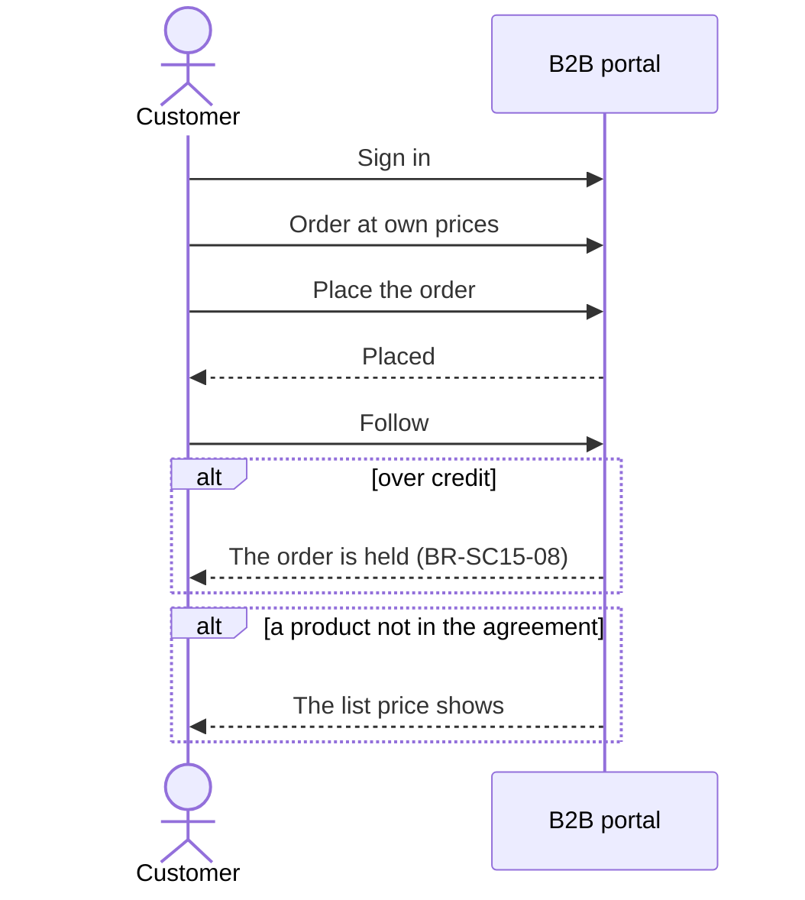

🏠 [Specs](../../../../README.md) › 🏷️ [Sectors](../../../README.md) ›
📦 [SC15 Wholesale and distribution](../../README.md) › 📝 [Use cases](../README.md) ›
📝 [Use cases: FL-SC15-02 Orders](README.md) › 📝 UC-SC15-18 Give customers a B2B portal and catalogue

# 📝 UC-SC15-18 Give customers a B2B portal and catalogue

**Status:** ✅ specified

## Summary

Customers sign in to the B2B portal, order at their own prices and follow deliveries and invoices.

## Personas

- [U09 Customer](../../../../01-users/personas/u09-customer.md)

## Goal

Customers order themselves.

## Trigger

A customer orders.

## Frequency

Daily.

## Preconditions

- The SC15 sector pack is installed for the company,
  [UC-F14-02](../../../../02-functional/f14-plugin-store/use-cases/01-find-and-install/uc-f14-02-install-a-plugin-or-sector-pack.md),
  and its users have their roles,
  [UC-F1-06](../../../../02-functional/f01-administration/use-cases/04-edit-a-role/uc-f01-06-edit-a-role-and-its-record-rules.md).

## Postconditions

- **Success:** the order is placed.
- **Failed:** an order over credit is held.

## Main flow

1. The customer signs in on [S-SC15-18 B2B portal](../../screens/02-orders/s-sc15-18-b2b-portal.md),
   [UC-F11-11](../../../../02-functional/f11-online-shop/use-cases/04-special-sales/uc-f11-11-sell-b2b-online.md).
2. The catalogue shows their prices.
3. The order is placed.
4. Deliveries and invoices show.

## Alternative flows

- 2a. Reorder from history: a past order is copied.

## Error flows

- 3e. Over credit: the order is held ([BR-SC15-08](../../business-rules/br-sc15-08-credit-limit-before-shipping.md)).
- 2e. A product not in the agreement: the list price shows.
- Any step: a call to a service or an outside system fails: it is retried first
  ([BR-F3-32](../../../../02-functional/f03-assistant/business-rules/br-f03-32-retry-before-an-error.md)), then the
  error message pattern ([D122](../../../../06-decisions/ux/d122-error-message-standard.md)) says what failed; what was
  typed is kept.

## Business rules

- [BR-SC15-02 Price from the agreement](../../business-rules/br-sc15-02-price-from-the-agreement.md)
- [BR-SC15-08 Credit limit before shipping](../../business-rules/br-sc15-08-credit-limit-before-shipping.md)

## Entities

- [E-SC15-04 Sales order](../../data/e-sc15-04-sales-order.md)
- [E-SC15-01 Price agreement](../../data/e-sc15-01-price-agreement.md)

## Permissions

The customer roles; the record rules of their role and site apply,
[UC-F1-06](../../../../02-functional/f01-administration/use-cases/04-edit-a-role/uc-f01-06-edit-a-role-and-its-record-rules.md).

## Notifications

None beyond the in-app updates of the records concerned.

## Audit events

Every creation, change and state change of sales order, price agreement records, with who, when and the values before
and after (T3).

## AI involvement

The AI assistant answers questions on the sales order, price agreement records of this use case, with links, and
prepares them as drafts the user confirms. It works within the user's rights,
[BR-F3-34](../../../../02-functional/f03-assistant/business-rules/br-f03-34-every-capability-is-reachable-from-the-assistant.md),
and never deletes or does anything irreversible without the user's confirmation,
[BR-F3-07](../../../../02-functional/f03-assistant/business-rules/br-f03-07-no-deletes-no-irreversible-acts.md).

## API, MCP and A2A exposure

Through the API and webhooks (T5) and the MCP and A2A gateway (T6), with the caller's rights,
[BR-F3-34](../../../../02-functional/f03-assistant/business-rules/br-f03-34-every-capability-is-reachable-from-the-assistant.md),
reading, creating and changing the records of this use case; nothing irreversible without a person's confirmation.

## Screens

- [S-SC15-18 B2B portal](../../screens/02-orders/s-sc15-18-b2b-portal.md)

## Flowchart

See [FL-SC15-02 Orders](../../flows/fl-sc15-02-orders.md#flowchart).

## Sequence diagram

## Acceptance criteria

1. **Given** the example wholesaler's Bistro Group **when** it orders on the portal **then** it sees its agreed prices.
2. **Given** Bistro Group at 46,000 EUR of 50,000 EUR ordering 6,000 EUR **when** it is placed **then** the order is
   held ([BR-SC15-08](../../business-rules/br-sc15-08-credit-limit-before-shipping.md)).

## Non-functional notes

[D408](../../../../06-decisions/technical/d408-performance-and-profiles.md)'s targets
([performance](../../../../05-non-functional/performance.md)): 95 % of screens within 1 second; lists paged on the
server, the first page within 1 second; reports within 5 seconds or in the background. WCAG 2.2 AA and RGAA
([D46](../../../../06-decisions/ux/d46-accessibility-standard.md)).

## Regulatory references

None specific to this use case; the sector's legal rules are listed in [SC15 regulatory](../../regulatory.md).

## Related use cases

- [UC-SC15-16 Manage customer credit limits](../05-sales-force-and-performance/uc-sc15-16-manage-customer-credit-limits.md)

## Open questions

None.

---

⬅️ [UC-SC15-17](../04-import-and-suppliers/uc-sc15-17-buy-against-forecasts-and-supplier-minimums.md) ·
⬆️ [Up](README.md) ·
➡️ [UC-SC15-19 Follow supplier performance](../04-import-and-suppliers/uc-sc15-19-follow-supplier-performance.md)
