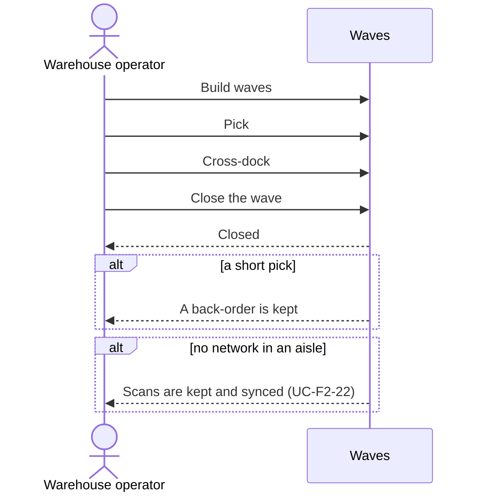

🏠 [Specs](../../../../README.md) › 🏷️ [Sectors](../../../README.md) ›
📦 [SC15 Wholesale and distribution](../../README.md) › 📝 [Use cases](../README.md) ›
📝 [Use cases: FL-SC15-03 Warehouse](README.md) › 📝 UC-SC15-08 Pick in waves and cross-dock

# 📝 UC-SC15-08 Pick in waves and cross-dock

**Status:** ✅ specified

## Summary

The warehouse operator builds pick waves, picks and cross-docks incoming goods to waiting orders.

## Personas

- [U15 Warehouse operator](../../../../01-users/personas/u15-warehouse-operator.md)

## Goal

Orders picked fast.

## Trigger

Orders released.

## Frequency

Several waves a day.

## Preconditions

- The SC15 sector pack is installed for the company,
  [UC-F14-02](../../../../02-functional/f14-plugin-store/use-cases/01-find-and-install/uc-f14-02-install-a-plugin-or-sector-pack.md),
  and its users have their roles,
  [UC-F1-06](../../../../02-functional/f01-administration/use-cases/04-edit-a-role/uc-f01-06-edit-a-role-and-its-record-rules.md).

## Postconditions

- **Success:** orders are picked.
- **Failed:** short picks become back-orders.

## Main flow

1. Waves are built on [S-SC15-08 Waves](../../screens/02-orders/s-sc15-08-waves.md).
2. The operator picks with the scanner,
   [UC-F7-06](../../../../02-functional/f07-purchasing-and-stock/use-cases/04-pick-pack-and-ship/uc-f07-06-pick-pack-and-ship.md).
3. Incoming goods go straight to waiting orders.
4. The wave closes.

## Alternative flows

- 1a. An urgent order: it is picked outside waves.

## Error flows

- 2e. A short pick: a back-order is kept.
- 2f. No network in an aisle: scans are kept and synced,
  [UC-F2-22](../../../../02-functional/f02-no-code-configuration/use-cases/09-portals-and-offline-forms/uc-f02-22-fill-a-form-offline-on-the-phone.md).
- Any step: a call to a service or an outside system fails: it is retried first
  ([BR-F3-32](../../../../02-functional/f03-assistant/business-rules/br-f03-32-retry-before-an-error.md)), then the
  error message pattern ([D122](../../../../06-decisions/ux/d122-error-message-standard.md)) says what failed; what was
  typed is kept.

## Business rules

- [BR-SC15-07 Back-orders kept or cancelled](../../business-rules/br-sc15-07-back-orders-kept-or-cancelled.md)

## Entities

- [E-SC15-05 Pick wave](../../data/e-sc15-05-pick-wave.md)

## Permissions

The warehouse operator roles; the record rules of their role and site apply,
[UC-F1-06](../../../../02-functional/f01-administration/use-cases/04-edit-a-role/uc-f01-06-edit-a-role-and-its-record-rules.md).

## Notifications

None beyond the in-app updates of the records concerned.

## Audit events

Every creation, change and state change of pick wave records, with who, when and the values before and after (T3).

## AI involvement

The AI assistant answers questions on the pick wave records of this use case, with links, and prepares them as drafts
the user confirms. It works within the user's rights,
[BR-F3-34](../../../../02-functional/f03-assistant/business-rules/br-f03-34-every-capability-is-reachable-from-the-assistant.md),
and never deletes or does anything irreversible without the user's confirmation,
[BR-F3-07](../../../../02-functional/f03-assistant/business-rules/br-f03-07-no-deletes-no-irreversible-acts.md).

## API, MCP and A2A exposure

Through the API and webhooks (T5) and the MCP and A2A gateway (T6), with the caller's rights,
[BR-F3-34](../../../../02-functional/f03-assistant/business-rules/br-f03-34-every-capability-is-reachable-from-the-assistant.md),
reading, creating and changing the records of this use case; nothing irreversible without a person's confirmation.

## Screens

- [S-SC15-08 Waves](../../screens/02-orders/s-sc15-08-waves.md)

## Flowchart

See [FL-SC15-03 Warehouse](../../flows/fl-sc15-03-warehouse.md#flowchart).

## Sequence diagram

## Acceptance criteria

1. **Given** the example wholesaler's wave of 38 orders in the dry zone on 12 November **when** it closes **then** 38
   orders are ready to pack.
2. **Given** a wave of 38 orders with 2 lines short **when** it is picked **then** a back-order is kept.

## Non-functional notes

[D408](../../../../06-decisions/technical/d408-performance-and-profiles.md)'s targets
([performance](../../../../05-non-functional/performance.md)): 95 % of screens within 1 second; lists paged on the
server, the first page within 1 second; reports within 5 seconds or in the background. WCAG 2.2 AA and RGAA
([D46](../../../../06-decisions/ux/d46-accessibility-standard.md)).

## Regulatory references

None specific to this use case; the sector's legal rules are listed in [SC15 regulatory](../../regulatory.md).

## Related use cases

- [UC-SC15-09 Build pallets and GS1 labels](uc-sc15-09-build-pallets-and-gs1-labels.md)

## Open questions

None.

---

⬅️ [UC-SC15-07 Drop-ship from suppliers](../02-orders/uc-sc15-07-drop-ship-from-suppliers.md) · ⬆️ [Up](README.md) ·
➡️ [UC-SC15-09 Build pallets and GS1 labels](uc-sc15-09-build-pallets-and-gs1-labels.md)
