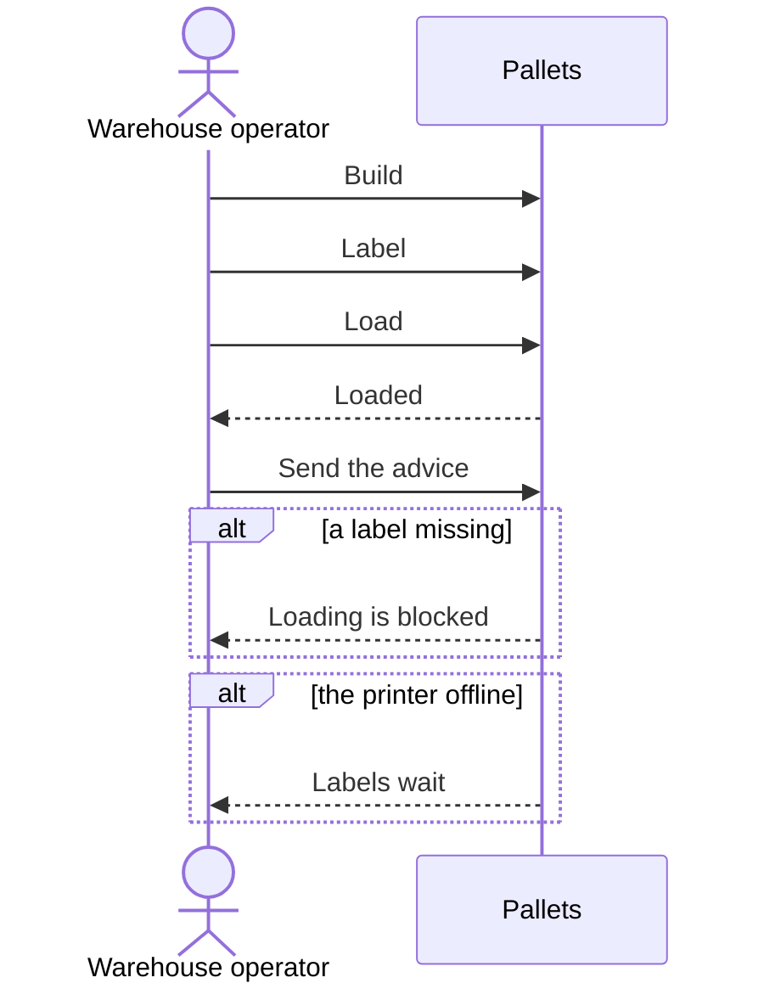

🏠 [Specs](../../../../README.md) › 🏷️ [Sectors](../../../README.md) ›
📦 [SC15 Wholesale and distribution](../../README.md) › 📝 [Use cases](../README.md) ›
📝 [Use cases: FL-SC15-03 Warehouse](README.md) › 📝 UC-SC15-09 Build pallets and GS1 labels

# 📝 UC-SC15-09 Build pallets and GS1 labels

**Status:** ✅ specified

## Summary

The operator builds pallets, prints GS1 labels with the serial shipping code, and loads them.

## Personas

- [U15 Warehouse operator](../../../../01-users/personas/u15-warehouse-operator.md)

## Goal

Every pallet labelled.

## Trigger

A picked order.

## Frequency

Many a day.

## Preconditions

- The SC15 sector pack is installed for the company,
  [UC-F14-02](../../../../02-functional/f14-plugin-store/use-cases/01-find-and-install/uc-f14-02-install-a-plugin-or-sector-pack.md),
  and its users have their roles,
  [UC-F1-06](../../../../02-functional/f01-administration/use-cases/04-edit-a-role/uc-f01-06-edit-a-role-and-its-record-rules.md).

## Postconditions

- **Success:** the pallet is loaded.
- **Failed:** loading is blocked.

## Main flow

1. The pallet is built on [S-SC15-09 Pallets](../../screens/03-warehouse/s-sc15-09-pallets.md).
2. A GS1 label is printed ([BR-SC15-09](../../business-rules/br-sc15-09-pallets-labelled.md)).
3. The pallet is loaded.
4. The despatch advice is sent.

## Alternative flows

- 1a. Mixed pallets: contents are listed per pallet.

## Error flows

- 2e. A label missing: loading is blocked.
- 2f. The printer offline: labels wait.
- Any step: a call to a service or an outside system fails: it is retried first
  ([BR-F3-32](../../../../02-functional/f03-assistant/business-rules/br-f03-32-retry-before-an-error.md)), then the
  error message pattern ([D122](../../../../06-decisions/ux/d122-error-message-standard.md)) says what failed; what was
  typed is kept.

## Business rules

- [BR-SC15-09 Pallets labelled](../../business-rules/br-sc15-09-pallets-labelled.md)

## Entities

- [E-SC15-05 Pick wave](../../data/e-sc15-05-pick-wave.md)
- [E-SC15-14 Pallet](../../data/e-sc15-14-pallet.md)

## Permissions

The warehouse operator roles; the record rules of their role and site apply,
[UC-F1-06](../../../../02-functional/f01-administration/use-cases/04-edit-a-role/uc-f01-06-edit-a-role-and-its-record-rules.md).

## Notifications

None beyond the in-app updates of the records concerned.

## Audit events

Every creation, change and state change of pick wave records, with who, when and the values before and after (T3).

## AI involvement

The AI assistant answers questions on the pick wave records of this use case, with links, and prepares them as drafts
the user confirms. It works within the user's rights,
[BR-F3-34](../../../../02-functional/f03-assistant/business-rules/br-f03-34-every-capability-is-reachable-from-the-assistant.md),
and never deletes or does anything irreversible without the user's confirmation,
[BR-F3-07](../../../../02-functional/f03-assistant/business-rules/br-f03-07-no-deletes-no-irreversible-acts.md).

## API, MCP and A2A exposure

Through the API and webhooks (T5) and the MCP and A2A gateway (T6), with the caller's rights,
[BR-F3-34](../../../../02-functional/f03-assistant/business-rules/br-f03-34-every-capability-is-reachable-from-the-assistant.md),
reading, creating and changing the records of this use case; nothing irreversible without a person's confirmation.

## Screens

- [S-SC15-09 Pallets](../../screens/03-warehouse/s-sc15-09-pallets.md)

## Flowchart

See [FL-SC15-03 Warehouse](../../flows/fl-sc15-03-warehouse.md#flowchart).

## Sequence diagram

## Acceptance criteria

1. **Given** the example wholesaler's pallet for MegaMart **when** it is labelled **then** its label shows its serial
   shipping code.
2. **Given** a pallet without its label **when** it is loaded **then** loading is blocked.

## Non-functional notes

[D408](../../../../06-decisions/technical/d408-performance-and-profiles.md)'s targets
([performance](../../../../05-non-functional/performance.md)): 95 % of screens within 1 second; lists paged on the
server, the first page within 1 second; reports within 5 seconds or in the background. WCAG 2.2 AA and RGAA
([D46](../../../../06-decisions/ux/d46-accessibility-standard.md)).

## Regulatory references

None specific to this use case; the sector's legal rules are listed in [SC15 regulatory](../../regulatory.md).

## Related use cases

- [UC-SC15-08 Pick in waves and cross-dock](uc-sc15-08-pick-in-waves-and-cross-dock.md)

## Open questions

None.

---

⬅️ [UC-SC15-08 Pick in waves and cross-dock](uc-sc15-08-pick-in-waves-and-cross-dock.md) · ⬆️ [Up](README.md) ·
➡️ [UC-SC15-10 Manage returns and credit notes](uc-sc15-10-manage-returns-and-credit-notes.md)
