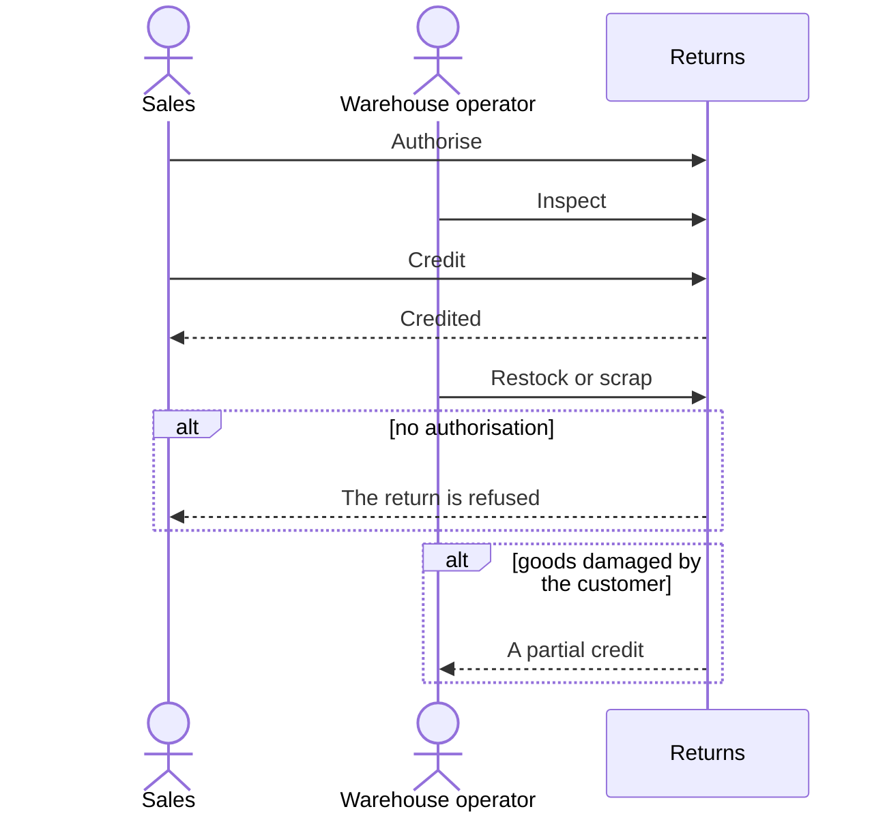

🏠 [Specs](../../../../README.md) › 🏷️ [Sectors](../../../README.md) ›
📦 [SC15 Wholesale and distribution](../../README.md) › 📝 [Use cases](../README.md) ›
📝 [Use cases: FL-SC15-03 Warehouse](README.md) › 📝 UC-SC15-10 Manage returns and credit notes

# 📝 UC-SC15-10 Manage returns and credit notes

**Status:** ✅ specified

## Summary

Sales authorises returns; the warehouse inspects goods; the customer is credited per condition.

## Personas

- [U03 Sales](../../../../01-users/personas/u03-sales.md)
- [U15 Warehouse operator](../../../../01-users/personas/u15-warehouse-operator.md)

## Goal

Returns controlled and credited.

## Trigger

A return request.

## Frequency

Daily.

## Preconditions

- The SC15 sector pack is installed for the company,
  [UC-F14-02](../../../../02-functional/f14-plugin-store/use-cases/01-find-and-install/uc-f14-02-install-a-plugin-or-sector-pack.md),
  and its users have their roles,
  [UC-F1-06](../../../../02-functional/f01-administration/use-cases/04-edit-a-role/uc-f01-06-edit-a-role-and-its-record-rules.md).

## Postconditions

- **Success:** the credit note is issued.
- **Failed:** the return is refused.

## Main flow

1. Sales authorises on [S-SC15-10 Returns](../../screens/03-warehouse/s-sc15-10-returns.md)
   ([BR-SC15-14](../../business-rules/br-sc15-14-returns-need-authorisation.md)).
2. The warehouse inspects.
3. A credit note is issued,
   [UC-F6-09](../../../../02-functional/f06-customers-and-sales/use-cases/03-invoice-and-get-paid/uc-f06-09-credit-note-and-refund.md).
4. Goods are restocked or scrapped,
   [UC-F7-10](../../../../02-functional/f07-purchasing-and-stock/use-cases/04-pick-pack-and-ship/uc-f07-10-handle-returns-and-scrap.md).

## Alternative flows

- 4a. A return to the supplier: the supplier is debited.

## Error flows

- 1e. No authorisation: the return is refused.
- 2e. Goods damaged by the customer: a partial credit.
- Any step: a call to a service or an outside system fails: it is retried first
  ([BR-F3-32](../../../../02-functional/f03-assistant/business-rules/br-f03-32-retry-before-an-error.md)), then the
  error message pattern ([D122](../../../../06-decisions/ux/d122-error-message-standard.md)) says what failed; what was
  typed is kept.

## Business rules

- [BR-SC15-14 Returns need authorisation](../../business-rules/br-sc15-14-returns-need-authorisation.md)

## Entities

- [E-SC15-07 Return authorisation](../../data/e-sc15-07-return-authorisation.md)

## Permissions

The sales and warehouse operator roles; the record rules of their role and site apply,
[UC-F1-06](../../../../02-functional/f01-administration/use-cases/04-edit-a-role/uc-f01-06-edit-a-role-and-its-record-rules.md).

## Notifications

None beyond the in-app updates of the records concerned.

## Audit events

Every creation, change and state change of return authorisation records, with who, when and the values before and after
(T3).

## AI involvement

The AI assistant answers questions on the return authorisation records of this use case, with links, and prepares them
as drafts the user confirms. It works within the user's rights,
[BR-F3-34](../../../../02-functional/f03-assistant/business-rules/br-f03-34-every-capability-is-reachable-from-the-assistant.md),
and never deletes or does anything irreversible without the user's confirmation,
[BR-F3-07](../../../../02-functional/f03-assistant/business-rules/br-f03-07-no-deletes-no-irreversible-acts.md).

## API, MCP and A2A exposure

Through the API and webhooks (T5) and the MCP and A2A gateway (T6), with the caller's rights,
[BR-F3-34](../../../../02-functional/f03-assistant/business-rules/br-f03-34-every-capability-is-reachable-from-the-assistant.md),
reading, creating and changing the records of this use case; nothing irreversible without a person's confirmation.

## Screens

- [S-SC15-10 Returns](../../screens/03-warehouse/s-sc15-10-returns.md)

## Flowchart

See [FL-SC15-03 Warehouse](../../flows/fl-sc15-03-warehouse.md#flowchart).

## Sequence diagram

## Acceptance criteria

1. **Given** the example wholesaler's RA-12 on SO-88 for damaged goods **when** they are inspected **then** a credit
   note is issued.
2. **Given** goods arriving without an RA number **when** they are received **then** the return is refused.

## Non-functional notes

[D408](../../../../06-decisions/technical/d408-performance-and-profiles.md)'s targets
([performance](../../../../05-non-functional/performance.md)): 95 % of screens within 1 second; lists paged on the
server, the first page within 1 second; reports within 5 seconds or in the background. WCAG 2.2 AA and RGAA
([D46](../../../../06-decisions/ux/d46-accessibility-standard.md)).

## Regulatory references

None specific to this use case; the sector's legal rules are listed in [SC15 regulatory](../../regulatory.md).

## Related use cases

- [UC-SC15-06 Handle back-orders and partial deliveries](../02-orders/uc-sc15-06-handle-back-orders-and-partial-deliveries.md)

## Open questions

None.

---

⬅️ [UC-SC15-09 Build pallets and GS1 labels](uc-sc15-09-build-pallets-and-gs1-labels.md) · ⬆️ [Up](README.md) ·
➡️ [UC-SC15-11](../01-prices-and-agreements/uc-sc15-11-run-supplier-promotions-and-listing-fees.md)
