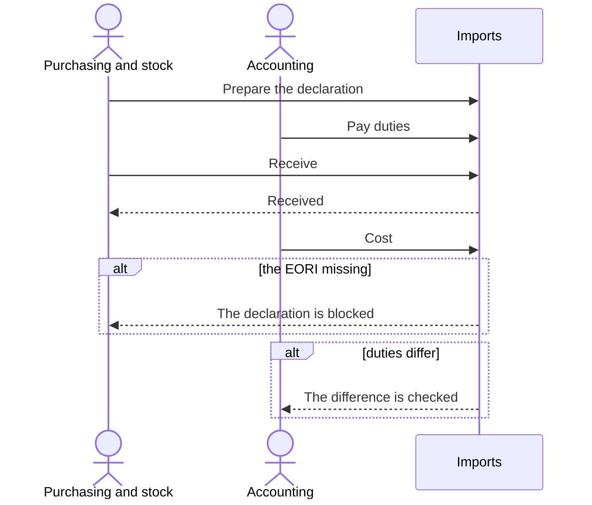

🏠 [Specs](../../../../README.md) › 🏷️ [Sectors](../../../README.md) ›
📦 [SC15 Wholesale and distribution](../../README.md) › 📝 [Use cases](../README.md) ›
📝 [Use cases: FL-SC15-04 Import and suppliers](README.md) › 📝 UC-SC15-12 Import goods

# 📝 UC-SC15-12 Import goods

**Status:** ✅ specified

## Summary

Purchasing and accounting prepare the import declaration with the EORI number, pay duties and receive the goods.

## Personas

- [U04 Purchasing and stock](../../../../01-users/personas/u04-purchasing.md)
- [U05 Accounting](../../../../01-users/personas/u05-accounting.md)

## Goal

Imports cleared and costed.

## Trigger

A shipment from outside the EU.

## Frequency

Monthly.

## Preconditions

- The SC15 sector pack is installed for the company,
  [UC-F14-02](../../../../02-functional/f14-plugin-store/use-cases/01-find-and-install/uc-f14-02-install-a-plugin-or-sector-pack.md),
  and its users have their roles,
  [UC-F1-06](../../../../02-functional/f01-administration/use-cases/04-edit-a-role/uc-f01-06-edit-a-role-and-its-record-rules.md).

## Postconditions

- **Success:** goods are received with landed costs.
- **Failed:** the declaration is blocked.

## Main flow

1. The declaration is prepared on [S-SC15-12 Imports](../../screens/04-import-and-suppliers/s-sc15-12-imports.md)
   ([BR-SC15-10](../../business-rules/br-sc15-10-imports-declared.md)).
2. Duties are paid.
3. Goods are received,
   [UC-F7-03](../../../../02-functional/f07-purchasing-and-stock/use-cases/02-receive-and-store/uc-f07-03-receive-goods.md).
4. Landed costs are allocated,
   [UC-F7-09](../../../../02-functional/f07-purchasing-and-stock/use-cases/02-receive-and-store/uc-f07-09-value-stock-and-landed-costs.md).

## Alternative flows

- 1a. A customs broker: the broker files and invoices.

## Error flows

- 1e. The EORI missing: the declaration is blocked.
- 2e. Duties differ: the difference is checked.
- Any step: a call to a service or an outside system fails: it is retried first
  ([BR-F3-32](../../../../02-functional/f03-assistant/business-rules/br-f03-32-retry-before-an-error.md)), then the
  error message pattern ([D122](../../../../06-decisions/ux/d122-error-message-standard.md)) says what failed; what was
  typed is kept.

## Business rules

- [BR-SC15-10 Imports declared](../../business-rules/br-sc15-10-imports-declared.md)

## Entities

- [E-SC15-09 Import file](../../data/e-sc15-09-import-file.md)

## Permissions

The purchasing and stock and accounting roles; the record rules of their role and site apply,
[UC-F1-06](../../../../02-functional/f01-administration/use-cases/04-edit-a-role/uc-f01-06-edit-a-role-and-its-record-rules.md).

## Notifications

None beyond the in-app updates of the records concerned.

## Audit events

Every creation, change and state change of import file records, with who, when and the values before and after (T3).

## AI involvement

The AI assistant answers questions on the import file records of this use case, with links, and prepares them as drafts
the user confirms. It works within the user's rights,
[BR-F3-34](../../../../02-functional/f03-assistant/business-rules/br-f03-34-every-capability-is-reachable-from-the-assistant.md),
and never deletes or does anything irreversible without the user's confirmation,
[BR-F3-07](../../../../02-functional/f03-assistant/business-rules/br-f03-07-no-deletes-no-irreversible-acts.md).

## API, MCP and A2A exposure

Through the API and webhooks (T5) and the MCP and A2A gateway (T6), with the caller's rights,
[BR-F3-34](../../../../02-functional/f03-assistant/business-rules/br-f03-34-every-capability-is-reachable-from-the-assistant.md),
reading, creating and changing the records of this use case; nothing irreversible without a person's confirmation.

## Screens

- [S-SC15-12 Imports](../../screens/04-import-and-suppliers/s-sc15-12-imports.md)

## Flowchart

See [FL-SC15-04 Import and suppliers](../../flows/fl-sc15-04-import-and-suppliers.md#flowchart).

## Sequence diagram

## Acceptance criteria

1. **Given** the example wholesaler's CNT-41 with EORI FR123456789 and 2,140 EUR duties **when** it is received **then**
   2,140 EUR goes into landed costs.
2. **Given** CNT-41 with no EORI **when** it is prepared **then** the declaration is blocked.

## Non-functional notes

[D408](../../../../06-decisions/technical/d408-performance-and-profiles.md)'s targets
([performance](../../../../05-non-functional/performance.md)): 95 % of screens within 1 second; lists paged on the
server, the first page within 1 second; reports within 5 seconds or in the background. WCAG 2.2 AA and RGAA
([D46](../../../../06-decisions/ux/d46-accessibility-standard.md)).

## Regulatory references

Legal values from the France country pack:
[CR-FR-172 EORI number and import declarations](../../../../10-country-packs/france/trade/cr-fr-172-eori-and-imports.md).

## Related use cases

- [UC-SC15-13 Declare EU trade statistics](uc-sc15-13-declare-eu-trade-statistics.md)

## Open questions

None.

---

⬅️ [UC-SC15-11](../01-prices-and-agreements/uc-sc15-11-run-supplier-promotions-and-listing-fees.md) ·
⬆️ [Up](README.md) · ➡️ [UC-SC15-13 Declare EU trade statistics](uc-sc15-13-declare-eu-trade-statistics.md)
