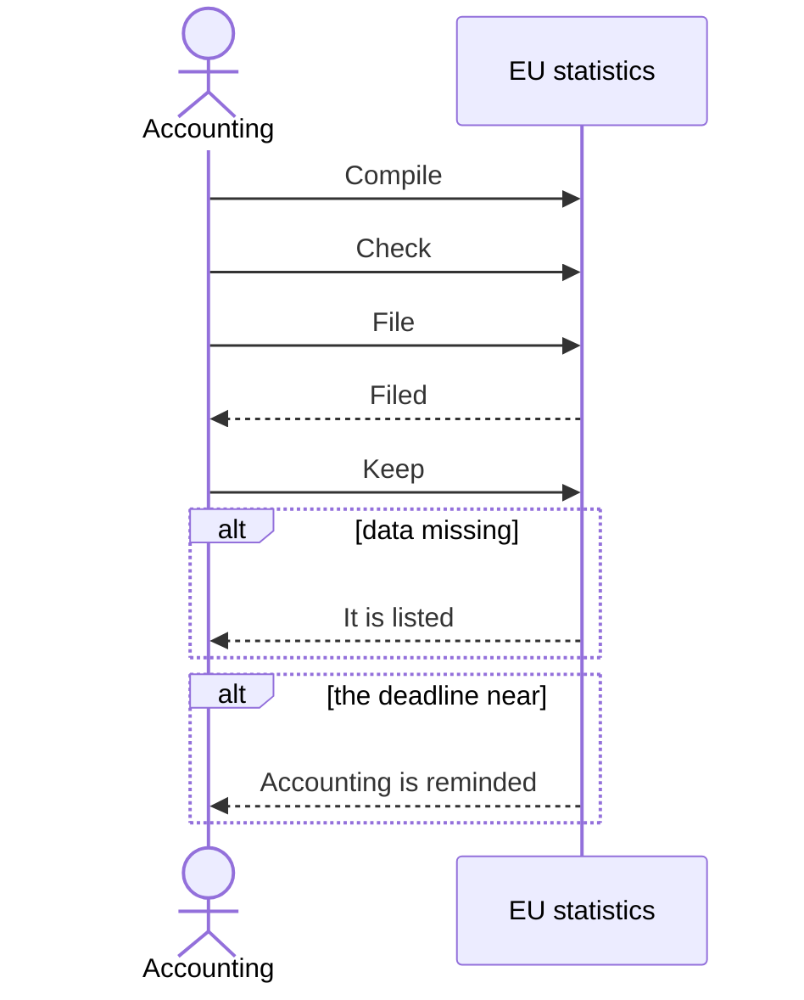

🏠 [Specs](../../../../README.md) › 🏷️ [Sectors](../../../README.md) ›
📦 [SC15 Wholesale and distribution](../../README.md) › 📝 [Use cases](../README.md) ›
📝 [Use cases: FL-SC15-04 Import and suppliers](README.md) › 📝 UC-SC15-13 Declare EU trade statistics

# 📝 UC-SC15-13 Declare EU trade statistics

**Status:** ✅ specified

## Summary

Accounting compiles EU deliveries monthly for the statistical survey and the VAT statement and files them.

## Personas

- [U05 Accounting](../../../../01-users/personas/u05-accounting.md)

## Goal

Statistics filed monthly.

## Trigger

Month end.

## Frequency

Monthly.

## Preconditions

- The SC15 sector pack is installed for the company,
  [UC-F14-02](../../../../02-functional/f14-plugin-store/use-cases/01-find-and-install/uc-f14-02-install-a-plugin-or-sector-pack.md),
  and its users have their roles,
  [UC-F1-06](../../../../02-functional/f01-administration/use-cases/04-edit-a-role/uc-f01-06-edit-a-role-and-its-record-rules.md).

## Postconditions

- **Success:** the return is filed.
- **Failed:** missing data is listed.

## Main flow

1. Lines are compiled on [S-SC15-13 EU statistics](../../screens/04-import-and-suppliers/s-sc15-13-eu-statistics.md)
   ([BR-SC15-11](../../business-rules/br-sc15-11-eu-statistics-filed.md)).
2. Accounting checks.
3. The return is filed.
4. The return is kept.

## Alternative flows

- 3a. Corrections: a corrected return is filed.

## Error flows

- 1e. Data missing: it is listed.
- 3e. The deadline near: accounting is reminded.
- Any step: a call to a service or an outside system fails: it is retried first
  ([BR-F3-32](../../../../02-functional/f03-assistant/business-rules/br-f03-32-retry-before-an-error.md)), then the
  error message pattern ([D122](../../../../06-decisions/ux/d122-error-message-standard.md)) says what failed; what was
  typed is kept.

## Business rules

- [BR-SC15-11 EU statistics filed](../../business-rules/br-sc15-11-eu-statistics-filed.md)

## Entities

- [E-SC15-10 Statistics return](../../data/e-sc15-10-statistics-return.md)

## Permissions

The accounting roles; the record rules of their role and site apply,
[UC-F1-06](../../../../02-functional/f01-administration/use-cases/04-edit-a-role/uc-f01-06-edit-a-role-and-its-record-rules.md).

## Notifications

None beyond the in-app updates of the records concerned.

## Audit events

Every creation, change and state change of statistics return records, with who, when and the values before and after
(T3).

## AI involvement

The AI assistant answers questions on the statistics return records of this use case, with links, and prepares them as
drafts the user confirms. It works within the user's rights,
[BR-F3-34](../../../../02-functional/f03-assistant/business-rules/br-f03-34-every-capability-is-reachable-from-the-assistant.md),
and never deletes or does anything irreversible without the user's confirmation,
[BR-F3-07](../../../../02-functional/f03-assistant/business-rules/br-f03-07-no-deletes-no-irreversible-acts.md).

## API, MCP and A2A exposure

Through the API and webhooks (T5) and the MCP and A2A gateway (T6), with the caller's rights,
[BR-F3-34](../../../../02-functional/f03-assistant/business-rules/br-f03-34-every-capability-is-reachable-from-the-assistant.md),
reading, creating and changing the records of this use case; nothing irreversible without a person's confirmation.

## Screens

- [S-SC15-13 EU statistics](../../screens/04-import-and-suppliers/s-sc15-13-eu-statistics.md)

## Flowchart

See [FL-SC15-04 Import and suppliers](../../flows/fl-sc15-04-import-and-suppliers.md#flowchart).

## Sequence diagram

## Acceptance criteria

1. **Given** the example wholesaler's November with 64 lines **when** it is filed **then** the return shows 64 lines.
2. **Given** a line without commodity code **when** November is compiled **then** it is listed.

## Non-functional notes

[D408](../../../../06-decisions/technical/d408-performance-and-profiles.md)'s targets
([performance](../../../../05-non-functional/performance.md)): 95 % of screens within 1 second; lists paged on the
server, the first page within 1 second; reports within 5 seconds or in the background. WCAG 2.2 AA and RGAA
([D46](../../../../06-decisions/ux/d46-accessibility-standard.md)).

## Regulatory references

Legal values from the France country pack:
[CR-FR-173 EU trade statistics on goods](../../../../10-country-packs/france/trade/cr-fr-173-eu-trade-statistics.md).

## Related use cases

- [UC-SC15-12 Import goods](uc-sc15-12-import-goods.md)

## Open questions

None.

---

⬅️ [UC-SC15-12 Import goods](uc-sc15-12-import-goods.md) · ⬆️ [Up](README.md) ·
➡️ [UC-SC15-14](../05-sales-force-and-performance/uc-sc15-14-follow-sales-reps-visits-routes-and-targets.md)
