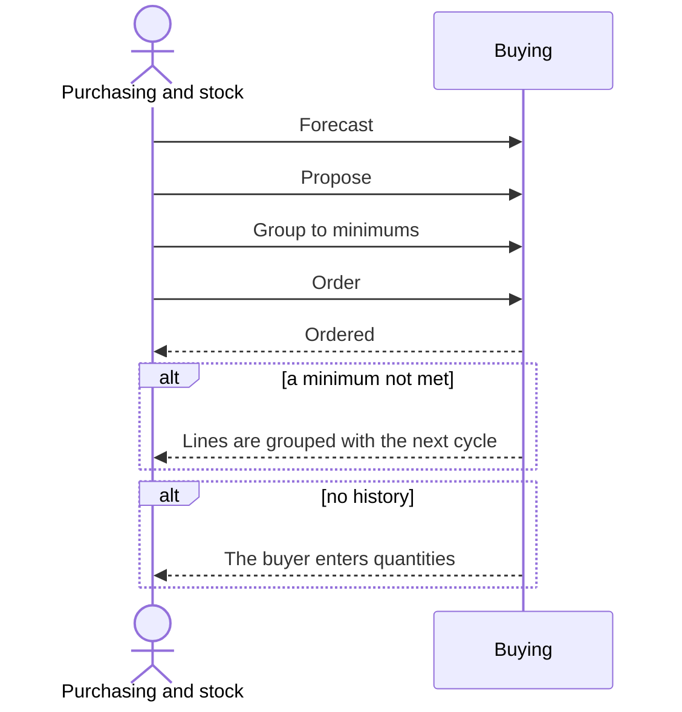

🏠 [Specs](../../../../README.md) › 🏷️ [Sectors](../../../README.md) ›
📦 [SC15 Wholesale and distribution](../../README.md) › 📝 [Use cases](../README.md) ›
📝 [Use cases: FL-SC15-04 Import and suppliers](README.md) › 📝 UC-SC15-17 Buy against forecasts and supplier minimums

# 📝 UC-SC15-17 Buy against forecasts and supplier minimums

**Status:** ✅ specified

## Summary

Purchasing forecasts demand, gets proposals and orders to suppliers' minimums.

## Personas

- [U04 Purchasing and stock](../../../../01-users/personas/u04-purchasing.md)

## Goal

Stock for demand at the best terms.

## Trigger

The buying cycle.

## Frequency

Weekly.

## Preconditions

- The SC15 sector pack is installed for the company,
  [UC-F14-02](../../../../02-functional/f14-plugin-store/use-cases/01-find-and-install/uc-f14-02-install-a-plugin-or-sector-pack.md),
  and its users have their roles,
  [UC-F1-06](../../../../02-functional/f01-administration/use-cases/04-edit-a-role/uc-f01-06-edit-a-role-and-its-record-rules.md).

## Postconditions

- **Success:** orders are placed.
- **Failed:** proposals are grouped.

## Main flow

1. Demand is forecast on [S-SC15-17 Buying](../../screens/04-import-and-suppliers/s-sc15-17-buying.md),
   [UC-F7-05](../../../../02-functional/f07-purchasing-and-stock/use-cases/03-replenish/uc-f07-05-replenish-stock.md).
2. Proposals are made per supplier.
3. Lines are grouped to minimums.
4. Orders are placed.

## Alternative flows

- 3a. Container fill: lines are added to fill a container.

## Error flows

- 3e. A minimum not met: lines are grouped with the next cycle.
- 1e. No history: the buyer enters quantities.
- Any step: a call to a service or an outside system fails: it is retried first
  ([BR-F3-32](../../../../02-functional/f03-assistant/business-rules/br-f03-32-retry-before-an-error.md)), then the
  error message pattern ([D122](../../../../06-decisions/ux/d122-error-message-standard.md)) says what failed; what was
  typed is kept.

## Business rules

- [BR-SC15-02 Price from the agreement](../../business-rules/br-sc15-02-price-from-the-agreement.md)

## Entities

- [E-SC15-06 Purchase proposal](../../data/e-sc15-06-purchase-proposal.md)

## Permissions

The purchasing and stock roles; the record rules of their role and site apply,
[UC-F1-06](../../../../02-functional/f01-administration/use-cases/04-edit-a-role/uc-f01-06-edit-a-role-and-its-record-rules.md).

## Notifications

None beyond the in-app updates of the records concerned.

## Audit events

Every creation, change and state change of purchase proposal records, with who, when and the values before and after
(T3).

## AI involvement

The AI assistant answers questions on the purchase proposal records of this use case, with links, and prepares them as
drafts the user confirms. It works within the user's rights,
[BR-F3-34](../../../../02-functional/f03-assistant/business-rules/br-f03-34-every-capability-is-reachable-from-the-assistant.md),
and never deletes or does anything irreversible without the user's confirmation,
[BR-F3-07](../../../../02-functional/f03-assistant/business-rules/br-f03-07-no-deletes-no-irreversible-acts.md).

## API, MCP and A2A exposure

Through the API and webhooks (T5) and the MCP and A2A gateway (T6), with the caller's rights,
[BR-F3-34](../../../../02-functional/f03-assistant/business-rules/br-f03-34-every-capability-is-reachable-from-the-assistant.md),
reading, creating and changing the records of this use case; nothing irreversible without a person's confirmation.

## Screens

- [S-SC15-17 Buying](../../screens/04-import-and-suppliers/s-sc15-17-buying.md)

## Flowchart

See [FL-SC15-04 Import and suppliers](../../flows/fl-sc15-04-import-and-suppliers.md#flowchart).

## Sequence diagram

## Acceptance criteria

1. **Given** the example wholesaler's Acme proposal of 22 lines **when** it reaches a pallet **then** the order is
   placed.
2. **Given** Acme's 1-pallet minimum with 22 lines under it **when** proposals are made **then** lines are grouped with
   the next cycle.

## Non-functional notes

[D408](../../../../06-decisions/technical/d408-performance-and-profiles.md)'s targets
([performance](../../../../05-non-functional/performance.md)): 95 % of screens within 1 second; lists paged on the
server, the first page within 1 second; reports within 5 seconds or in the background. WCAG 2.2 AA and RGAA
([D46](../../../../06-decisions/ux/d46-accessibility-standard.md)).

## Regulatory references

None specific to this use case; the sector's legal rules are listed in [SC15 regulatory](../../regulatory.md).

## Related use cases

- [UC-SC15-12 Import goods](uc-sc15-12-import-goods.md)

## Open questions

None.

---

⬅️ [UC-SC15-16](../05-sales-force-and-performance/uc-sc15-16-manage-customer-credit-limits.md) · ⬆️ [Up](README.md) ·
➡️ [UC-SC15-18](../02-orders/uc-sc15-18-give-customers-a-b2b-portal-and-catalogue.md)
