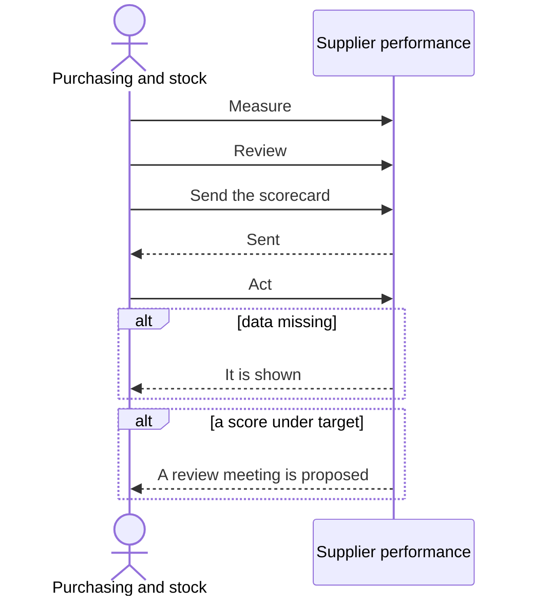

🏠 [Specs](../../../../README.md) › 🏷️ [Sectors](../../../README.md) ›
📦 [SC15 Wholesale and distribution](../../README.md) › 📝 [Use cases](../README.md) ›
📝 [Use cases: FL-SC15-04 Import and suppliers](README.md) › 📝 UC-SC15-19 Follow supplier performance

# 📝 UC-SC15-19 Follow supplier performance

**Status:** ✅ specified

## Summary

Purchasing measures suppliers' on-time and complete deliveries and quality, reviews and acts.

## Personas

- [U04 Purchasing and stock](../../../../01-users/personas/u04-purchasing.md)

## Goal

Better suppliers.

## Trigger

Quarter end.

## Frequency

Quarterly.

## Preconditions

- The SC15 sector pack is installed for the company,
  [UC-F14-02](../../../../02-functional/f14-plugin-store/use-cases/01-find-and-install/uc-f14-02-install-a-plugin-or-sector-pack.md),
  and its users have their roles,
  [UC-F1-06](../../../../02-functional/f01-administration/use-cases/04-edit-a-role/uc-f01-06-edit-a-role-and-its-record-rules.md).

## Postconditions

- **Success:** actions are recorded.
- **Failed:** missing data is shown.

## Main flow

1. Scores are computed on
   [S-SC15-19 Supplier performance](../../screens/04-import-and-suppliers/s-sc15-19-supplier-performance.md),
   [UC-F7-19](../../../../02-functional/f07-purchasing-and-stock/use-cases/07-supplier-agreements-and-performance/uc-f07-19-follow-supplier-performance.md).
2. Purchasing reviews.
3. The supplier gets its scorecard.
4. Actions are recorded.

## Alternative flows

- 3a. A supplier portal: the supplier reads it there,
  [UC-F7-12](../../../../02-functional/f07-purchasing-and-stock/use-cases/01-procure/uc-f07-12-use-the-supplier-portal.md).

## Error flows

- 1e. Data missing: it is shown.
- 2e. A score under target: a review meeting is proposed.
- Any step: a call to a service or an outside system fails: it is retried first
  ([BR-F3-32](../../../../02-functional/f03-assistant/business-rules/br-f03-32-retry-before-an-error.md)), then the
  error message pattern ([D122](../../../../06-decisions/ux/d122-error-message-standard.md)) says what failed; what was
  typed is kept.

## Business rules

- [BR-SC15-12 Supplier funds tracked](../../business-rules/br-sc15-12-supplier-funds-tracked.md)

## Entities

- [E-SC15-13 Supplier scorecard](../../data/e-sc15-13-supplier-scorecard.md)

## Permissions

The purchasing and stock roles; the record rules of their role and site apply,
[UC-F1-06](../../../../02-functional/f01-administration/use-cases/04-edit-a-role/uc-f01-06-edit-a-role-and-its-record-rules.md).

## Notifications

None beyond the in-app updates of the records concerned.

## Audit events

Every creation, change and state change of supplier scorecard records, with who, when and the values before and after
(T3).

## AI involvement

The AI assistant answers questions on the supplier scorecard records of this use case, with links, and prepares them as
drafts the user confirms. It works within the user's rights,
[BR-F3-34](../../../../02-functional/f03-assistant/business-rules/br-f03-34-every-capability-is-reachable-from-the-assistant.md),
and never deletes or does anything irreversible without the user's confirmation,
[BR-F3-07](../../../../02-functional/f03-assistant/business-rules/br-f03-07-no-deletes-no-irreversible-acts.md).

## API, MCP and A2A exposure

Through the API and webhooks (T5) and the MCP and A2A gateway (T6), with the caller's rights,
[BR-F3-34](../../../../02-functional/f03-assistant/business-rules/br-f03-34-every-capability-is-reachable-from-the-assistant.md),
reading, creating and changing the records of this use case; nothing irreversible without a person's confirmation.

## Screens

- [S-SC15-19 Supplier performance](../../screens/04-import-and-suppliers/s-sc15-19-supplier-performance.md)

## Flowchart

See [FL-SC15-04 Import and suppliers](../../flows/fl-sc15-04-import-and-suppliers.md#flowchart).

## Sequence diagram

## Acceptance criteria

1. **Given** the example wholesaler's Acme in Q4 at 94 % on time and 98 % complete **when** it is measured **then** the
   scorecard shows both.
2. **Given** receipts without dates **when** Q4 is measured **then** it is shown.

## Non-functional notes

[D408](../../../../06-decisions/technical/d408-performance-and-profiles.md)'s targets
([performance](../../../../05-non-functional/performance.md)): 95 % of screens within 1 second; lists paged on the
server, the first page within 1 second; reports within 5 seconds or in the background. WCAG 2.2 AA and RGAA
([D46](../../../../06-decisions/ux/d46-accessibility-standard.md)).

## Regulatory references

None specific to this use case; the sector's legal rules are listed in [SC15 regulatory](../../regulatory.md).

## Related use cases

- [UC-SC15-17 Buy against forecasts and supplier minimums](uc-sc15-17-buy-against-forecasts-and-supplier-minimums.md)

## Open questions

None.

---

⬅️ [UC-SC15-18](../02-orders/uc-sc15-18-give-customers-a-b2b-portal-and-catalogue.md) · ⬆️ [Up](README.md) ·
➡️ [UC-SC15-20 Ask the AI assistant](../05-sales-force-and-performance/uc-sc15-20-ask-the-assistant.md)
