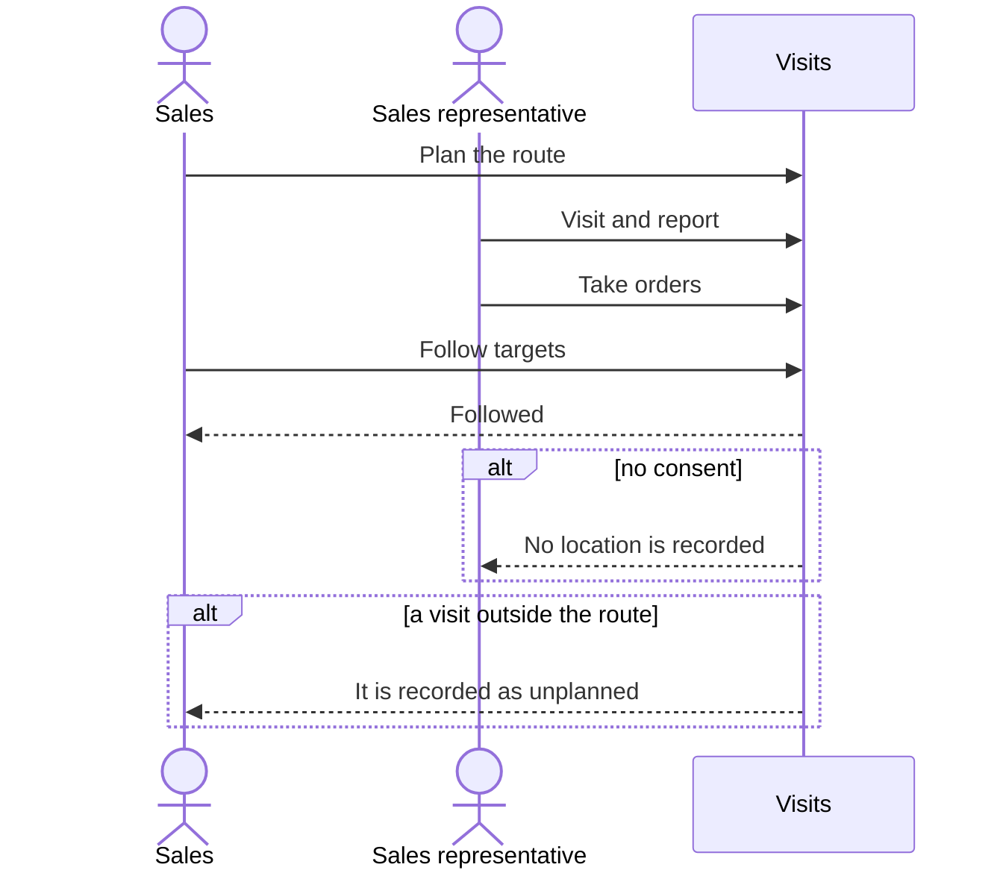

🏠 [Specs](../../../../README.md) › 🏷️ [Sectors](../../../README.md) ›
📦 [SC15 Wholesale and distribution](../../README.md) › 📝 [Use cases](../README.md) ›
📝 [Use cases: FL-SC15-05 Sales force and performance](README.md) ›
📝 UC-SC15-14 Follow sales reps' visits, routes and targets

# 📝 UC-SC15-14 Follow sales reps' visits, routes and targets

**Status:** ✅ specified

## Summary

Sales plans reps' routes with the shared rounds optimiser; reps visit and report; targets follow the shared targets and
commissions.

## Personas

- [U42 Sales representative](../../../../01-users/personas/u42-sales-representative.md)
- [U03 Sales](../../../../01-users/personas/u03-sales.md)

## Goal

Reps visit the right customers and reach targets.

## Trigger

The week's planning.

## Frequency

Weekly.

## Preconditions

- The SC15 sector pack is installed for the company,
  [UC-F14-02](../../../../02-functional/f14-plugin-store/use-cases/01-find-and-install/uc-f14-02-install-a-plugin-or-sector-pack.md),
  and its users have their roles,
  [UC-F1-06](../../../../02-functional/f01-administration/use-cases/04-edit-a-role/uc-f01-06-edit-a-role-and-its-record-rules.md).

## Postconditions

- **Success:** visits are reported and targets followed.
- **Failed:** the route stays a draft.

## Main flow

1. Sales plans the week's route on [S-SC15-14 Visits](../../screens/05-sales-force-and-performance/s-sc15-14-visits.md),
   [UC-F9-30](../../../../02-functional/f09-hr-and-projects/use-cases/11-capacity-rounds-and-partners/uc-f09-30-plan-rounds-and-optimise-routes.md).
2. The rep checks in and reports ([BR-SC15-13](../../business-rules/br-sc15-13-visits-located-with-consent.md)).
3. Orders are taken ([UC-SC15-05](../02-orders/uc-sc15-05-take-orders-on-the-road-offline.md)).
4. Targets and commissions follow,
   [UC-F6-25](../../../../02-functional/f06-customers-and-sales/use-cases/09-sell-on-the-road-and-steer-sales/uc-f06-25-set-sales-targets-and-pay-commissions.md).

## Alternative flows

- 2a. A new prospect: a lead is created,
  [UC-F6-01](../../../../02-functional/f06-customers-and-sales/use-cases/01-lead-to-quote/uc-f06-01-capture-and-qualify-a-lead.md).

## Error flows

- 2e. No consent: no location is recorded.
- 1e. A visit outside the route: it is recorded as unplanned.
- Any step: a call to a service or an outside system fails: it is retried first
  ([BR-F3-32](../../../../02-functional/f03-assistant/business-rules/br-f03-32-retry-before-an-error.md)), then the
  error message pattern ([D122](../../../../06-decisions/ux/d122-error-message-standard.md)) says what failed; what was
  typed is kept.

## Business rules

- [BR-SC15-13 Visits located with consent](../../business-rules/br-sc15-13-visits-located-with-consent.md)
- [BR-F9-22 Rounds respect travel, skills, continuity and working time](../../../../02-functional/f09-hr-and-projects/business-rules/br-f09-22-rounds-respect-travel-skills-continuity-and-working-time.md)
- [BR-F6-18 Commissions follow paid invoices](../../../../02-functional/f06-customers-and-sales/business-rules/br-f06-18-commissions-follow-paid-invoices.md)

## Entities

- [E-SC15-11 Visit report](../../data/e-sc15-11-visit-report.md)
- [E-F9-26 Round](../../../../02-functional/f09-hr-and-projects/data/e-f09-26-round.md)
- [E-F6-18 Commission plan and target](../../../../02-functional/f06-customers-and-sales/data/e-f06-18-commission-plan-and-target.md)

## Permissions

The sales representative and sales roles; the record rules of their role and site apply,
[UC-F1-06](../../../../02-functional/f01-administration/use-cases/04-edit-a-role/uc-f01-06-edit-a-role-and-its-record-rules.md).

## Notifications

None beyond the in-app updates of the records concerned.

## Audit events

Every creation, change and state change of visit report, round, commission plan and target records, with who, when and
the values before and after (T3).

## AI involvement

The AI assistant answers questions on the visit report, round, commission plan and target records of this use case, with
links, and prepares them as drafts the user confirms. It works within the user's rights,
[BR-F3-34](../../../../02-functional/f03-assistant/business-rules/br-f03-34-every-capability-is-reachable-from-the-assistant.md),
and never deletes or does anything irreversible without the user's confirmation,
[BR-F3-07](../../../../02-functional/f03-assistant/business-rules/br-f03-07-no-deletes-no-irreversible-acts.md).

## API, MCP and A2A exposure

Through the API and webhooks (T5) and the MCP and A2A gateway (T6), with the caller's rights,
[BR-F3-34](../../../../02-functional/f03-assistant/business-rules/br-f03-34-every-capability-is-reachable-from-the-assistant.md),
reading, creating and changing the records of this use case; nothing irreversible without a person's confirmation.

## Screens

- [S-SC15-14 Visits](../../screens/05-sales-force-and-performance/s-sc15-14-visits.md)

## Flowchart

See [FL-SC15-05 Sales force and performance](../../flows/fl-sc15-05-sales-force-and-performance.md#flowchart).

## Sequence diagram

## Acceptance criteria

1. **Given** the example wholesaler's rep visiting Bistro Lyon 2 on 12 November **when** she reports "new menu" with
   order SO-91 **then** the visit shows with its order.
2. **Given** a rep who refused location **when** she checks in **then** no location is recorded.

## Non-functional notes

[D408](../../../../06-decisions/technical/d408-performance-and-profiles.md)'s targets
([performance](../../../../05-non-functional/performance.md)): 95 % of screens within 1 second; lists paged on the
server, the first page within 1 second; reports within 5 seconds or in the background. WCAG 2.2 AA and RGAA
([D46](../../../../06-decisions/ux/d46-accessibility-standard.md)).

## Regulatory references

Legal values from the France country pack:
[CR-FR-054 Location only when needed and announced](../../../../10-country-packs/france/data-protection/cr-fr-054-location-with-consent.md).

## Related use cases

- [UC-SC15-05 Take orders on the road, offline](../02-orders/uc-sc15-05-take-orders-on-the-road-offline.md)

## Open questions

None.

---

⬅️ [UC-SC15-13 Declare EU trade statistics](../04-import-and-suppliers/uc-sc15-13-declare-eu-trade-statistics.md) ·
⬆️ [Up](README.md) · ➡️ [UC-SC15-15](uc-sc15-15-follow-margins-per-customer-product-and-rep.md)
